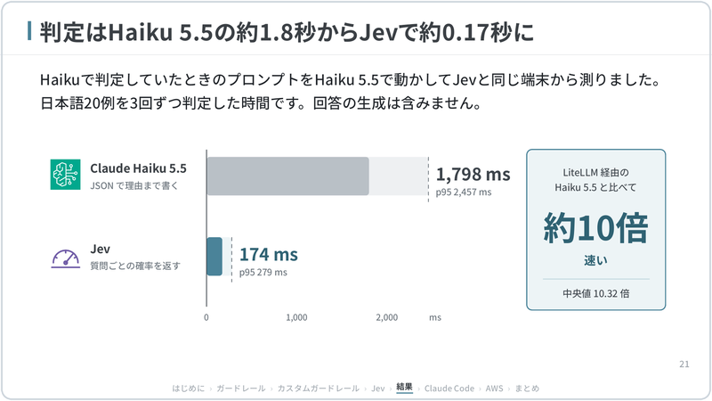
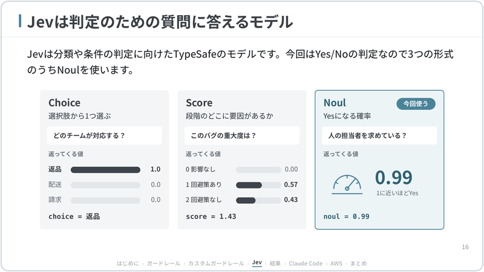
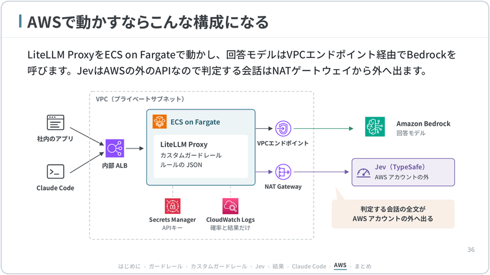
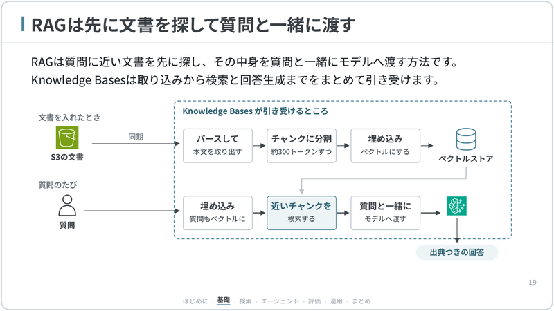
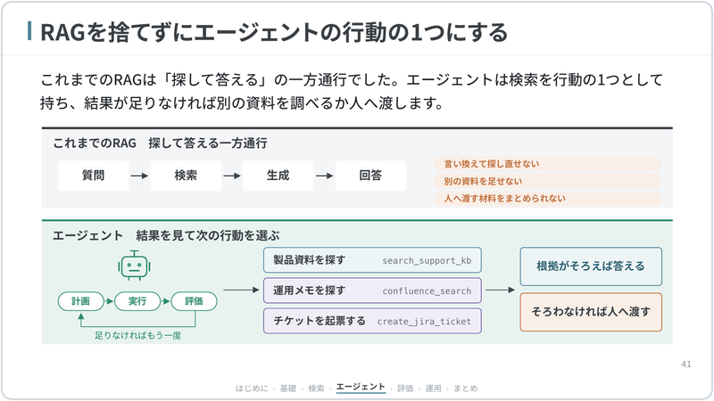
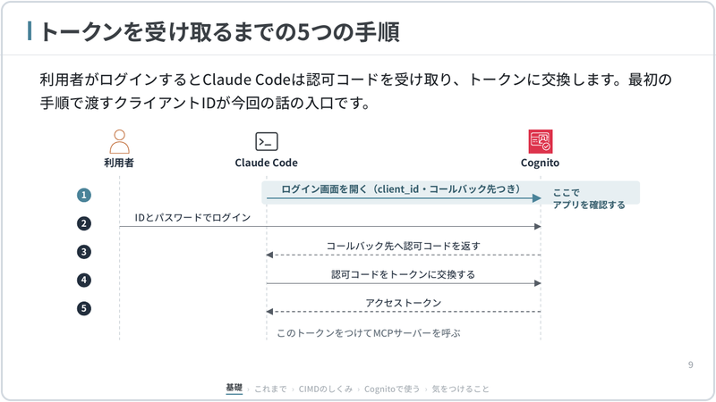
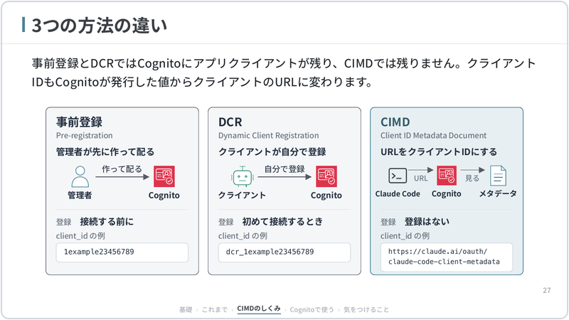
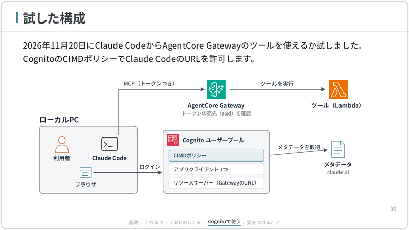

# Jinno Slide Kit

Ask Claude Code or Codex for a deck, and get slides with carefully drawn diagrams in the style of Yudai Jinno's talks! The slides are Markdown and the diagrams are SVG, so you can still edit every word and shape afterwards.


[日本語 README](README.md)

### Edit text

Click a slide title or paragraph to edit it in place.


### Edit diagrams

Double-click a diagram in the editor to open the SVG editor. Change the text or the color of a box, save, and the slide updates right away!


### Give feedback to the AI

In the editor, open the メモ (Notes) tab on the right and leave notes on any page or diagram you want changed. Click エージェント向けにコピー (Copy for agent) to copy all the notes at once.
The copied text includes the page and line number of each note, so when you paste it into Claude Code or Codex, the AI fixes just those lines!


### Present right away

Click 発表 (Present) at the top right of the editor to open the audience and presenter windows. The presenter window shows your notes, the next slide, and the elapsed time while you talk!


### Export to PowerPoint too

You can also export to PowerPoint from 書き出し (Export), and the text and shapes stay editable. You can import the file into Google Slides too.
Code switches to a different font, and PCs without Noto Sans JP show another typeface, so it won’t look quite as polished as the PDF. Think of it as good enough!

## Ask an AI to build it

The easiest way to start is to give Claude Code or Codex the URL of this repository and ask it to set things up! The AI clones the repository, installs the dependencies, and adds the skill for you. See [the table below](#install-it-yourself) for what you need.

```text
Set up this repository so I can use it: https://github.com/yuu551/jinno-slide-kit
```

Once it is set up, just ask! The skill and the sample decks are in Japanese, so Japanese requests work best.

```text
この記事をアップデート紹介のスライドにして https://example.com/whats-new
（Turn this article into slides introducing the update）
社内勉強会で RAG の基本を話す 20 分の資料を作って
（Make a 20-minute deck on RAG basics for an internal study session）
```

The skill plans the story, draws SVG diagrams, checks for overflow in a browser, and exports to PDF or PowerPoint. The downside is that your first deck may take about five minutes. In return, you get slides with carefully drawn diagrams! The `slides check` command also suggests edits to the Japanese, such as changing 「APIを叩く」 (“hit the API”) to 「APIを呼び出す」 (“call the API”). [Japanese style guide](docs/japanese-rules.md)

### Install it yourself

Install the following on macOS. You only need the last row to build the macOS app.

| What you need | Version | What it is for |
| --- | --- | --- |
| Node.js | 22.12 or later (24.16.0 for development) | Runs the kit: creating, checking, and exporting decks, and the editor |
| pnpm | 10.34.5 or later | Installs the dependencies. pnpm switches to 12.23.0, the version set in `package.json` |
| Google Chrome | — | Checking for overflow and exporting to PDF and PowerPoint |
| uv | — | Runs scripts such as the ones that draw the SVG diagrams. uv sets up Python for you |
| Claude Code or Codex | — | Asking for slides. Install it first so that `./install.sh` can add the skill |
| Rust and Xcode Command Line Tools (optional) | Rust 1.100.0 | Only for building the macOS app. rustup installs the version set in `rust-toolchain.toml` |

You can install uv with `brew install uv`. Then run:

```sh
git clone https://github.com/yuu551/jinno-slide-kit.git
cd jinno-slide-kit
./install.sh
```

`./install.sh` uses uv to install Python 3.14.10, installs the dependencies, and adds the bundled [marp-jinno](skills/marp-jinno/SKILL.md) skill to your Claude Code and Codex setups. If Node.js, pnpm, Chrome, or uv is missing, `./install.sh` tells you. If you install Claude Code or Codex later, run `./install.sh --no-deps` to add only the skill.

To make and export decks with commands yourself, see the [kit reference](docs/usage.md#english).

## Make your own kit

You can also ask Claude Code or Codex to read the themes, skill, checks, and sample decks in this repository and build a kit in your own style.
Try attaching a diagram you drew and asking, “Use this repo as a starting point for a slide kit for our study group. Use our company colors and fonts, and draw diagrams in the same line style as my example.”

## Sample decks

These pages put the diagrams first. Click any image to open the PDF.

None of these decks came out in one shot. Each went through many rounds of edits. The kit won’t give you a perfect deck on the first try, so take the time to reread and polish what the AI drafts!

**[Using Jev as a LiteLLM guardrail (46 slides)](examples/gallery/jev-guardrail/jev-guardrail.pdf)** · a latency chart, three answer formats side by side, and an AWS architecture

<p><a href="examples/gallery/jev-guardrail/jev-guardrail.pdf"></a> <a href="examples/gallery/jev-guardrail/jev-guardrail.pdf"></a> <a href="examples/gallery/jev-guardrail/jev-guardrail.pdf"></a></p>

**[Bringing RAG and AI agents into a support workflow (84 slides)](examples/gallery/rag-webinar/rag-webinar.pdf)** · the RAG flow, closeness in meaning, and RAG compared with an agent

<p><a href="examples/gallery/rag-webinar/rag-webinar.pdf"></a> <a href="examples/gallery/rag-webinar/rag-webinar.pdf"></a> <a href="examples/gallery/rag-webinar/rag-webinar.pdf"></a></p>

**[Understanding CIMD in Amazon Cognito (58 slides)](examples/gallery/cognito-cimd/cognito-cimd.pdf)** · the steps to a token, three registration methods compared, and the setup tested with Cognito and Gateway

<p><a href="examples/gallery/cognito-cimd/cognito-cimd.pdf"></a> <a href="examples/gallery/cognito-cimd/cognito-cimd.pdf"></a> <a href="examples/gallery/cognito-cimd/cognito-cimd.pdf"></a></p>

## Try the macOS app

MarpKit is a macOS app that wraps the editor and the library with Tauri. You can open and edit decks from the app without typing commands in Terminal.

Install Rust and Xcode Command Line Tools, then run `pnpm app:build` to build `src-tauri/target/release/bundle/macos/MarpKit.app`!

## Built on Marp

This kit uses `@marp-team/marp-core` and `@marp-team/marp-cli`, both MIT-licensed.
Licenses for the other dependencies are in [docs/dependencies.md](docs/dependencies.md), and the notices for the Lucide line icons are in [THIRD_PARTY_NOTICES.md](THIRD_PARTY_NOTICES.md).

[Marp website](https://marp.app/) · [Marp on GitHub](https://github.com/marp-team/marp)

On top of Marp, this kit adds Jinno’s themes and templates, slide checks, an editor, editable PowerPoint export, and a skill for drafting decks!
Thank you, as always, to the Marp team!!
