# Jinno Slide Kit

図まで作り込んだ神野風のスライドを Claude Code や Codex に頼んで作れるキットです！
原稿は Markdown で図は SVG なので、できたあとも文字や図を手で直せます。


[English README](README.en.md)

### 文字を直す

スライドのタイトルや段落をクリックすると、その場で編集できます。

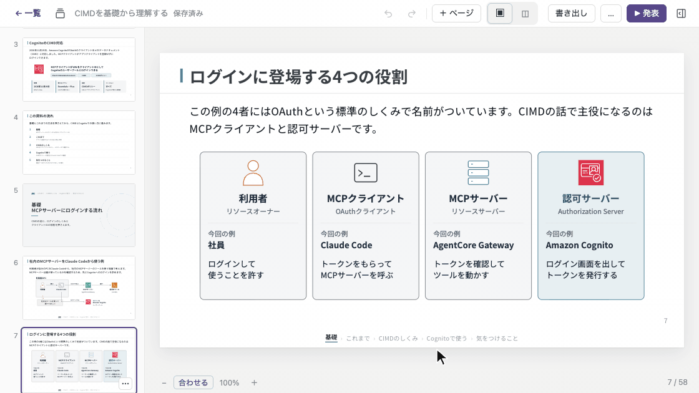

### 図を直す

エディターでスライドの図をダブルクリックすると、SVG の編集画面が開きます。文字を打ち替えたり箱の色を変えたりして保存すると、そのままスライドに反映されます！

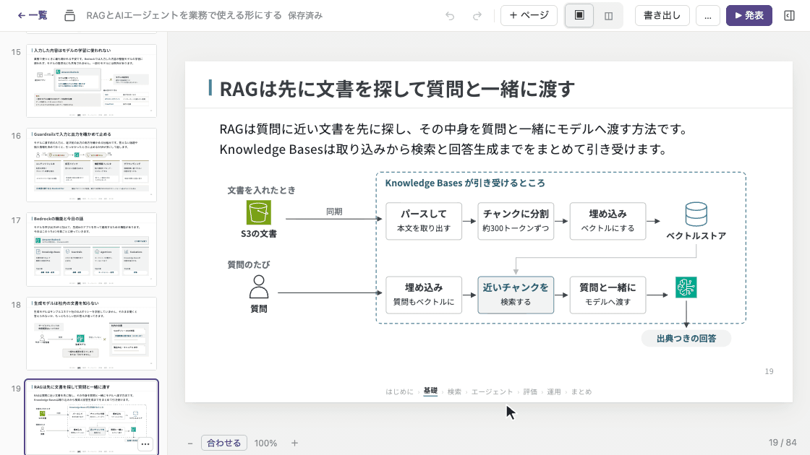

### AI にフィードバックする

エディターの右側の「メモ」タブで気になるページや図にメモを残せます。「エージェント向けにコピー」を押すとメモをまとめてコピーできます。
コピーした文にはページと行番号も入るので、Claude Code や Codex に貼るとその行だけを直してくれます！

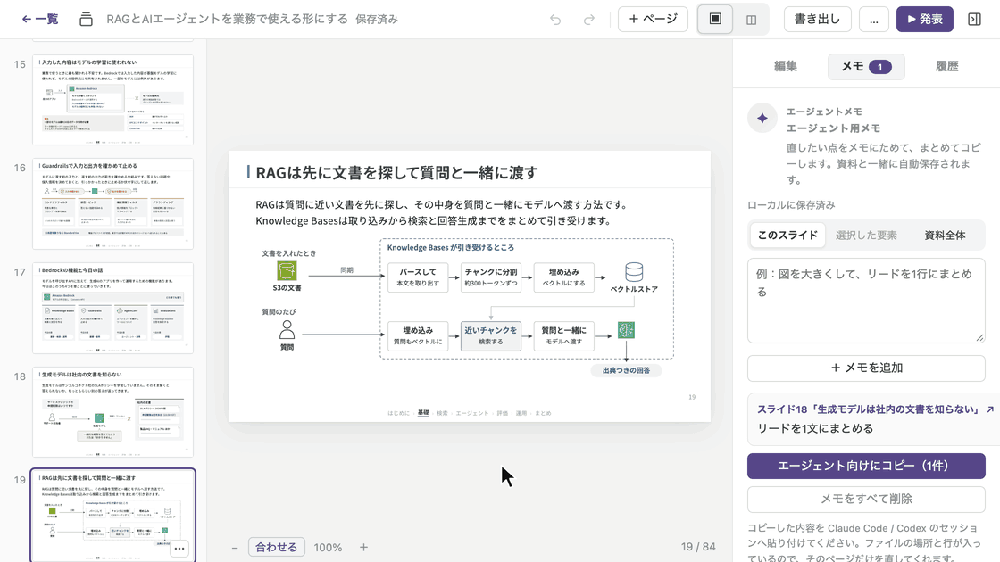

### 発表する

エディター右上の「発表」を押すと発表画面と発表者画面が開きます。発表者画面ではノートや次のスライド、経過時間を見ながら話せます！


### PowerPoint にも書き出す

「書き出し」から PowerPoint にもできて、文字や図形をそのまま直せます。Google スライドに取り込んで使うこともできます。
ただコードの書体が変わったり Noto Sans JP がない PC では別の書体になったりするので、見た目は PDF ほどそろわないぼちぼちの仕上がりです！

## AI に頼んで作る

Claude Code や Codex にこのリポジトリの URL を渡して「使えるようにして」と頼むだけで、準備ができます！clone から依存パッケージのインストール、スキルの追加まで AI が進めてくれます。必要なものは[下の表](#自分で入れるなら)のとおりです。

```text
このリポジトリを使えるようにして https://github.com/yuu551/jinno-slide-kit
```

使えるようになったら、あとは頼むだけです！

```text
この記事をアップデート紹介のスライドにして https://example.com/whats-new
社内勉強会で RAG の基本を話す 20 分の資料を作って
できた slides.md の見切れを確かめて PDF にして
```

スキルは構成とリードを組み、人やサービスの動きを SVG の図に描いてブラウザーで見切れまで確かめます。PDF や PowerPoint への書き出しも頼めます。
デメリットとして、初めて作るときは5分ほどかかるかもしれません。その分、図まで作り込んだ資料ができあがります！
`slides check` では「APIを叩く」を「APIを呼び出す」にするなど、日本語の言い換えも出ます！ [日本語の決まり](docs/japanese-rules.md)

### 自分で入れるなら

macOS に次のものを用意します。最後の行は macOS アプリをビルドするときだけ必要です。

| 必要なもの | バージョン | 何に使うか |
| --- | --- | --- |
| Node.js | 22.12 以降（開発では 24.16.0） | キットを動かす（資料の作成・検査・書き出し・エディター） |
| pnpm | 10.34.5 以降 | 依存パッケージを入れる。`package.json` で指定した 12.23.0 に切り替わる |
| Google Chrome | — | 見切れの検査と PDF・PowerPoint への書き出し |
| uv | — | 図の SVG を描くスクリプトなどを動かす。Python は uv が用意する |
| Claude Code か Codex | — | スライド作りを頼む。先に入れておくと `./install.sh` がスキルを追加する |
| Rust・Xcode Command Line Tools（任意） | Rust 1.100.0 | macOS アプリをビルドするときだけ。`rust-toolchain.toml` で指定した Rust を rustup が入れる |

uv は `brew install uv` で入れられます。用意できたら、次のコマンドを実行します。

```sh
git clone https://github.com/yuu551/jinno-slide-kit.git
cd jinno-slide-kit
./install.sh
```

`./install.sh` は uv で Python 3.14.10 を入れてから依存パッケージをインストールし、同梱のスキル [marp-jinno](skills/marp-jinno/SKILL.md) を Claude Code と Codex に追加します。Node.js・pnpm・Chrome・uv が見つからないときは `./install.sh` が知らせます。Claude Code や Codex をあとから入れたときは、`./install.sh --no-deps` でスキルだけ追加できます。

自分でコマンドを打って作るときは [キットの使い方](docs/usage.md) を見てください。

## 自分流のキットを作る

テーマやスキル、検査のコード、作例を Claude Code や Codex に読んでもらって、自分好みのキットを作るのもありです！
たとえば自分で描いた図を1枚添えて「このリポジトリを参考に、うちの会社の色と書体で勉強会用のキットを作って。図はこの見本みたいな線画にして」と頼めます。

## 作例

図が主役のページを集めました。画像を押すと PDF が開きます。

作例はどれも一度で出したものではなく、何度も手を入れて仕上げました。キットで完璧な資料が一発でできるわけではないので、AI が作った原稿は自分で読み直して推敲するのが大事です！

**[LiteLLMのガードレールにJevを入れてみた（46枚）](examples/gallery/jev-guardrail/jev-guardrail.pdf)** · 判定時間のグラフ、3つの形式の比較、AWS の構成図

<p><a href="examples/gallery/jev-guardrail/jev-guardrail.pdf">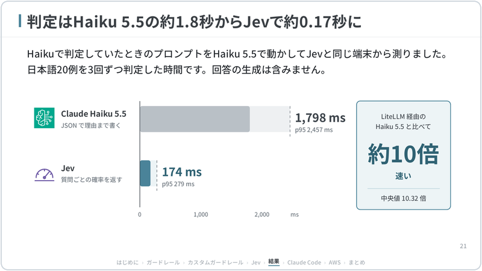</a> <a href="examples/gallery/jev-guardrail/jev-guardrail.pdf">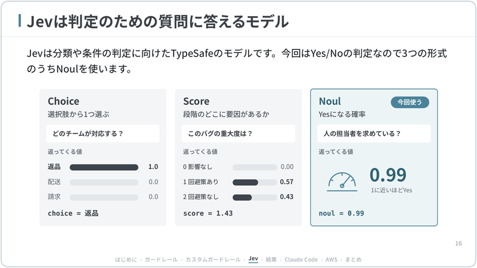</a> <a href="examples/gallery/jev-guardrail/jev-guardrail.pdf">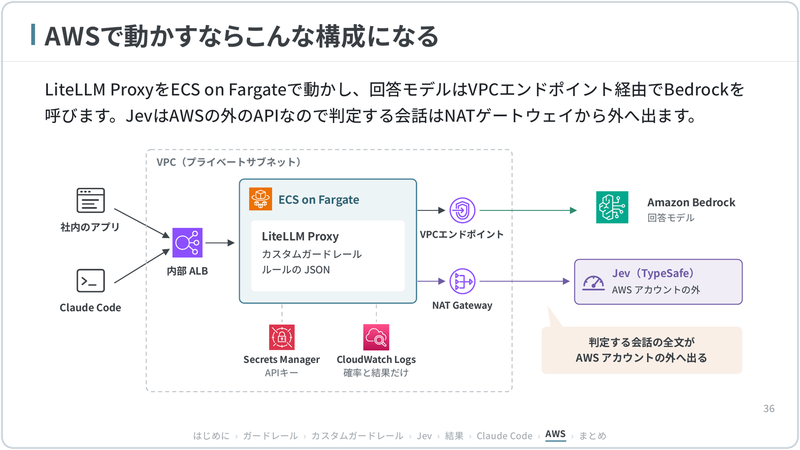</a></p>

**[RAGとAIエージェントを業務で使える形にする（84枚）](examples/gallery/rag-webinar/rag-webinar.pdf)** · RAG の処理の流れ、意味の近さの図、RAG とエージェントの比較

<p><a href="examples/gallery/rag-webinar/rag-webinar.pdf">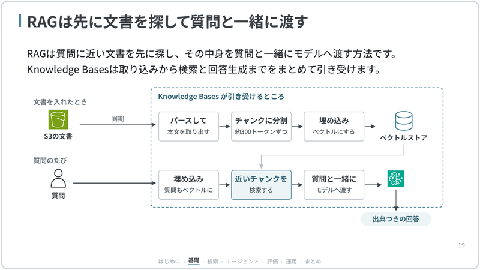</a> <a href="examples/gallery/rag-webinar/rag-webinar.pdf">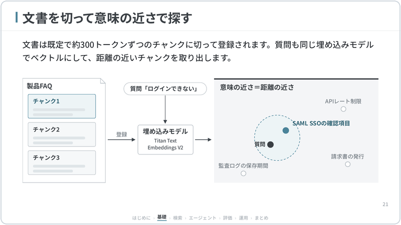</a> <a href="examples/gallery/rag-webinar/rag-webinar.pdf">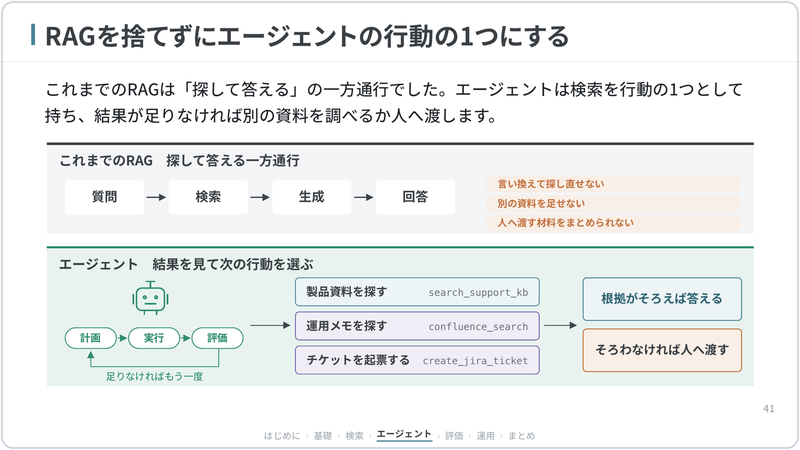</a></p>

**[CIMDを基礎から理解する（58枚）](examples/gallery/cognito-cimd/cognito-cimd.pdf)** · ログインの手順、3つの方法の比較、Cognito と Gateway で試した構成

<p><a href="examples/gallery/cognito-cimd/cognito-cimd.pdf">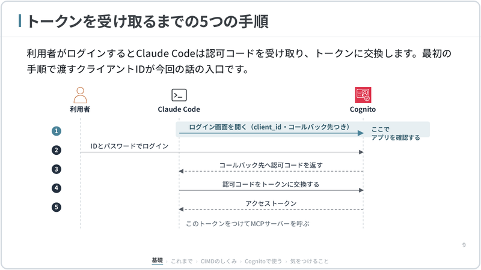</a> <a href="examples/gallery/cognito-cimd/cognito-cimd.pdf">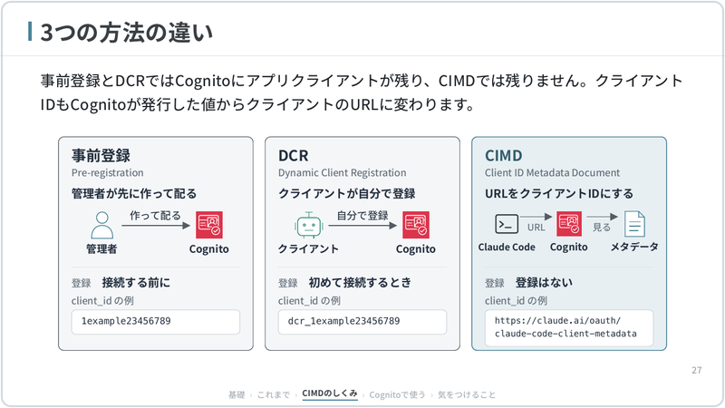</a> <a href="examples/gallery/cognito-cimd/cognito-cimd.pdf">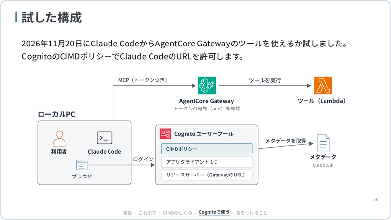</a></p>

## macOS アプリでも使える

エディターとライブラリーを Tauri で macOS アプリにした MarpKit もあります。ターミナルでコマンドを打たなくても、アプリから資料を開いて直せます。

Rust と Xcode Command Line Tools を入れて `pnpm app:build` を実行すると、`src-tauri/target/release/bundle/macos/MarpKit.app` ができます！

## Marp を土台にしています

このキットでは `@marp-team/marp-core` と `@marp-team/marp-cli`（どちらも MIT）を使っています。
ほかの依存パッケージのライセンスは [docs/dependencies.md](docs/dependencies.md)、線画アイコン（Lucide）の許諾文は [THIRD_PARTY_NOTICES.md](THIRD_PARTY_NOTICES.md) にあります。

[Marp 公式サイト](https://marp.app/) · [Marp の GitHub](https://github.com/marp-team/marp)

Marpを土台に神野風のテーマと雛形、検査、エディター、編集できる PowerPoint への書き出し、スライド作成用のスキルを追加しています！
いつもMarpを使わせていただきありがとうございます！！
