<!--
CIMD（Client ID Metadata Document）の解説。OAuthやMCPのログインに初めて触れる方向けのガイド資料なので、掛け合いは使わず、章扉・リード＋図・帯で組む。
例は全ページで同じ。利用者が自分のPCのClaude Codeから、Cognitoで認証を設定した社内のMCPサーバー（AgentCore Gateway、ツールはLambda）を使う。
仕様は2026-11-20時点で確認した。Cognitoは開発者ガイド「Client ID metadata documents (CIMD)」「Dynamic client registration」、MCPは2026-07-28のバージョンの仕様（Client Registration・Security Considerations）。
検証の値（エラー・画面・ログ）は2026-11-20にus-east-1で試した結果。
-->

<!-- _class: cover cover-talk -->
<!-- _paginate: false -->

# CIMDを<br>基礎から<br>理解する

<p class="kicker">Amazon Cognitoのアップデートから</p>

<p class="sub">MCPクライアントが<br>URLをクライアントIDにするしくみ</p>

<p class="who"><b>神野 雄大</b>Yudai Jinno</p>

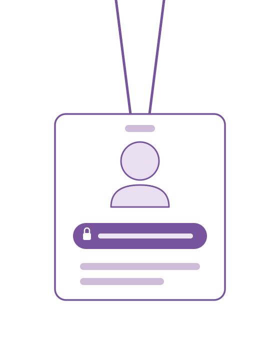

---

<!-- _class: centered -->

# この資料の対象と目的

MCPのログインのしくみを知らなくても読めるように、ログインとクライアントIDの基礎から順に説明します。

::: purpose 1.12
- 対象
  - MCPやOAuthのログインのしくみに初めて触れる方
  - Cognitoで認証を設定したMCPサーバーを社内で使いたい方
- **目的**
  - CIMDが何を解決するのかを理解する
  - CognitoでCIMDを使う設定と、つまずきやすい点を知る
:::

---

# CognitoのCIMD対応

2026年11月19日、Amazon CognitoがOAuthのクライアントIDメタデータドキュメント（CIMD）に対応しました。MCPクライアントがアプリクライアントを登録せずにログインできます。

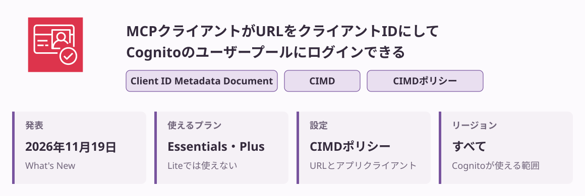

<!--
出典 What's New「Amazon Cognito now supports client ID metadata documents」（2026-11-19）と開発者ガイド「Client ID metadata documents (CIMD)」。
-->

---

# この資料の流れ

基礎とこれまでの方法を押さえてから、CIMDとCognitoでの使い方に進みます。

::: agenda 0.86
1. 基礎
   MCPサーバーにログインする流れとクライアントID
2. これまで
   アプリを登録する2つの方法と残る手間
3. CIMDのしくみ
   URLをクライアントIDにし、メタデータで確認する
4. Cognitoで使う
   CIMDポリシーの設定とClaude Codeでの確認
5. 気をつけること
   検証でつまずいた点となりすましへの備え
:::

---

<!-- _class: divider -->
<!-- chapter: 基礎 -->

# 基礎<br>MCPサーバーにログインする流れ

CIMDの前に、ログインのしくみと
クライアントIDの役割を押さえます。

---

# 社内のMCPサーバーをClaude Codeから使う例

利用者が自分のPCのClaude Codeから、社内のMCPサーバーのツールを使う場面で考えます。MCPサーバーは誰が使っているかを確認するため、先にCognitoへのログインを求めます。

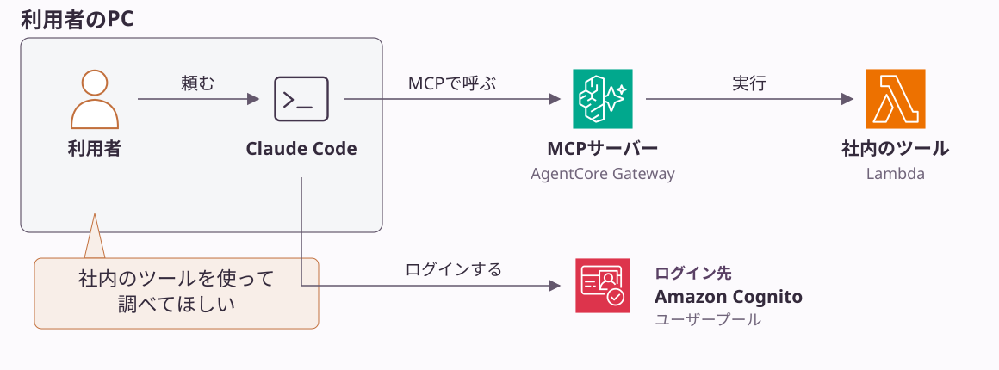

<!--
この例は2026-11-20に実際に試した構成と同じ。MCPサーバーはAgentCore Gateway、ツールはLambda（名前を受け取ってあいさつを返す）。
-->

---

# ログインに登場する4つの役割

この例の4者にはOAuthという標準のしくみで名前がついています。CIMDの話で主役になるのはMCPクライアントと認可サーバーです。

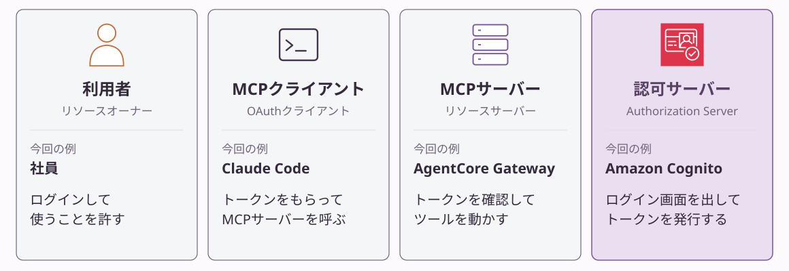

<!--
MCPの仕様では、MCPサーバーがOAuth 2.1のリソースサーバー、MCPクライアントがOAuth 2.1のクライアントにあたる。
-->

---

# トークンによる利用者の確認

Claude Codeはリクエストにアクセストークンをつけて送ります。MCPサーバーはトークンの発行元・宛先・期限を確認し、トークンがなければ401で断ります。

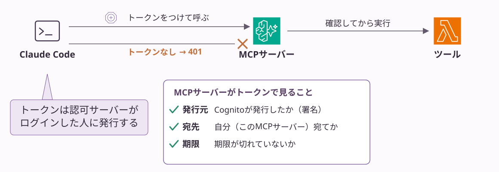

<!--
検証では、トークンなしでGatewayを呼ぶと HTTP 401 と WWW-Authenticate ヘッダー（resource_metadata）が返った。宛先の確認はGatewayの allowedAudience で設定した。
-->

---

# トークンを受け取るまでの5つの手順

利用者がログインするとClaude Codeは認可コードを受け取り、トークンに交換します。最初の手順で渡すクライアントIDが今回の話の入口です。

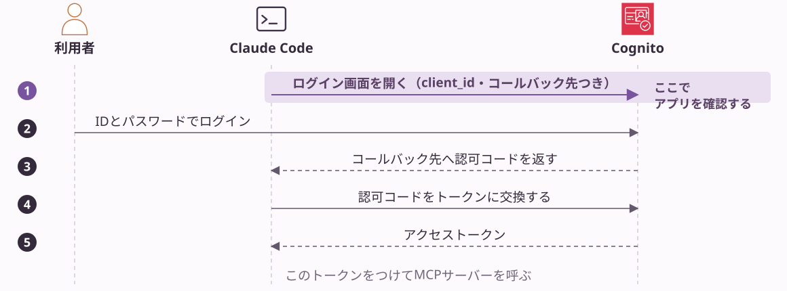

<!--
OAuthの認可コードフロー。実際には盗み見への備え（PKCE）や、使う先のMCPサーバーのURL（resource）も一緒に送る。
-->

---

# クライアントIDはどのアプリかを伝える値

認可サーバーは登録してあるアプリにだけログインを許します。クライアントIDで登録を探し、コールバック先が登録どおりかも確認します。

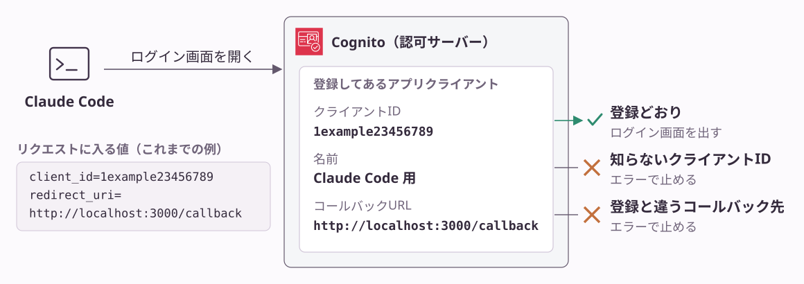

<!--
Cognitoではこの登録を「アプリクライアント」と呼ぶ。クライアントIDの値の形はCognitoの開発者ガイドの例に合わせた。
-->

---

# PCの中で認可コードを受け取るしくみ

Claude CodeはPCの中に一時的な受け取り口を開きます。Cognitoはブラウザを通して、その受け取り口へ認可コードを届けます。

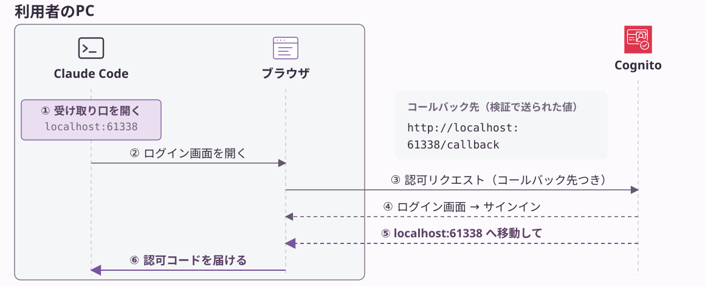

<!--
localhost は、そのPC自身を指す名前。検証でClaude Codeが送ったコールバック先は http://localhost:61338/callback だった。
RFC 8252（OAuth 2.0 for Native Apps）7.3 では、認可サーバーはループバックのコールバック先のポート番号を問わず受け付けることになっている。Cognitoも同じ（開発者ガイド「Client ID metadata documents (CIMD)」）。
-->

---

# コールバック先を確認する理由

認可コードはトークンと交換できる大事な値です。登録していないコールバック先に返すと、別のアプリがトークンを取れてしまいます。

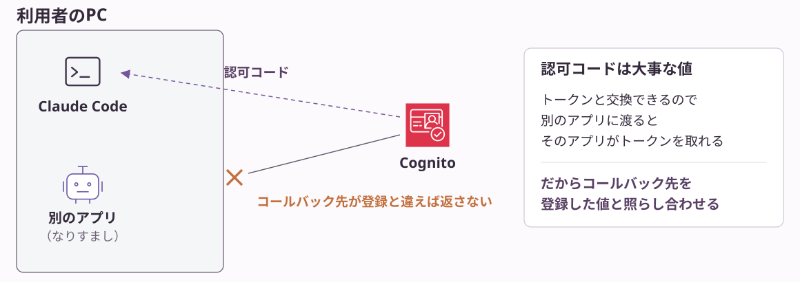

---

# シークレットを持たないクライアントとPKCE

利用者のPCに配るアプリは中身を調べられるので、秘密の値（クライアントシークレット）を隠せません。代わりにPKCEという合言葉のしくみで、横取りされた認可コードを使えなくします。

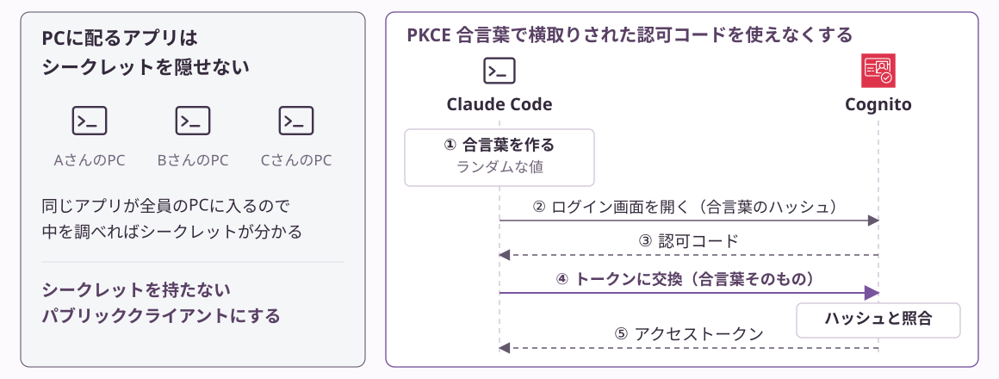

<!--
出典 RFC 8252 8.5（配布するアプリに入れたシークレットは秘密として扱えない）。MCPの仕様（2026-07-28 Security Considerations）はクライアントにPKCE（S256）を求めている。検証でClaude Codeが送った認可リクエストにも code_challenge_method=S256 が入っていた。
合言葉は code_verifier、ハッシュは code_challenge。Claude Codeのメタデータの token_endpoint_auth_method は none（シークレットなし）。
-->

---

<!-- _class: centered lead-l -->
<!-- _footer: "" -->

# 基礎のまとめ

::: band 1.08
認可サーバーは、ログインを始めたアプリを**クライアントID**で確認し、**コールバック先**を照らし合わせます。
そのため、アプリをあらかじめ認可サーバーに登録しておく必要がありました。
:::

---

<!-- _class: divider -->
<!-- chapter: これまで -->

# これまで<br>アプリを登録する2つの方法

CIMDより前から使われてきた方法と、
残っていた手間を見ます。

---

# 管理者がアプリクライアントを作る事前登録

管理者がCognitoにアプリクライアントを作り、発行されたクライアントIDを利用者に伝えます。利用者はそのIDをMCPクライアントの設定に入れてから接続します。

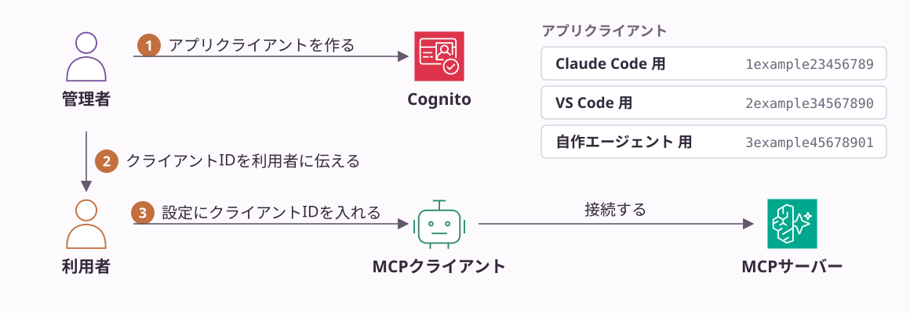

<!--
Claude Codeでは claude mcp add の --client-id でクライアントIDを渡す。
-->

---

# 組み合わせの数だけ増える登録

MCPクライアントもMCPサーバーも種類が多く、利用者が自由に組み合わせます。事前登録では組み合わせごとに誰かがアプリクライアントを作ることになります。

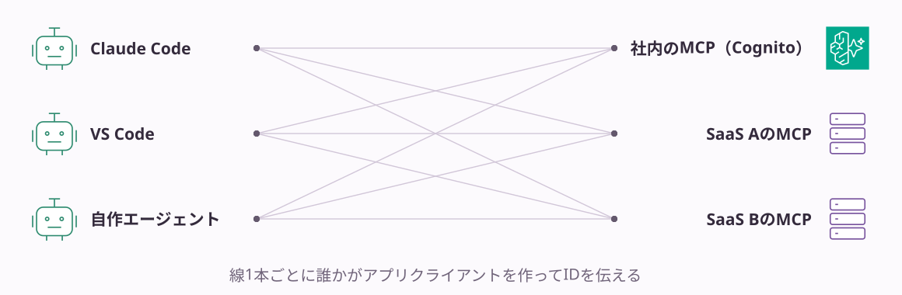

---

# クライアントが自分で登録するDCR

動的クライアント登録（DCR）を有効にすると、MCPクライアントが初めて接続するときに自分でアプリクライアントを登録します。Cognitoも2026年11月に対応しました。

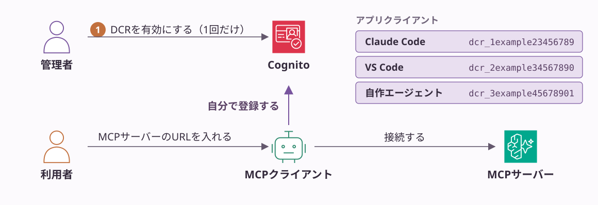

<!--
出典 What's New「Amazon Cognito now supports dynamic client registration」（2026年11月）と開発者ガイド「Dynamic client registration」。登録の窓口はユーザープールのドメインの /oauth2/register。
-->

---

# DCRで登録してからログインする流れ

DCRではMCPクライアントが登録の窓口にアプリの情報を送り、Cognitoがアプリクライアントを作ります。ログインはそのあと、受け取ったクライアントIDで始めます。

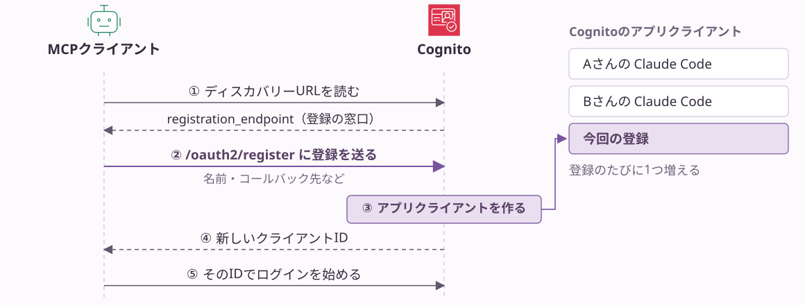

<!--
出典 Cognito開発者ガイド「Dynamic client registration」。DCRを有効にするとディスカバリーURLの中身に registration_endpoint が載る。窓口は https://<ユーザープールのドメイン>/oauth2/register。登録したクライアントはアプリクライアントの上限に数えられる。
-->

---

# DCRで残る手間

DCRでは登録したクライアントの数だけアプリクライアントが増えていきます。使われなくなった登録を探して消すのは管理者の仕事で、名前も登録する側が自由に書けます。

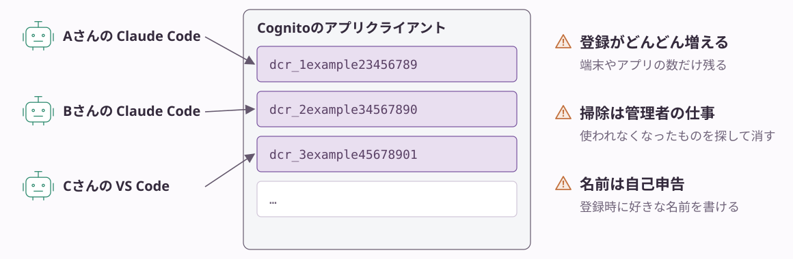

<!--
出典 Cognito開発者ガイド「Dynamic client registration」。登録したクライアントはアプリクライアントの上限に数えられる。アプリは自分の登録を消せず、管理者が ListUserPoolClients（ClientType=DCR）で探して DeleteUserPoolClient で消す。
-->

---

<!-- _class: centered lead-l -->
<!-- _footer: "" -->

# これまでのまとめ

::: band 1.08
事前登録でもDCRでも、**クライアントの数だけ登録が増え**、管理する手間が残っていました。
CIMDは、この**登録そのものをなくす**方法です。
:::

---

<!-- _class: divider -->
<!-- chapter: CIMDのしくみ -->

# CIMDのしくみ<br>URLをクライアントIDにする

登録しないのに、認可サーバーが
アプリを確認できる理由を見ます。

---

# URLになるクライアントID

CIMDではMCPクライアントが自分の情報をJSONにしてHTTPSで公開し、そのURLをクライアントIDとして使います。このJSONをメタデータと呼びます。

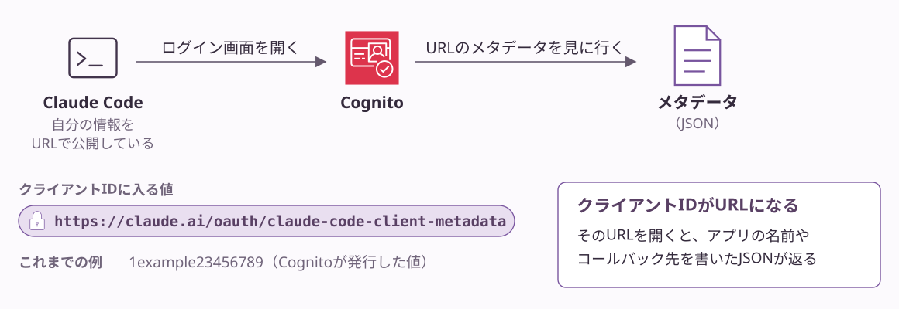

---

# Claude Codeのメタデータ

Claude Codeはclaude.aiでメタデータを公開しています。事前登録でアプリクライアントに設定していた名前やコールバック先を、アプリの提供元が自分で書いています。

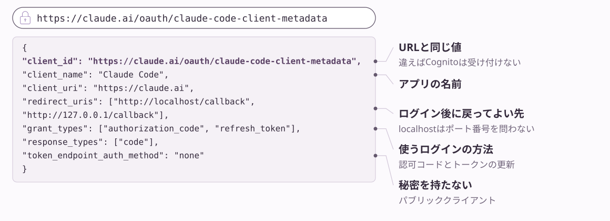

<!--
2026-11-20に https://claude.ai/oauth/claude-code-client-metadata から取得した実物。応答の cache-control は max-age=300。
-->

---

# Cognitoによるメタデータの取得と照合

CognitoはクライアントIDのURLが許可したものかを確認し、そのURLのメタデータと照らし合わせてからログイン画面を出します。取得したメタデータはキャッシュに置き、期限まで再利用します。

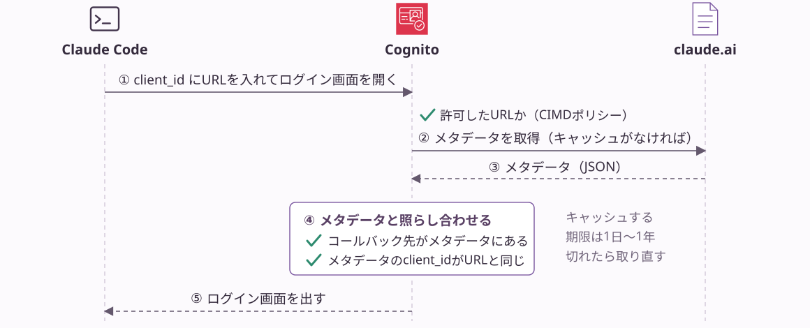

<!--
出典 Cognito開発者ガイド「Validation and caching」。ワイルドカードを含まないパターンは、ポリシーを作ったとき（更新したとき）に非同期で取得する。ワイルドカードを含むパターンは、ログインの要求を受けたときに取得する。
-->

---

# 登録しなくても確認できる理由

claude.aiにメタデータを置けるのはclaude.aiの持ち主だけです。別のアプリがClaude CodeのURLをクライアントIDにしても、コールバック先は本物のメタデータの値でしか通りません。

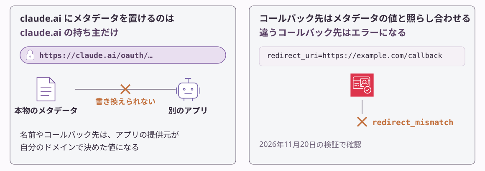

<!--
ただし、localhostで待ち受ける別のアプリは見分けにくい。最後の章で扱う。
-->

---

# 3つの方法の違い

事前登録とDCRではCognitoにアプリクライアントが残り、CIMDでは残りません。クライアントIDもCognitoが発行した値からクライアントのURLに変わります。

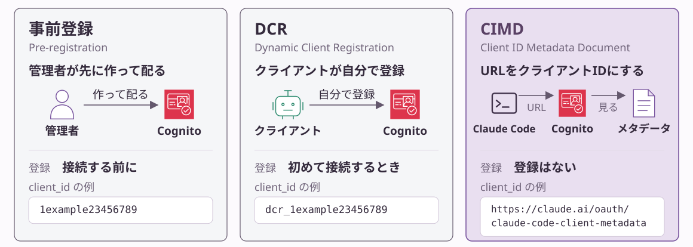

---

# CIMDで変わること

管理者はクライアントのURLを許可するだけで、アプリクライアントは1つのままです。利用者もクライアントIDを設定せずにログインできます。

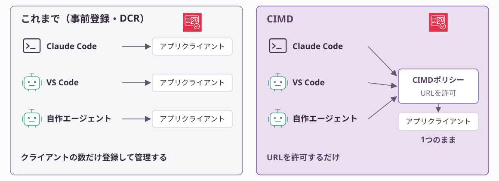

---

# MCPの仕様での位置づけ

現在のMCPの仕様（2026-07-28のバージョン）では、認可サーバーとクライアントはCIMDに対応すべき（SHOULD）とされています。DCRは非推奨になり、CIMDに対応していない認可サーバーとの互換のために残っています。

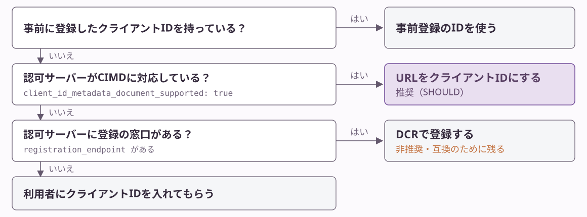

<!--
出典 MCP 2026-07-28「Client Registration」。クライアントは事前登録の情報 → CIMD → DCR → 利用者に入力してもらう、の順に選ぶ（SHOULD）。CIMDのクライアントIDは認可サーバーが変わっても登録し直さずに使える、とも書かれている。
-->

---

# クライアントがCIMD対応を知るしくみ

クライアントはMCPサーバーの401応答からログイン先を調べ、認可サーバーのディスカバリーURLを読みます。CIMDに対応しているかはその中の1項目で分かります。

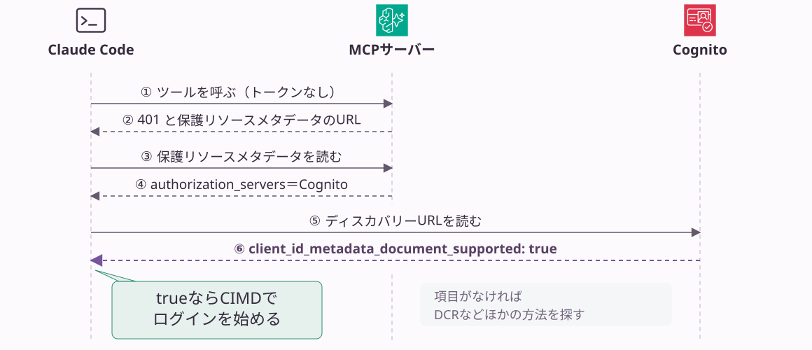

<!--
検証では、Gatewayの保護リソースメタデータの authorization_servers にユーザープールの issuer が入っていた。ディスカバリーURLは https://cognito-idp.us-east-1.amazonaws.com/<ユーザープールID>/.well-known/openid-configuration。
-->

---

<!-- _class: centered lead-l -->
<!-- _footer: "" -->

# CIMDのしくみのまとめ

::: band 1.08
CIMDでは**URLがクライアントID**になり、認可サーバーは**メタデータを取りに行って確認し**ます。
アプリクライアントの登録は残りません。
:::

---

<!-- _class: divider -->
<!-- chapter: Cognitoで使う -->

# Cognitoで使う<br>CIMDポリシーでURLを許可する

Cognitoの設定と、
Claude Codeで試した結果を見ます。

---

# URLとアプリクライアントを結ぶCIMDポリシー

Cognitoでは受け入れるクライアントをCIMDポリシーで決めます。メタデータのURLパターンを既存のアプリクライアント1つに対応づけます。

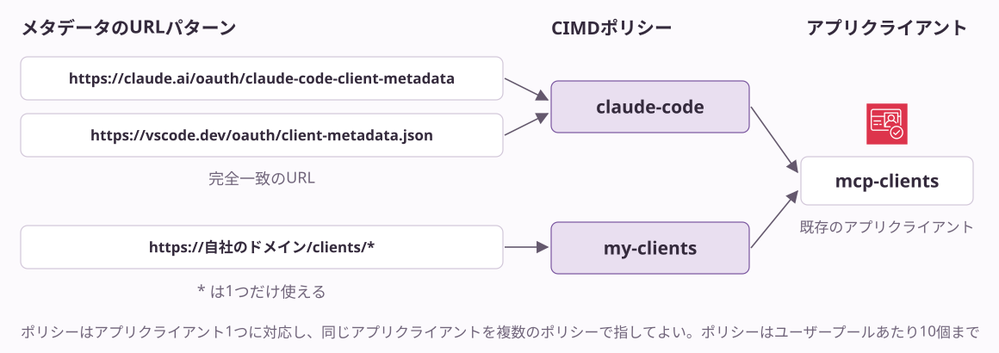

<!--
複数のパターンに一致したときは、より具体的なパターンが使われる。コンソールではユーザープールのナビゲーションの MCP Auth から作れる（開発者ガイドより）。
-->

---

# 使える範囲の決まり方

ログインの方法とスコープはアプリクライアントとリクエストの両方にあるものに絞られます。コールバック先だけはメタデータの値を使います。

::: scale 0.95
| 項目 | 決まり方 |
| --- | --- |
| グラントタイプ | アプリクライアント・メタデータ・認可リクエストのすべてにあるもの<br>（認可コードとインプリシットに対応） |
| スコープ | アプリクライアントにあり、認可リクエストで要求したもの<br>（要求がなければアプリクライアントのすべて） |
| コールバック先 | メタデータの redirect_uris<br>（localhostはポート番号を問わない） |
:::

<!--
出典 Amazon Cognito 開発者ガイド「Client ID metadata documents (CIMD)」の Grant types, scopes, and redirect URIs。
-->

---

# 使うための条件

CIMDのクライアントはシークレットを持たないパブリッククライアントに限られます。URLパターンやキャッシュにも決まりがあります。

::: scale 0.92
| 項目 | 内容 |
| --- | --- |
| 機能プラン | EssentialsとPlus |
| クライアント | シークレットを持たないパブリッククライアント（client_credentials は使えない） |
| ポリシーの数 | ユーザープールあたり10個まで |
| URLパターン | httpsだけ。ワイルドカード（\*）は1つまで。https://\* のようなパターンは作れない |
| メタデータのサイズ | 5 KiBまで。取得は1秒で打ち切り、3回まで再試行 |
| キャッシュ | 1日〜1年。REFRESH ですぐ取り直せる |
:::

<!--
出典 Amazon Cognito 開発者ガイド「Client ID metadata documents (CIMD)」。
-->

---

# 試した構成

2026年11月20日にClaude CodeからAgentCore Gatewayのツールを使えるか試しました。CognitoのCIMDポリシーでClaude CodeのURLを許可します。

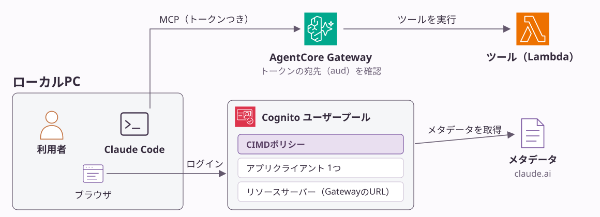

<!--
リージョンはus-east-1。boto3 1.44.7、Claude Code 2.1.321。リソースサーバーの識別子をGatewayのURLにした理由は「気をつけること」の章で扱う。
-->

---

# CIMDポリシーを作る前の状態

最初はCIMDポリシーを作らずに、Claude CodeへGatewayを追加しました。このユーザープールはDCRもCIMDも使えないので、Claude CodeにはクライアントIDを手に入れる方法がありません。

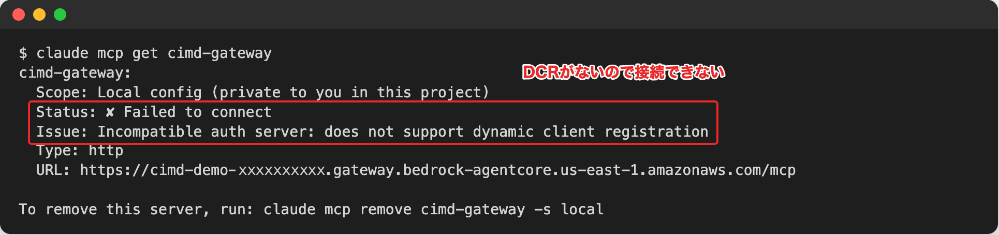

---

# CIMDポリシーを作るコード

boto3 1.44.7以降の create_cimd_policy で作ります。Claude CodeのURLを、作っておいたアプリクライアントに対応づけます。

```python create_cimd_policy.py（抜粋）
import boto3

cognito = boto3.client("cognito-idp", region_name="us-east-1")
policy = cognito.create_cimd_policy(
    UserPoolId=USER_POOL_ID,
    ClientId=APP_CLIENT_ID,  # 作っておいたアプリクライアント
    PolicyName="claude-code",
    URLPatterns=["https://claude.ai/oauth/claude-code-client-metadata"],
)
```

キャッシュの期間（CacheDuration）を指定しないと、最小の86400秒（1日）になりました

---

# ポリシーの作成前と作成後

ポリシーを作ると、CognitoのディスカバリーURLの中身に client_id_metadata_document_supported が加わります。Claude Codeの表示もログインを待つ状態に変わりました。

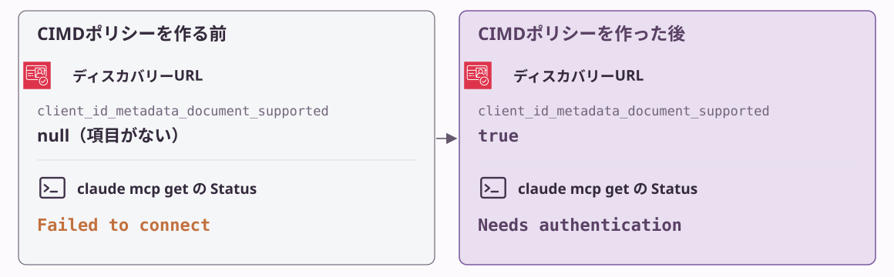

---

# Cognitoのログイン画面

claude mcp login を実行すると、ブラウザでCognitoのログイン画面が開きます。このときのクライアントIDはClaude CodeのURLで、コールバック先はPCのlocalhostです。

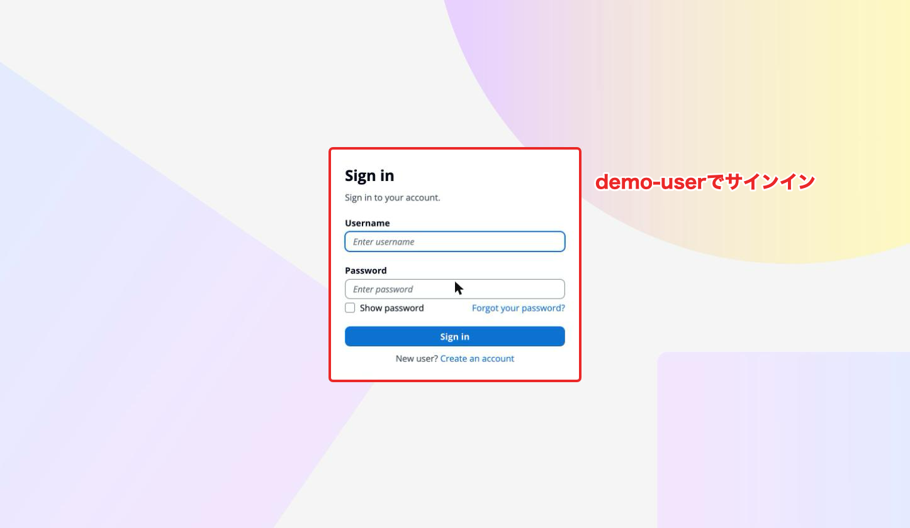

<!--
Claude Codeが送った認可リクエスト（抜粋）
client_id = https://claude.ai/oauth/claude-code-client-metadata
redirect_uri = http://localhost:61338/callback
code_challenge_method = S256
resource = https://<GatewayのID>.gateway.bedrock-agentcore.us-east-1.amazonaws.com/mcp
-->

---

# ログイン後の接続状態

サインインするとClaude Codeに戻り、Gatewayに接続できました。Cognitoのアプリクライアントは最初に作った1つのままです。

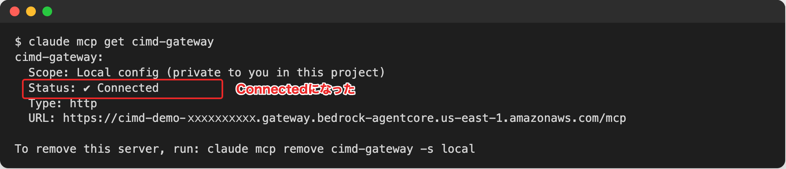

<!--
list_user_pool_clients の結果はアプリクライアント mcp-clients の1件だけだった（Claude Codeと自作クライアント2つでログインし、VS CodeのURLも許可したあと）。完全一致のURLはポリシーを作った時点でCognitoがメタデータを取得してキャッシュしていた（list_client_metadata_urls で確認）。
-->

---

# Claude Codeからのツールの実行

Claude Codeに頼むとGateway経由でLambdaのツールが動き、戻り値が返ってきました。

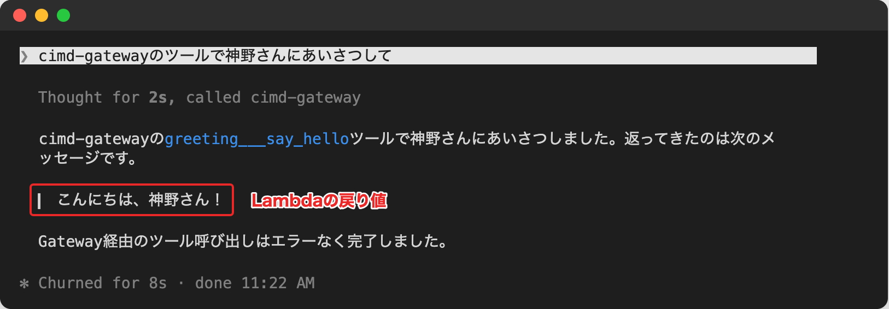

---

# ログインからツール実行までの流れ

Claude CodeはURLをクライアントIDにしてログインし、宛先がGatewayのトークンでツールを呼び出しました。Cognitoはclaude.aiのメタデータでコールバック先を確認しています。

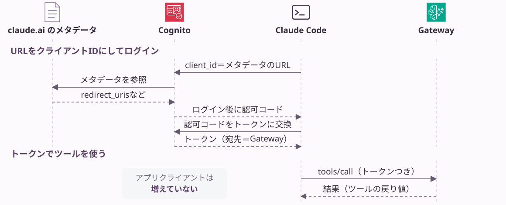

<!--
CloudTrailのトークン発行（Token_POST）のイベントでも、clientId は https://claude.ai/oauth/claude-code-client-metadata だった。
-->

---

<!-- _class: centered lead-l -->
<!-- _footer: "" -->

# Cognitoで使うまとめ

::: band 1.08
CIMDポリシーで**Claude CodeのURLを許可するだけ**で、アプリクライアントを増やさずにGatewayのツールを使えました。
:::

---

<!-- _class: divider -->
<!-- chapter: 気をつけること -->

# 気をつけること<br>つまずきとなりすまし

検証でつまずいた点と、
localhostに戻るクライアントを運用する際の注意点を見ます。

---

# リソースサーバーの登録

Claude Codeはトークンの宛先（resource）にGatewayのURLを入れます。このURLがCognitoのリソースサーバーにないと、トークンへの交換が invalid_grant で失敗しました。

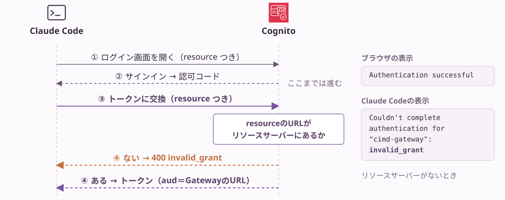

<!--
Claude Codeの表示は Couldn't complete authentication for "cimd-gateway": invalid_grant。CloudTrailの Token_POST は400だった。resource を付けなければ交換できたが、MCPの仕様ではクライアントが認可リクエストとトークン要求の両方に resource を付ける。DCRの開発者ガイドのMCP向けの手順でも、MCPサーバーのURLをリソースサーバーの識別子にするよう書かれている。
-->

---

# 許可していないURLとコールバック先の扱い

認可リクエストを直接送って確認しました。コールバック先がメタデータにないと redirect_mismatch、ポリシーにないURLは invalid_request のエラー画面で止まります。

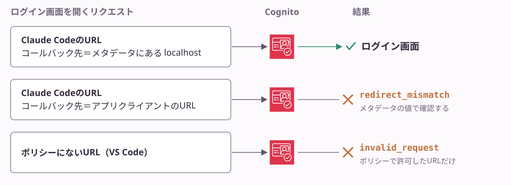

<!--
アプリクライアントのコールバックURLには https://example.com/callback を入れておいた。この値をコールバック先にしても通らないので、コールバック先はメタデータの値で確認していると分かる。
-->

---

# URLを追加したあとの取り直し

VS CodeのURLをポリシーに追加しても、しばらく invalid_request のままでした。REFRESH でメタデータを取り直すと、ログイン画面へ進みました。

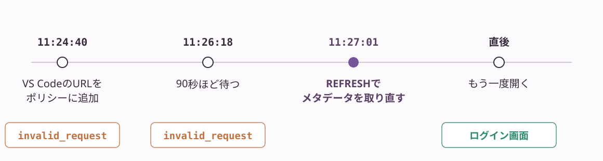

<!--
REFRESH は update_client_metadata_url_state（Action=REFRESH）。原因は分かっていない。VS Codeは入れていないので、ログイン画面が返るところまでを確認した。
-->

---

# ワイルドカードで許可する自作クライアント

Lambda関数URLで自作クライアントのメタデータを公開し、/clients/ 配下のURLをまとめて許可しました。CognitoはメタデータをURLごとに初回だけ取りに来て、1日キャッシュしていました。

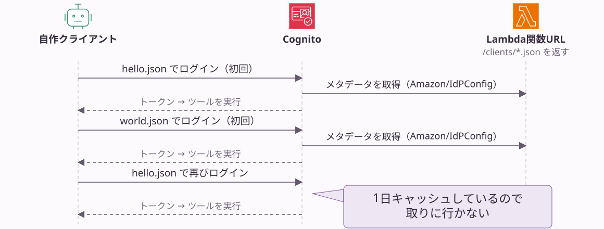

<!--
自作クライアントのトークンでも client_id はメタデータのURL、aud はGatewayのURLだった。パターンの外にある /other/hello.json は invalid_request で止まった。
-->

---

# CIMDより前からある課題

PCで動くアプリが本物かを確認しにくいのは、事前登録やDCRでも同じです。OAuthの仕様（RFC 8252）も、PCやスマホのアプリはなりすましの対象になりうるとしています。

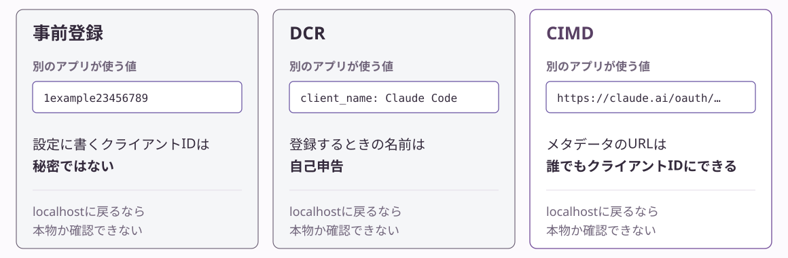

<!--
出典 RFC 6749 2.2（クライアントIDは秘密ではない）、RFC 8252 8.5・8.6、Cognito開発者ガイド「Dynamic client registration」（登録時の名前は登録する側が書く）。
-->

---

# 仕様が認可サーバーに求める備え

MCPの仕様はコールバック先のホスト名を画面に出すよう求めています。今回のCognitoのサインイン画面には、アプリの名前もコールバック先も出ていませんでした。

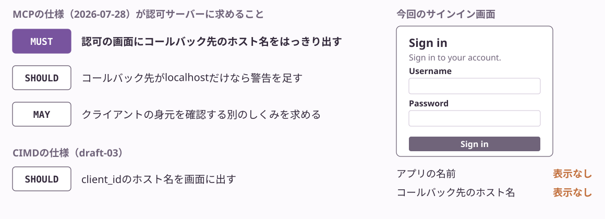

<!--
出典 MCP 2026-07-28「Security Considerations」の Localhost Redirect URI Risks（MUST・SHOULD・MAY）と draft-ietf-oauth-client-id-metadata-document-03 の 10.6。サインイン画面は2026-11-20の検証のマネージドログイン（「Cognitoのログイン画面」のページの画像）。
-->

---

# 管理者ができること

CIMDポリシーで許可したURLは、PCの中の別のアプリもクライアントIDとして使えます。管理者は許可するURLと渡すスコープを絞り、PCに入れるアプリを管理します。

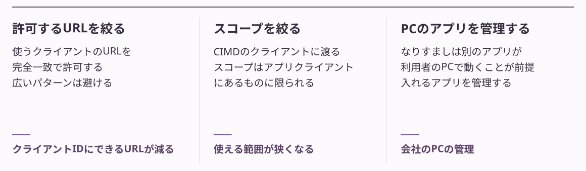

<!--
出典 Cognito開発者ガイド「Client ID metadata documents (CIMD)」。広いパターンは意図しないクライアントまで一致するので狭いパターンを勧めている。スコープはアプリクライアントにあり、認可リクエストで要求したもの（要求がなければアプリクライアントのすべて）。
-->

---

<!-- _class: centered lead-l -->
<!-- _footer: "" -->

# 気をつけることのまとめ

::: band 1.08
GatewayのURLを**リソースサーバー**に登録し、URLを追加したら**REFRESH**で取り直します。
localhostに戻るクライアントは**CIMDだけでは本物か確認できない**ので、許可するURLとスコープを絞ります。
:::

---

# まとめ

CIMDはMCPクライアントのログインから登録をなくすしくみです。Cognitoではポリシーで許可し、リソースサーバーの登録となりすましへの備えをあわせて考えます。

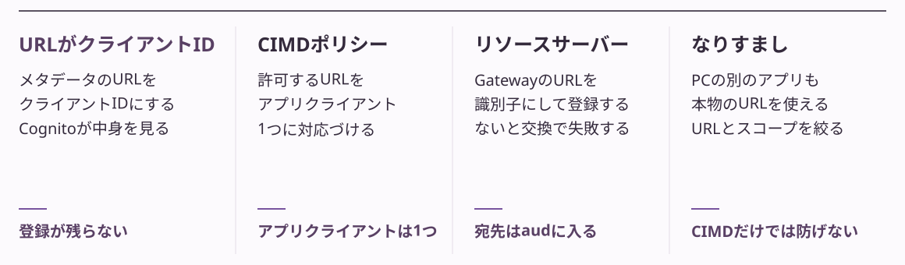

---

<!-- _class: no-lead -->

# 参考資料 Cognito

::: links
- [Amazon Cognito now supports client ID metadata documents](https://aws.amazon.com/jp/about-aws/whats-new/2026/11/cognito-client-id-metadata-documents/): CIMDの発表（2026年11月19日）
- [Client ID metadata documents (CIMD)](https://docs.aws.amazon.com/cognito/latest/developerguide/cognito-user-pools-client-id-metadata.html): CIMDポリシー・キャッシュ・条件
- [Amazon Cognito now supports dynamic client registration](https://aws.amazon.com/jp/about-aws/whats-new/2026/11/cognito-dynamic-client-registration/): DCRの発表（2026年11月）
- [Dynamic client registration](https://docs.aws.amazon.com/cognito/latest/developerguide/cognito-user-pools-dynamic-client-registration.html): DCRとMCPクライアント向けの手順
:::

---

<!-- _class: no-lead -->

# 参考資料 仕様

::: links
- [Client Registration（MCP 2026-07-28）](https://modelcontextprotocol.io/specification/2026-07-28/basic/authorization/client-registration): CIMDの推奨・DCRの非推奨・選ぶ順
- [Security Considerations（MCP 2026-07-28）](https://modelcontextprotocol.io/specification/2026-07-28/basic/authorization/security-considerations): localhostのなりすましと認可サーバーの備え
- [OAuth Client ID Metadata Document（draft-03）](https://datatracker.ietf.org/doc/draft-ietf-oauth-client-id-metadata-document/03/): CIMDの仕様と画面に出す情報
- [RFC 8252 OAuth 2.0 for Native Apps](https://www.rfc-editor.org/rfc/rfc8252): localhostのコールバック先とアプリのなりすまし
:::

---

<!-- _class: centered no-lead -->

# おわりに

::: prose 1.15
CIMDを使うと、MCPクライアントごとにアプリクライアントを用意しなくて済みます。

まずは使っているMCPクライアントのURLを1つだけ許可して、**社内のMCPサーバーに接続してみてください**。
最後までご覧いただきありがとうございました。
:::


---

<!-- _class: closing back-cover -->

# ありがとうございました

<p class="kicker">Amazon Cognitoのアップデートから</p>

<p class="who"><b>神野 雄大</b>Yudai Jinno</p>

[GitHub · yuu551](https://github.com/yuu551)<br><small>アイコン：Lucide / Feather（[ライセンス](https://github.com/yuu551/jinno-slide-kit/blob/main/THIRD_PARTY_NOTICES.md)）</small>


