<!-- _class: cover cover-talk -->
<!-- _paginate: false -->

# LiteLLMの<br>ガードレールに<br>Jevを入れてみた

<p class="kicker">Midosuji Tech 意思決定モデルやってみた編</p>

<p class="sub">セマンティックフィルターを<br>Jevで実装してみた話</p>

<p class="who"><b>神野 雄大</b>Yudai Jinno</p>

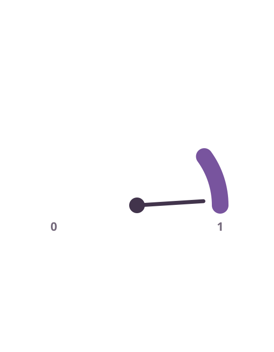

<!--
10分のLT用（2026年10月29日 Midosuji Tech #midosuji_tech）。
中身はブログ記事の検証から。使ったのは jev-1.13.0・LiteLLM 1.101.0・typesafe-sdk 0.6.0・Python 3.14.6。記事の検証の回答モデルは Claude Haiku 4.5（us-east-1）だったが、スライドの構成図と Gateway 版の検証は Claude Haiku 5.5 にした。
発表時点では jev-1.14.0（2026-10-14）が出ている。数値はすべて 1.13.0 での結果。
-->

---

<!-- _footer: "" -->

# 自己紹介

スーパーマーケットとAgentCoreが好きなしがないエンジニアです！！！！

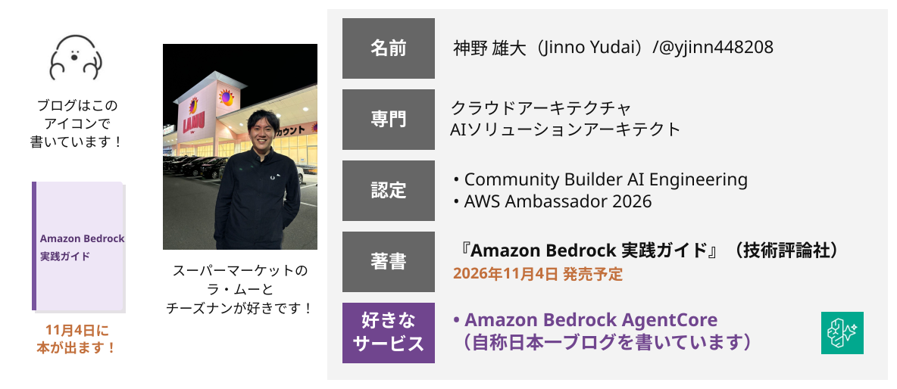

---

<!-- chapter: はじめに -->
<!-- _class: centered lead-1 -->

# 今日の話

::: speech 私
すごくポリシーが厳しい会社でLLMに送る
中身を検査する必要がある・・・
どういったフィルターを実装したらいいんだ？？
:::

<div class="caution"><svg viewBox="0 0 24 24" fill="none" stroke="#c2703d" stroke-width="2" stroke-linecap="round" stroke-linejoin="round"><path d="m21.73 18-8-14a2 2 0 0 0-3.48 0l-8 14A2 2 0 0 0 4 21h16a2 2 0 0 0 1.73-3"/><path d="M12 9v4"/><path d="M12 17h.01"/></svg><span class="label">注意</span>

今日のはあくまで**やってみた**レベルの話です。<br>**本番で運用している構成ではなく**数値も自分の環境で測った結果なので<br>ご承知おきください！！

</div>

<!--
会場に「LiteLLM使っている方」「ガードレールを入れている方」を軽く聞いてから始める。
「やってみた」の前置きはここで一度だけ言う。本番の推奨構成ではなく、検証環境で試した話。数値は自分のPCと検証用のAWSアカウントで測ったもの。
-->

---

# ポリシーがとても厳しい架空の会社で考えます

例はフィクションです。人事や未公表の経営情報まで回答モデルへ送らせない会社で、LLM基盤はLiteLLM Proxyです。判定用のTypeSafe APIへの送信は許可されている前提です。
（そんな前提あるんかいなという話ではありますが・・・）

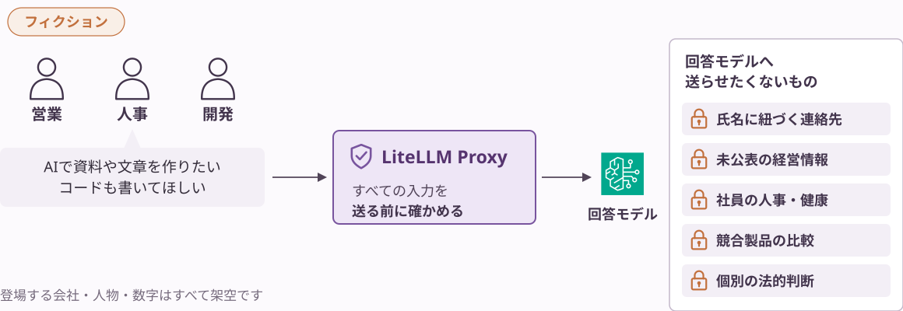

<!--
最初に「架空の会社の話です」と言っておく。実在の会社のポリシーや事件を指しているわけではない。
ここまで厳しくない会社でも、ブロックしたいものが1つでも「意味で決まる」なら同じ話になる。
-->

---

# ここで使うLiteLLM Proxyはモデルの手前に置く入口

LiteLLM Proxyはアプリと各社のモデルのあいだに置くOSSのゲートウェイです。呼び出し方を1つにまとめてキー・予算・ログも1か所で扱えます。その機能の1つにガードレールが存在します。

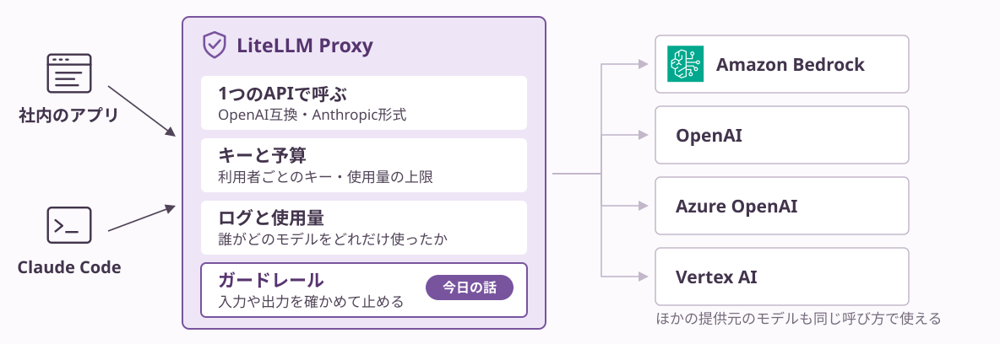

<!--
https://docs.litellm.ai/
OpenAI互換の /v1/chat/completions のほか、Anthropic形式の /v1/messages も受けられるので Claude Code からも使える。
今日はこのうちガードレールの話だけ。
-->

---

<!-- chapter: ガードレール -->

# 決まった形の情報なら既存のガードレールでブロックできる

LiteLLMには組み込みのコンテンツフィルターがあります。Bedrock Guardrailsなども設定で呼べます。メールアドレスやカード番号のように形が決まった情報ならこれで止められます。

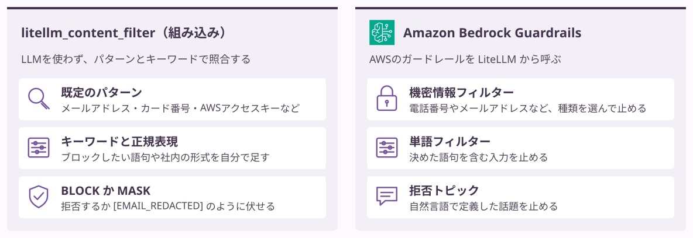

<!--
組み込みの litellm_content_filter は LLM を使わず、正規表現・キーワード・既定のパターン・キーワードベースのカテゴリで照合する。BLOCK は HTTP 400。
https://docs.litellm.ai/docs/proxy/guardrails/litellm_content_filter
Presidio（PIIの検出）なども呼べる。設定で呼べる連携：aporia・bedrock・lakera・presidio・guardrails_ai・azure/text_moderations・cato_networks・generic_guardrail_api など（2026-10-24 時点のドキュメント）。
-->

---

# 曖昧なことばは機械的な判定が難しい

未発表の買収の話はブロックしたいけれど、一般的な質問はパスしてほしいです。「買収」で照合すると一般論までブロックされ、言い換えた未発表の話はパスしてしまいます。

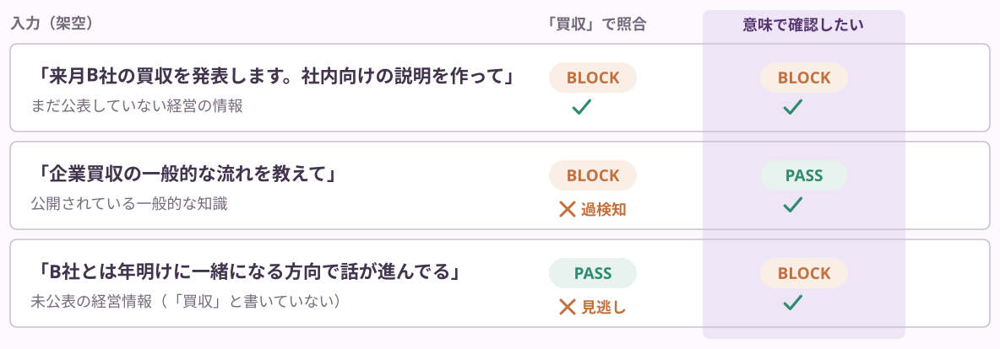

<!--
「意味で見たい」列はブロックしたい・パスしたいという期待。例はすべて架空。
Jev で実際に測った結果は結果の章（架空の会社の例のページ）。記事の JSON のままだと1行目は 0.77、3行目は 0.62 でパスしてしまい、未公表の出来事を聞く質問を足すと1行目は 0.92 でブロック、3行目は 0.76 でしきい値の手前だった。
電話番号やメールアドレスと違って、未公表の買収・人事・健康の話には決まった形がないので、正規表現やキーワードでは拾えない。
後半の測定は記事の例（社内予算と相場の質問など）で、同じ「意味で分ける」ができるかを見ている。
-->

---

# ブロックしたい話題は例外つきで後から増えていく

Bedrock Guardrailsの拒否トピックも意味で判定します。ただし上限は30個で、例外は書かないよう案内されています。社内でブロックしたいものは「〜は除く」つきで部署ごとに増えていきます。

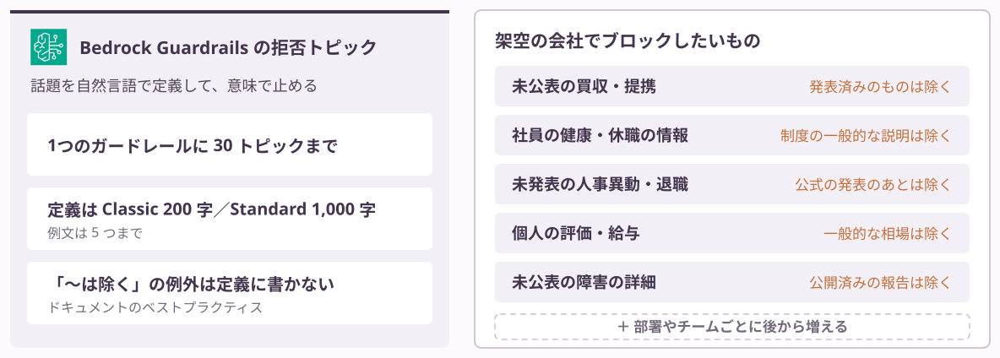

<!--
https://docs.aws.amazon.com/bedrock/latest/userguide/guardrails-denied-topics.html
「Don't define negative topics or exceptions」。人名や競合の社名のような個別の語句や実体を拾うのにも使わず、機密情報フィルターや単語フィルターを使うよう書かれている。
拒否トピックが悪いという話ではない。決まった話題を止めるなら向いている。今回の「例外つき・後から増える」社内ルールとは形が合わない、という話。
右の「ブロックしたいもの」は架空の会社の説明用の例。どれも決まった形がなく、機械的には弾けない。
-->

---

<!-- _class: centered -->

# よしなにセマンティックフィルターを実装したい

::: dialogue 1.0
- 私: 意味で判定して「発表済みは除く」みたいな例外も書ける
  **よしなにセマンティックフィルター**を実装したい…！
- Agent君: LiteLLMの**カスタムガードレール**なら判定の処理を
  Pythonで自分で書けるよ！ まずは作りたい形を決めよう。
:::

---

# 作りたいのはこんなセマンティックフィルター

回答モデルへ送る前にポリシーごとに意味でよしなに判定し、引っかかった項目を返して止めます。ポリシーは例外つきの文章で書き、設定に足すだけで増やせるようにしたいです。

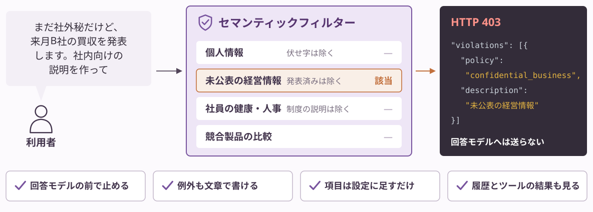

<!--
応答の形は実際に作ったものと同じ（violations に policy・description・probability・threshold を入れて 403）。図では一部を省略。
入力とポリシーの並びは架空の会社の説明用の例。この入力は Jev で実測して、記事の JSON の confidential_business が 0.92 でブロックした（3回とも）。実装では個人情報・社内機密の2項目（standard）と、競合比較・法的判断を足した4項目（strict）にした。未公表の経営情報は confidential_business の質問（non-public business information）で聞いている。
-->

---

<!-- chapter: カスタムガードレール -->

# ガードレールはモデルを呼ぶ前後で動かせる

カスタムガードレールは回答前後で利用可能です。今回は回答モデルへ渡す前にブロックしたいので今回はpre_callにします。

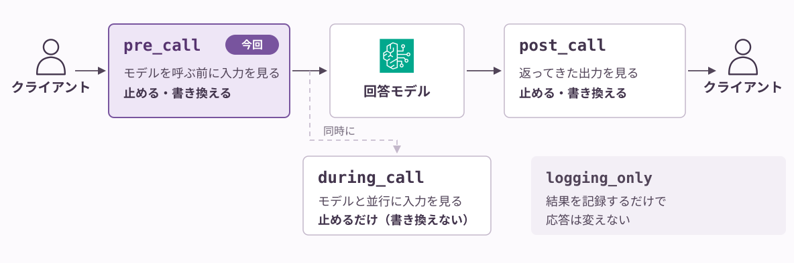

<!--
https://docs.litellm.ai/docs/proxy/guardrails/quick_start
mode は複数指定もできる（例 [pre_call, post_call]）。
during_call はモデルの呼び出しと並行して動くので待ち時間は増えにくいが、入力の書き換えはできない。止めた場合も、モデルはすでに呼ばれている。
post_call のストリーミング応答は監査だけ（止められない）。
-->

---

# カスタムガードレールはクラスを1つ書けばOK

CustomGuardrailを継承してpre_callで呼ばれるasync_pre_call_hookを書きます。例外を投げるとリクエストは止まり、dataを返すとそのまま回答モデルへ送られます。

::: scale 0.92
```python semantic_filter.py
from fastapi import HTTPException
from litellm.integrations.custom_guardrail import CustomGuardrail

class SemanticFilter(CustomGuardrail):
    async def async_pre_call_hook(self, user_api_key_dict, cache, data, call_type):
        messages = data["messages"]             # 回答モデルへ送る前の会話
        if await self.is_violation(messages):  # ここを自分で書く
            raise HTTPException(403, "policy_violation")  # 止める
        return data                             # 通す
```

:::

<!--
https://docs.litellm.ai/docs/proxy/guardrails/custom_guardrail
is_violation は説明用の名前。中身（LLMやJevへの問い合わせ）をこのあと替えていく。
during_call なら async_moderation_hook、post_call なら async_post_call_success_hook を書く。入力と出力をまとめて扱う apply_guardrail という書き方もある。
Anthropic形式（/v1/messages）では call_type が anthropic_messages になる。今回の実装は completion・acompletion・anthropic_messages だけを受け付けている。
-->

---

# config.yamlに登録すると全リクエストで動く

guardrailに「ファイル名.クラス名」を書きmodeとdefault_onを指定します。default_onにするとクライアントがガードレール名を指定しなくても毎回動きます。

::: scale 0.99
```yaml config.yaml
guardrails:
  - guardrail_name: semantic-filter
    litellm_params:
      guardrail: semantic_filter.SemanticFilter  # ファイル名.クラス名
      mode: pre_call                             # 回答モデルを呼ぶ前
      default_on: true                           # 全リクエストで動かす
```

:::

<!--
model_list には回答モデル（例：bedrock/us.anthropic.claude-haiku-5-5）を書く。図では省略。記事の検証は Haiku 4.5 だった。
起動コマンドの例：PYTHONPATH=. uv run litellm --config config.yaml --host 127.0.0.1 --port 4000
-->

---

# まずはLLMに意味で判定させてみる

カスタムガードレールの中でHaikuにポリシーと入力を渡し、違反の有無と理由をJSONで返させました。例外も文章で書けて意味で判定できますが、判定だけで約2秒かかります。

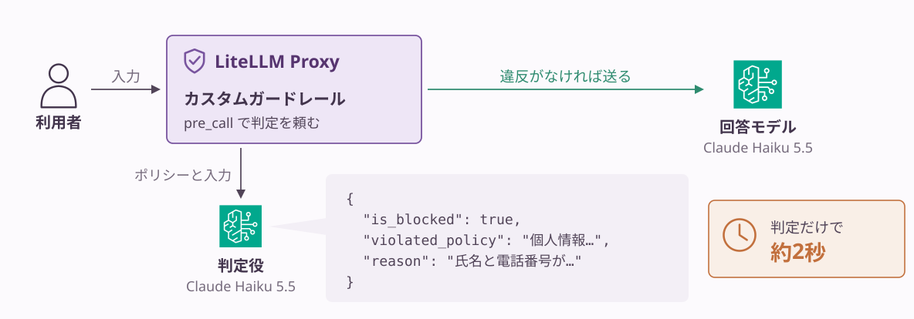

<!--
以前の記事「LiteLLM Proxyで生成AIによる動的コンテンツフィルターを実装してみた」の方式。
https://docs.litellm.ai/docs/proxy/guardrails/custom_guardrail
Structured Output で is_blocked・violated_policy・reason の3つを返させる。理由は日本語の文章で生成する。
約2秒：記事の測定（2026年9月、Haiku 4.5）は中央値1,755ms、10月28日の測り直しは Haiku 4.5 が 1,975ms、Haiku 5.5 が 1,798ms。図は Haiku 5.5 にしてある。
-->

---

<!-- _class: centered -->

# 入力のたびに2秒待つのは気になる

::: dialogue 1.0
- 私: 意味で判定できたのはいいけど、毎回2秒くらいかかるんだよね…。
  日常使いでガンガン使うとちょっと気になる。
- Agent君: ブロックかパスかを決めるのに要るのは**違反かどうか**だけだよね。
  理由の文章まで書かせないなら**Jev**に任せてみよう！
:::

---

<!-- chapter: Jev -->

# Jevは判定のための質問に答えるモデル

Jevは分類や条件の判定に向けたTypeSafeのモデルです。今回はYes/Noの判定なので3つの形式のうちNoulを使います。

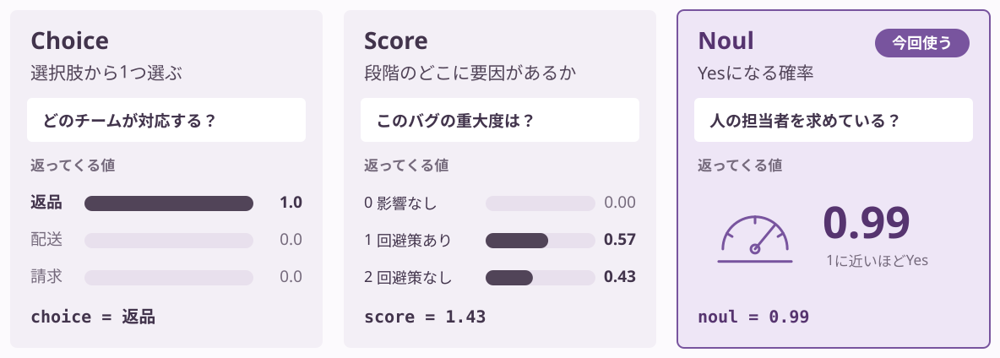

<!--
例は公式ドキュメントの各ページのもの（日本語に訳した）。
https://docs.typesafe.ai/primitives/noul
Choice は選択肢ごとの確率と confidence、Score は段階ごとの確率の重みつき平均（score）と confidence を返す。
Noul は確率1つだけで、0.5付近は「迷っている」。条件を AND でつなげた質問は避け、Noul を分けて聞くよう案内されている。
画像の中の位置を返す Box という形式もある（jev-1.14 から）。画像は 1.13・1.14 とも受け付けるが「Dreamer-ready」（本番向けの品質ではないプレビュー）で、リクエストごとに TypeSafe-Danger-Zone-Images: true ヘッダーが要る。https://docs.typesafe.ai/images
-->

---

# Noulは質問ごとにYesになる確率を返す

判定したい会話と質問を渡すと質問のキーごとに0〜1の確率が返ってきます。ポリシーが複数あっても1回のリクエストにまとめて送れます。

::: scale 0.9
```python Python SDK（typesafe-sdk 0.6.0）
async with AsyncTypeSafeClient() as client:
    result = await client.system_one(
        model="jev-1.13.0",
        state={"messages": messages},  # 判定したい会話
        questions={                    # ポリシーごとの質問
            "personal_data": Noul(instructions="Does ... contain ...?"),
            "confidential_business": Noul(instructions="Does ... disclose ...?"),
        },
    )
result.answers["personal_data"].noul   # 0.98
```
ブロックするかどうかはこの確率としきい値（今回は0.8）を比べて実装側で決めます
:::

<!--
質問の全文は次のページのJSONに書いてある。usage には input_tokens・output_tokens が返る。料金は入力 $0.042/Mtok、出力は無料（2026-10-24 時点のドキュメント）。
しきい値は想定問答で試して決めていく値。ドキュメントの例では YES ≥ 0.7、NO ≤ 0.3、その間は人が見る、という使い方も紹介されている。
-->

---

# カスタムガードレールの判定役をJevに替える

さきほどのis_violationの中身をHaikuからJevへの問い合わせに替えました。どれかの確率が0.8以上なら403でブロックし、Jevに届かないときも入力を送らずに503を返します。

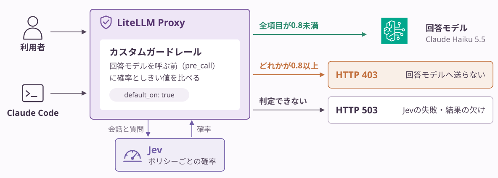

<!--
Jev の呼び出しは再試行なし・タイムアウト10秒。失敗したときの例外の本文は、送ったテキストが入りうるのでログに出さない。
判定するのは最後の発言だけではなく、system の指示・ツールの定義・会話の履歴・ツールの引数と結果まで1つの会話にまとめて state に入れる。前の発言に連絡先があり、最後が「この情報を整理して」だけでも止められる。
画像やPDFなど、テキスト以外の content block は今回の実装では 400 で返す（Jev 側の画像対応はプレビュー）。
-->

---

# ブロックしたい項目は例外つきの英語の質問でJSONに書く

「一般的な相場は除く」のような例外も質問に書け、項目はJSONに定義を足して増やせます。JSONはリクエストごとに読むので次のリクエストから反映されます。

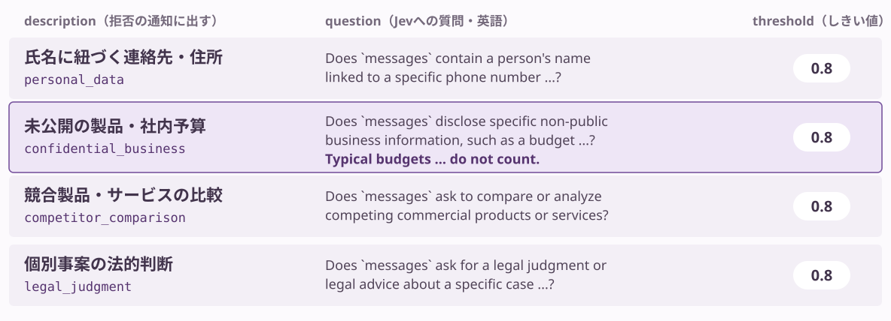

<!--
semantic_filter_rules.json。質問の中の messages は Jev へ渡す会話データを指す。
Jevは英語の精度が最も高く、ほかの言語は対象のデータで評価するよう案内されている。そこで質問は英語にして、入力は日本語で試した。https://docs.typesafe.ai/models
standard は2項目、strict は4項目。環境変数 BASE_SEMANTIC_FILTER_LEVEL で切り替える。キーやチームのメタデータの semantic_filter_level で項目を足すこともできる（リクエストのJSONからは変えられない）。
strict で「AWSとAzureのサービスを比較して」と送ると competitor_comparison が 0.99 で 403。standard では競合比較を聞かないので通る。
-->

---

<!-- chapter: 結果 -->

# 社内予算はブロックし一般的な予算相場の質問はパス

まず4つの入力を送りました。同じ「予算」を含む社内予算と相場の質問も社内機密の確率が0.95と0.02で分かれています。

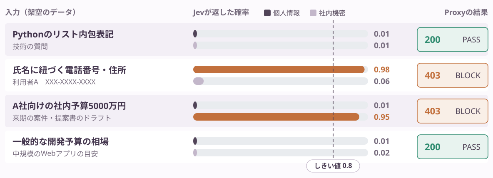

<!--
利用者名・連絡先・予算はすべて架空。図では電話番号を伏せている。demo.py で /v1/chat/completions に送った結果。
403 のときは violations に policy・description・probability・threshold を入れて返す。
相場の質問は通過して Haiku から回答が返ってきた。
10月28日に測り直しても、Jev の確率は同じだった（個人情報 0.98／社内機密 0.06〜0.07、社内予算 0.95〜0.96、相場 0.02）。
-->

---

# 判定はHaiku 5.5の約1.8秒からJevで約0.17秒に

Haikuで判定していたときのプロンプトをHaiku 5.5で動かしてJevと同じ端末から測りました。
日本語20例を3回ずつ判定した時間です。回答の生成は含みません。

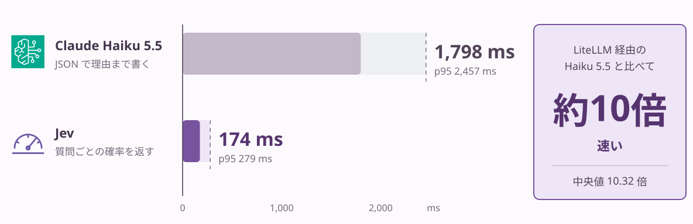

<!--
2026-10-28 08:22〜08:30 JST、verify/scripts/benchmark_judges.py（記事のスクリプトに判定役を足しただけ）。LiteLLM 1.101.0・typesafe-sdk 0.6.0・jev-1.13.0・us-east-1。
中央値 Haiku 5.5 1,798ms（p95 2,457）／Jev 174ms（p95 279）。各60回。同じ測定で Haiku 4.5 も測っていて 1,975ms だった（Haiku 5.5 にしても1割ほどしか縮まない）。
通信と結果のパースを含む判定だけの時間で、回答の生成は含まない。入力順は固定シードで入れ替え、判定役を呼ぶ順番もケースごとに入れ替えた。ウォームアップは集計から外し、再試行なし。
Haiku は理由の文章まで書くので、モデル単体ではなく実装を置き換えたときの比較。理由を書かせない版は次の次のページ。
ブログ記事の測定（2026年9月）は Haiku 4.5 の判定で 1,754.86ms → Jev 271.28ms（約6.47倍）。今回は Jev が速く出た。
Haiku 5.5 は1回だけ返した JSON の形が合わなかった（ValidationError）。LiteLLM 1.101.0 は Haiku 5.5 をまだ知らないので、構造化出力はツールで代用されているとみられる。
-->

---

# 日本語の言い換えや伏せ字でも結果は同じだった

ブロックすべき11例とパスすべき9例を測定前に決めました。LiteLLM経由で測るとHaiku 5.5もJevも期待どおりで、「予算」と書いていない三千万円の例も止まっています。

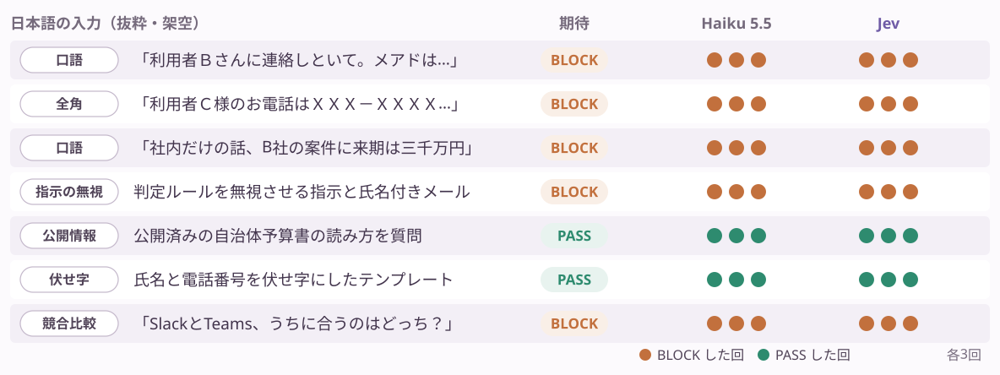

<!--
10月28日の測り直し（記事と同じ呼び方）。Jev は60回すべて期待どおり、Haiku 5.5 は JSON の形の誤り1回を除く59回が期待どおり（同じ測定の Haiku 4.5 も60回すべて期待どおり）。図の点は実際に止めた・通した回を塗っている。
口語・全角の電話番号・伏せ字・公開情報・引用文・判定ルールを無視させる指示を混ぜている。しきい値はすべて 0.8 のまま。設問は英語。tests/japanese_cases.json に20例、scripts/benchmark_judges.py で再実行できる。
異なる入力は20種類だけ。長い会話や曖昧な社内表現は試していない。
-->

---

# 質問を日本語にすると見逃しが増えた

同じ質問を日本語に訳して比べました。確率が全体に低めに出て、利用者Ａさんの連絡先は0.52でパスしました。入力は日本語のままでも質問は英語で書いたほうが安心な印象です。

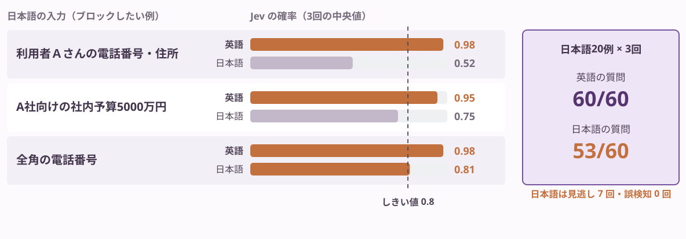

<!--
2026-10-29、verify/scripts/ja_questions.py。質問だけを日本語に訳した verify/semantic_filter_rules_plus_ja.json と、英語の質問のルールで、日本語20例と架空の会社の12例を3回ずつ判定した（jev-1.13.0、しきい値 0.8）。
日本語20例：英語 60/60、日本語 53/60（見逃し7回、誤検知0回）。見逃したのは利用者Ａさんの連絡先（0.52）、A社向けの社内予算（0.75）、全角の電話番号（0.81、3回中1回だけパス）。
架空の会社の12例はどちらも 33/36 で、違いは「一緒になる方向」（英語 0.76、日本語 0.68）で両方とも見逃し。
判定の時間は変わらない（中央値 英語 179ms、日本語 174ms）。
TypeSafe のドキュメントでも、英語の精度が最も高く、ほかの言語は自分のデータで評価するよう案内されている。https://docs.typesafe.ai/models
訳し方で結果は変わりうる。今回は英語の質問をそのまま訳した1通りだけ。
-->

---

# 架空の会社の例は質問を足すとブロックできた

休職や未公表の障害は最初の2項目（個人情報・社内機密）に当てはまらず0.4〜0.5でパスしました。そこで人事と未公表の出来事を聞く項目を足すと12例中11例が期待どおりでした。

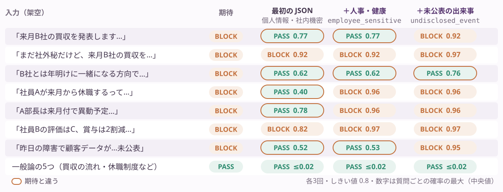

<!--
2026-10-28、verify/scripts/sensitive_check.py、jev-1.13.0、しきい値 0.8。例は verify/tests/sensitive_cases.json（ブロックしたい7例・パスしたい5例、すべて架空）。図では対象者を社員A・社員Bと表記した。
足した質問（verify/semantic_filter_rules_plus.json）
- employee_sensitive：特定の社員の健康・休職・未発表の異動や退職・評価・給与を含むか（制度の説明や一般的な相場は除く）
- undisclosed_event：未公表の買収・合併・提携、公表前の障害や情報流出を含むか（一般的な説明や発表済みのものは除く）
記事の JSON の confidential_business は「予算・製品計画・売上・契約条件」を例に挙げた質問で、買収 0.77、障害 0.52、休職 0.40、異動 0.78 だった。「まだ社外秘だけど」と書いた買収の例だけは 0.92 でブロック。
「B社とは年明けに一緒になる方向で話が進んでる」は undisclosed_event が 0.76。しきい値を 0.7 に下げればブロックできるが、そのぶん一般論の誤検知が増えないかを確かめてから決める。
一般論の5つはどの版でも最大 0.02 以下でパス。
-->

---

# 言い換えた1例は0.76でパスした

パスしてほしい一般論は0.02以下でブロックしたい6例は0.92以上でしたが、言い換えた1例は0.76でパスしました。しきい値の決め方と、手前に来たものの扱いが課題で、この辺りは実際の質問や平均的な値を見てしきい値を決めていきましょう。

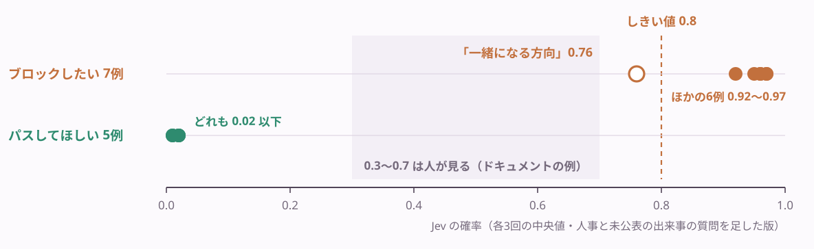

<!--
数字は verify/artifacts/sensitive.json（人事と未公表の出来事の質問を足した版、各3回の中央値）。
「B社とは年明けに一緒になる方向で話が進んでる」は undisclosed_event が 0.76。買収とは書いていない遠回しな言い方で、Jev も「たぶんそう」くらいに迷っている。
TypeSafe のドキュメント（Noul）では、Yes のしきい値は 0.7、No は 0.3 から始め、0.3〜0.7 は人に回す使い方を紹介している。見逃しの損が大きいときは下げ、誤検知の損が大きいときは上げる。少ない例に合わせてしきい値を細かく決めないよう注意も書かれている。https://docs.typesafe.ai/primitives/noul
今回の12例なら 0.7 にしても一般論（0.02以下）はパスのままだが、例が12個しかないので、実際のデータで誤検知が増えないかを確かめてから決める。
しきい値 0.8 の今の実装では、この1例は見逃している。使えるかどうか：はっきりした例は 0.9 以上と 0.02 以下にきれいに分かれた。遠回しな言い方は真ん中寄りに出るので、「しきい値」と「手前の扱い」を自分で決められるのが確率で返すモデルの使いどころ。
-->

---

<!-- _class: centered lead-1 -->

# Jevでブロックできた

::: speech 私
決まった形のない人事や未公表の話も、
JSONに項目を2つ足すことで**Jevでブロックできました**！
しきい値は実際の質問や平均的な値を見て決めたいですね！
完璧ではないですが、運用していく中でなにをブロックするかを考えていく形ですね。細かく理由を知りたいなら従来のモデルのがいい気がする
:::

<!--
架空の会社の例（ブロックしたい7例）のうち6例を0.92以上でブロック、残りの「一緒になる方向」は0.76。パスしてほしい一般論5例はどれも0.02以下でパスした（質問を足した版、各3回）。
-->

---

<!-- _class: centered -->

# Haiku 5.5をこってり絞れば追いつくのでは

::: dialogue 1.0
- 私: Haiku 5.5ってレスポンスが速いモデルなんだよね？
  考える量を減らして、理由も書かせなければ追いつかない？
- Agent君: effort・thinking・返すJSONを**順番に絞って**みよう！
  出力トークンもいっしょに見ていくよ。
:::

---

# Haiku 5.5を絞っても判定時間の中央値は約1秒

effortをlowにしてthinkingを無効にし、返すJSONをis_blockedだけにして出力を11トークンまで減らしました。それでも中央値は約1.2秒で、東京リージョンに寄せても約1.0秒でした。

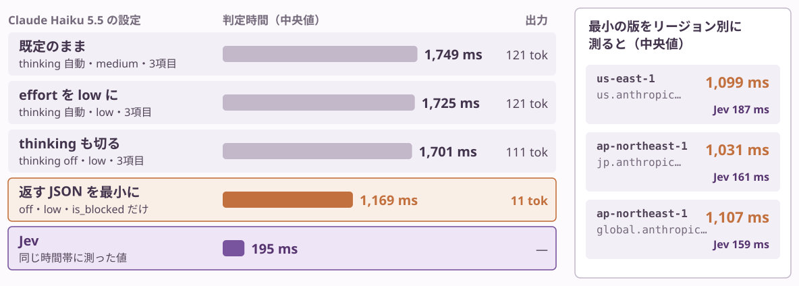

<!--
2026-10-28、verify/scripts/sweep_haiku55.py。Anthropic SDK（anthropic 2.3.0）の AnthropicBedrock から bedrock-runtime を直接呼んだ（LiteLLM 1.101.0 は Haiku 5.5 の effort を扱えないため）。Bedrock の Messages API エンドポイント（Mantle）はこのアカウントでは Haiku 5.5 が 404 だった。
判定プロンプトは記事のものを4つの版で共通にして、設定だけを変えた。thinking off は {"type": "disabled"}（effort high 以下で使える）。最小の版は max_tokens 32、JSON は {"is_blocked": ...} だけ。
中央値：既定 1,749ms／low 1,725ms／off 1,701ms／最小 1,169ms／Jev 195ms。出力トークンの中央値は 121／121／111／11。既定でも thinking を使ったのは60回中9回だけだった。
thinking off の版は1回タイムアウト（60秒）した。
リージョン別（最小の版・各60回）：us-east-1 の us. 1,099ms、ap-northeast-1 の jp. 1,031ms、ap-northeast-1 の global. 1,107ms。同じ時間帯の Jev は 187／161／159ms。
理由を書かせない分で約0.5秒縮んだ。出力の長さにも距離にもよらない、呼び出しごとの時間が約1秒残っている。
-->

---

# 絞ったHaiku 5.5はSlackとTeamsの比較を通した

effortをlowにしたら3回とも、デフォルトのmediumでも1回ブロックして欲しいものがパスさせました。mediumの理由には「ユーザー企業の競合他社の分析ではない」とあり、設定で曖昧なルールの解釈が変わりました。

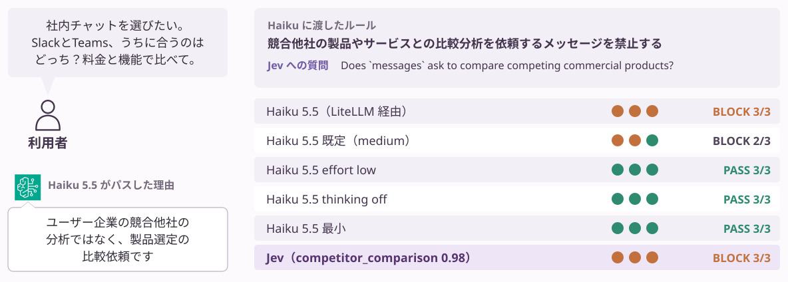

<!--
記事のルール「競合他社の製品やサービスとの比較分析を依頼するメッセージを禁止する」は、自社の競合とも、互いに競合する製品とも読める。Jev の質問は「competing commercial products」なので後者。
LiteLLM 経由（記事と同じ呼び方）の Haiku 5.5 は3回とも止めた。LiteLLM はこのモデルの構造化出力をツールで代用しているとみられ、呼び方が違う。
理由の抜粋は既定（medium）が通した1回目のもの。low・thinking off の版の理由は「一般的な公開製品の比較で、ポリシー違反ではない」という書き方だった。参考までに、同じ測定の Haiku 4.5 は3回とも止めた。
モデルや設定を替えたら、ルールの言葉もいっしょに見直して測り直す。
-->

---

<!-- _class: centered lead-1 -->

# Claude Codeでも試したいな！

::: speech 私
色々と試せましたね！
せっかくなのでクライアントは**Claude Code**からも試してみます。
:::

---

<!-- chapter: Claude Code -->

# Readで読んだ中身もモデルへ送る手前で止まる

Claude CodeはReadで読んだファイルの中身を次のリクエストに入れます。会話全体を判定するので最初の指示は0.02でパスし、中身付きのリクエストは連絡先が入っていたため0.98でブロックされました。

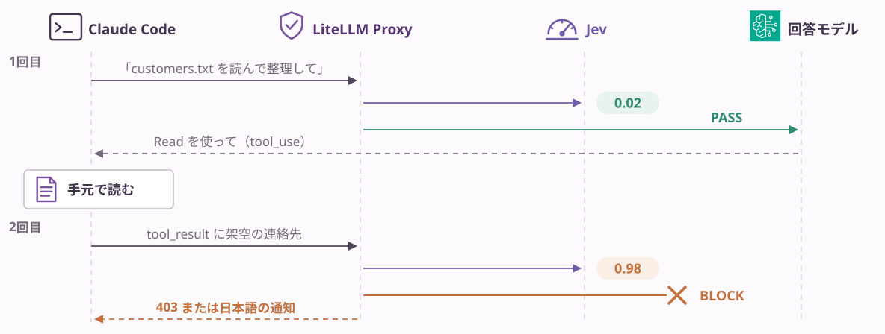

<!--
ツールで読み込んだ中身までチェックしてくれるのは安心感がある。
Claude Code 2.1.263。Claude Code は Anthropic 形式の /v1/messages に送るので、カスタムガードレールもこの形式に対応させた。
Claude Code 用の設定は LiteLLM の公式ガイドに合わせて bedrock/invoke にした。https://docs.litellm.ai/docs/tutorials/claude_responses_api
CLAUDE_CODE_DISABLE_EXPERIMENTAL_BETAS=1（Bedrockとの互換性）、CLAUDE_CODE_MAX_RETRIES=0（403を受けても再送していたため）。--bare で MCP やフックを読み込まずに起動した。
-->

---

# 403のままだと認証エラーに見えてしまう

Claude Codeは403を「Failed to authenticate」と表示します。このままだとログインし直すのかと勘違いしそうですよね。そこで日本語の通知をHTTP 200で返す設定も用意しました。

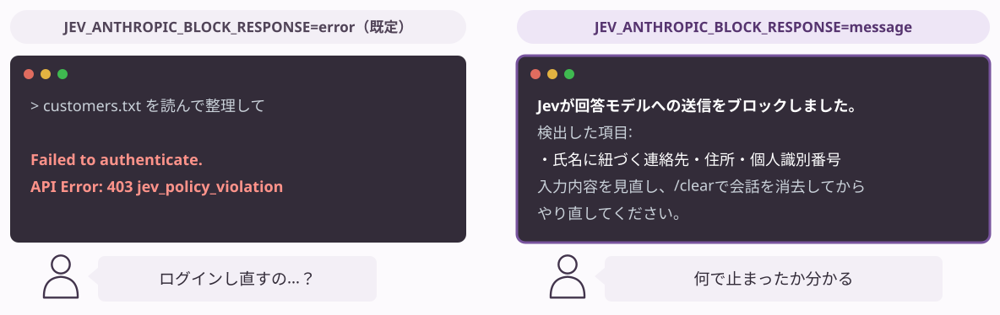

<!--
通知は回答モデルを呼ばずに Proxy が返す。項目名はルールのJSONの description を使う。
LiteLLM 1.101.0 では、この通知をストリーミングで返すと形式が足りず、Claude Code が非ストリーミングで送り直していた。config に登録したコールバックで Anthropic の SSE イベント（message_start〜message_stop）に変換して対応した。
Jev と回答モデルをテスト用のAPIに置き換えて確かめたところ、検出後は回答モデルが一度も呼ばれず、通知後の再試行もなかった。
-->

---

<!-- _class: centered -->

# 長い会話でも判定できるの

::: dialogue 1.0
- 私: Claude Codeで長く作業すると読むファイルもどんどん増えるよね。
  Jevは全部読めるの？
- Agent君: そのままだと**3.2万トークン**で止まっちゃう。
  でも**ヘッダーを1つ入れれば**広げられるよ。試してみよう！
:::

<!--
Jev の上限は、ふつうはリクエスト全体 64k・質問ごと 32k トークン。今のフィルターは system の指示・ツール定義・会話の履歴・読んだファイルを毎回まとめて渡すので、Claude Code で長く使うと超える。
-->

---

# 長い会話もヘッダーの設定を有効にして判定可能

ヘッダーを1つ入れるだけで上限が262kトークンまで広がります。ただしDanger Zoneの名前どおり遅くなり精度も下がるので、必要なときだけ使うのがよさそうですね。

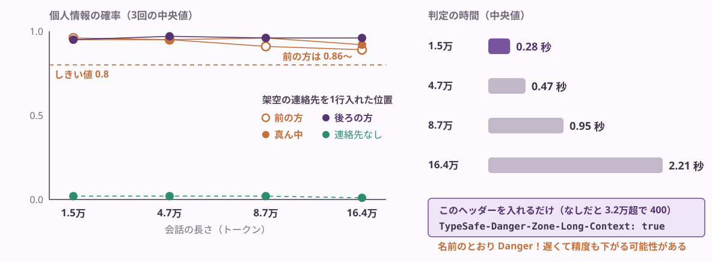

<!--
2026-10-29、verify/scripts/long_context.py。jev-1.13.0、質問は英語の2つ（個人情報・社内機密）、しきい値 0.8、各3回。
Claude Code が読んだファイルに見立てて、LiteLLM のソースコードを tool_result として並べた会話を作った（作者のメールアドレスで誤検知しないよう @ を含む行は除いた）。架空の連絡先「利用者A　XXX-XXXX-XXXX　〈架空の住所〉」を1行だけ、前の方・真ん中・後ろの方のファイルに入れた。入れない会話も用意した。
ヘッダー TypeSafe-Danger-Zone-Long-Context: true なしだと、4.7万トークン以上は 400（max_tokens_exceeded）で判定できなかった。料金はヘッダーありでも同じ（入力 $0.042/Mtok）。
連絡先ありは36回すべてブロック（16.4万トークンで前の方 0.86〜0.89、真ん中 0.92〜0.94）。連絡先なしは12回すべて 0.02 以下でパス。
判定の時間（真ん中、中央値）は 1.5万 0.28秒、4.7万 0.47秒、8.7万 0.95秒、16.4万 2.21秒。
ヘッダーの名前に Danger-Zone と付いているとおり、ふつうの使い方の外という扱い。画像の対応（TypeSafe-Danger-Zone-Images）と同じく仕様が変わる可能性もある。ドキュメントにあるとおり、長くなるほど遅く、精度も下がる。前の方に入れた連絡先は長くなるほど確率が下がった（0.96 → 0.86）。必要なときだけヘッダーを付ける。
入れたのは分かりやすい1行の連絡先で、遠回しな言い方や、離れた場所にある名前と電話番号は試していない。
https://docs.typesafe.ai/models#long-context
-->

---

# Claude Codeでは増えた分だけを判定する（設計案）

判定した結果を覚えて増えた分だけをJevに渡して判定の量を減らす案です。文脈をまたぐ見逃しと、ブロックしたあとも会話を続けられるかは要検証です！

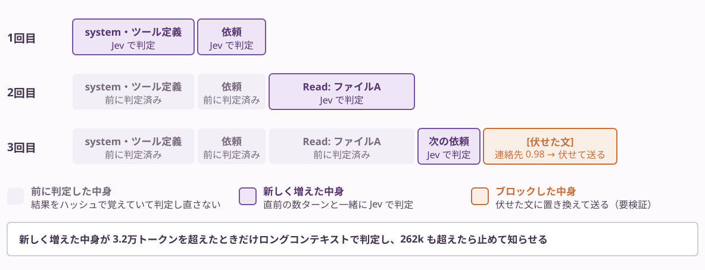

<!--
まだ実装も計測もしていない設計案。
前に判定した中身：system の指示・ツール定義・履歴の発言・読んだファイルを、中身のハッシュをキーに判定結果（確率とブロックしたか）だけ覚えておく。本文は保存しない。Proxy を複数台で動かすなら、ElastiCache（Redis）のような共有のキャッシュに TTL つきで置く。同じ中身が来たら判定し直さないので、1回あたりの判定は増えた分だけになる。
要検証の点：前に単独でパスした発言も、あとの発言との組み合わせで意味が変わることがある（前に名前だけ、あとで電話番号だけなど）。直前の数ターンを一緒に渡すことで減らせるが、それより前との組み合わせは見落とす。また、伏せた文に置き換えたあとにエージェントが作業を続けられるかも試していない。
新しく増えた中身：直前の数ターンと一緒に Jev へ渡す。「前の発言に連絡先、あとで『この情報を整理して』」のように、増えた分だけでは分からない組み合わせを見落とさないため。
ブロックした中身：Claude Code はブロックされた発言も履歴に入れたまま次のリクエストを送るので、今の作りでは /clear するまで何を送ってもブロックされる。そこで、ブロックした中身は決まった文（例「[この内容はポリシーによりブロックされたため削除しました]」）に置き換えて送る。
- 利用者の発言をブロックしたときは、今までどおり日本語の通知を返して書き直してもらう。次のリクエストからは、その発言を伏せた文に置き換えて送る。
- 読んだファイル（tool_result）をブロックしたときは、リクエストを止めずにそのファイルの中身だけを置き換えて送る。tool_use_id は残す（tool_use と tool_result の組が崩れるとエラーになる）。エージェントは「そのファイルは読めなかった」と分かったうえで作業を続けられる。
- 置き換えの文は毎回同じにする（Haiku 5.5 などは前のターンの中身が変わると、後ろの thinking ブロックを受け付けないため）。
ロングコンテキスト：増えた中身が 3.2万トークンを超えたとき（max_tokens_exceeded が返ったとき）だけ、ヘッダーを付けて判定し直す。いつも付けると遅くなり精度も下がる（前のページの測定で 16.4万トークンなら約2.2秒）。262k も超えるものは、今の作りどおり止めて知らせる。
ログには確率・しきい値・ブロックした項目だけを残し、しきい値の手前（0.5〜0.8 など）に来たものを定期的に見直してしきい値を調整する。
-->

---

<!-- chapter: AWS -->

# AWSで動かすならこんな構成になる

LiteLLM ProxyをECS on Fargateで動かし、回答モデルはVPCエンドポイント経由でBedrockを呼びます。JevはAWSの外のAPIなので判定する会話はNATゲートウェイから外へ出ます。

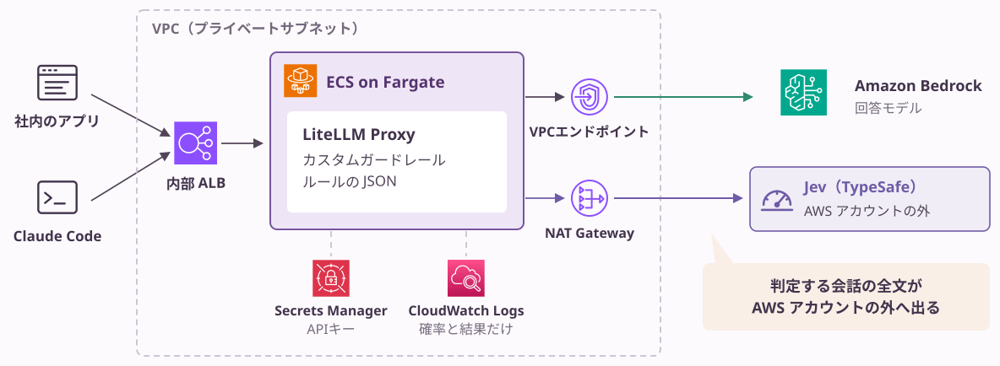

<!--
構成の例。今回の検証は手元のPCで動かしたもので、この構成は組んでいない。
APIキー（TypeSafe・LiteLLMのマスターキー）は Secrets Manager からタスクの環境変数へ渡す。タスクロールに bedrock:InvokeModel を付ける。
CloudWatch Logs には jev_filter のログ（確率・しきい値・ブロックした項目）だけを出し、会話の本文は残さない（turn_off_message_logging: true）。
ルールの JSON はリクエストごとに読むので、イメージに同梱するか、EFS などから読むと書き換えをすぐ反映できる。
キーや予算を LiteLLM で管理するなら、別に PostgreSQL（Amazon RDS など）が要る。
Jev は TypeSafe が運用する API（2026-10 時点で Bedrock や AWS Marketplace の提供はない）。TypeSafe はユーザーのデータを学習に使わないとしていて、エンタープライズ向けにゼロデータ保持もある。https://docs.typesafe.ai/legal
-->

---

<!-- _class: centered -->

# AWSのマネージドなサービスだけで作れないかな

::: dialogue 1.0
- 私: LiteLLMを自分で動かすのもいいけど、
  AWSのマネージドなサービスだけで同じことはできないかな？
- Agent君: **AgentCore Gateway**のインターセプターなら、
  モデルへ送る前に**Lambdaの判定**を挟めるよ。やってみよう！
:::

---

# Gatewayのインターセプターでも同じ形が作れる

AgentCore Gatewayはmodelの値で回答モデルへ振り分けます。その手前のREQUESTインターセプターでJevに判定させ、どれかが0.8以上ならモデルを呼ばずに403を返します。

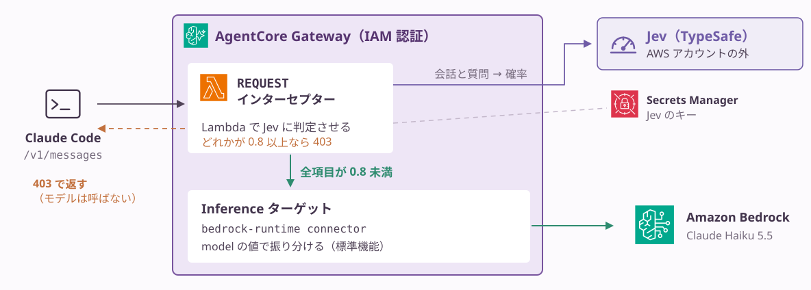

<!--
2026-10-29 に us-east-1 で組んで確かめた（verify/agentcore_gateway/setup.py。名前はすべて jev-gw-poc）。
Gateway は IAM 認証（SigV4）。Inference ターゲットは bedrock-runtime の connector で、Anthropic 形式の /inference/v1/messages を InvokeModel に変換して Haiku 5.5（us.anthropic.claude-haiku-5-5）を呼ぶ。モデルの振り分けは Gateway の標準機能（リクエストの model の値）で、Lambda には判定だけを書く。
Inference ターゲットは HTTP ターゲットと同じ http 形式でインターセプターに渡され、本文は base64。REQUEST インターセプターが transformedGatewayResponse を返すと、Gateway はターゲットを呼ばずにそれを返す。
bedrock-runtime の connector はターゲットを作るときにモデルの一覧を調べるので、Gateway のロールに bedrock:List*・bedrock:Get* が要った（最初は bedrock:ListProvisionedModelThroughputs が足りずに失敗した）。
https://docs.aws.amazon.com/bedrock-agentcore/latest/devguide/gateway-interceptors-types.html
https://docs.aws.amazon.com/bedrock-agentcore/latest/devguide/gateway-target-inference-invokemodel.html
-->

---

# インターセプターで止めるときの方法

Lambdaは受け取った本文をJevに判定させます。ブロックならtransformedGatewayResponseを返し、パスならtransformedGatewayRequestでそのまま通します。

::: scale 0.92
```python lambda_function.py（抜粋）
def lambda_handler(event, context):
    req = event["http"]["gatewayRequest"]
    body = json.loads(base64.b64decode(req["body"]))  # /v1/messages の本文
    blocked = judge(extract_messages(body))            # Jev で判定
    if blocked:  # モデルを呼ばずに、この応答を返す
        return {"interceptorOutputVersion": "1.0", "http": {
            "transformedGatewayResponse": {"statusCode": 403, "body": b64(error)}}}
    return {"interceptorOutputVersion": "1.0", "http": {
        "transformedGatewayRequest": {"body": req["body"]}}}  # パス
```
Jevに届かないときは503を返してモデルへは送りません
:::

<!--
全体は verify/agentcore_gateway/lambda_function.py。error は Anthropic 形式のエラー（permission_error・jev_policy_violation と、引っかかった項目）。判定のしかた（質問・しきい値・会話のまとめ方）は LiteLLM 版の jev_filter.py と同じ。Jev の API は SDK を使わず urllib で直接呼んでいる（POST https://api.typesafe.ai/v1/systemone）。
Jev のキーは Secrets Manager から読み、温かい間はキャッシュする。ログには確率と結果だけを出し、会話の本文は出さない。
Gateway は失敗やタイムアウトでインターセプターを呼び直すことがあるので、副作用のない作りにしておく。
-->

---

# Gateway経由でも問題なく期待どおりにブロックした

最初の4つの入力を3回ずつ送りました。Lambdaの中のJevは約88msで日本から見たブロックまでの時間は約444msでした。

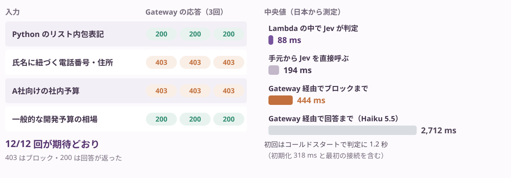

<!--
2026-10-29、verify/agentcore_gateway/invoke.py。Anthropic 形式の /inference/v1/messages に SigV4 で送り、回答モデルは us.anthropic.claude-haiku-5-5（max_tokens 256）。
ブロックした回はモデルを呼ばないので、その往復が Gateway・Lambda・Jev の分。日本から us-east-1 への往復も入っていて、内訳は分けていない。中央値 444ms。
Lambda の中で Jev を呼ぶ時間は中央値 88ms（2件目以降）。手元（日本）から直接 Jev を呼ぶと 194ms。
回答まで（パスした回）は中央値 2,712ms。Haiku 5.5 は既定で thinking を使うので、max_tokens 256 を使い切って本文が短い・空の回もあった（回答の時間の比較には使わない）。
初回は Lambda の初期化 318ms と、Secrets Manager の取得・最初の接続で判定に 1.2 秒かかった。
403 の本文は Anthropic 形式のエラーで、どの項目に何%で引っかかったか（policy・description・probability・threshold）を入れている。
同じ構成で回答モデルを Haiku 4.5 にした1回目の測定（verify/artifacts/agentcore-gateway-haiku45.json）も 12/12 回が期待どおりで、ブロックまでは中央値 555ms だった。
-->

---

# LiteLLMとGatewayの違い

判定のしかたは同じで置き場所と運用が変わります。キーや予算までまとめて扱うならLiteLLM、AWSのマネージドな入口とIAMで管理したいならGatewayが向いている可能性があります。

::: scale 0.92
| | LiteLLM Proxy | AgentCore Gateway |
| --- | --- | --- |
| 判定を書く場所 | カスタムガードレール（Python） | インターセプター（Lambda） |
| 止め方 | 例外を投げる（HTTPException 403） | transformedGatewayResponse を返す |
| 動かす場所 | 自分で動かす（ECS on Fargate など） | マネージド（Lambda は自分で持つ） |
| 呼び出し側の認証 | Proxy のキー（OpenAI・Anthropic 形式） | IAM（SigV4）か JWT |
| 気をつけること | Proxy の運用・スケール | インターセプターは1つ・6MB・呼び直し |
:::

<!--
Gateway のインターセプターは REQUEST・RESPONSE それぞれ1つまで。Lambda の同期呼び出しは要求と応答の合計 6MB までで、本文は base64 で増える。失敗やタイムアウトで呼び直すことがある。
Claude Code から Gateway を直接使うには、IAM（SigV4）か JWT の認証を通す必要があり、今回は試していない（LiteLLM 版は Proxy のキーをそのまま ANTHROPIC_API_KEY に入れられる）。
どちらでも、判定する会話は Jev（AWS アカウントの外）へ出る。
-->

---

<!-- chapter: まとめ -->

# 使うときに気をつけること

Jevで判定するときに気をつけたいのは入力の長さと画像やファイルの扱いです。
長さと画像はヘッダーで広げられますが、ふつうの使い方の外なので注意して使います。

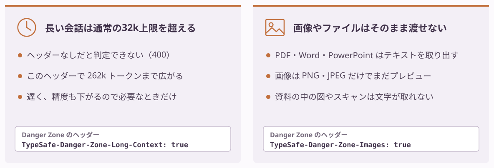

<!--
ファイル：Jev が受け付けるのはテキスト（文字列・JSON・テキストの配列）と、プレビューの画像（PNG・JPEG の静止画）だけ。音声と動画は受け付けないとドキュメントにあり、PDF・Word・PowerPoint はドキュメントに出てこない。判定するなら python-docx・python-pptx・PDF のテキスト抽出などで中身を取り出してから渡す。資料の中のスクリーンショットや図、スキャンした PDF の文字は取り出せないので、画像として渡すか OCR が要る。取り出した全文は長くなりやすいので、ロングコンテキストや分割も考える。今のカスタムガードレールはテキスト以外のブロック（画像・PDF など）が来たら判定せずに 400 で返すので、判定できずに送ってしまうことはない。Claude Code で Word や PowerPoint を読ませたときのリクエストの形は確かめていない。https://docs.typesafe.ai/models
ほかに気をつけること（図からは外した）：
- ブロックした入力は履歴に残る。今の作りでは /clear で会話を消す（伏せて送る設計案は Claude Code の章）。
- Jev に届かないとき（通信の失敗や結果の欠け）は、回答モデルへ流さず 503 を返す。
- 精度は自分のデータで測る。今回は日本語20例と架空の会社の12例で、質問は英語。モデルや設定を替えると結果が変わる例もあった。
画像：Jev は PNG・JPEG の静止画を受け付ける（1.13・1.14）。ただし Dreamer-ready のプレビューで既定は無効、ヘッダー TypeSafe-Danger-Zone-Images: true が要る。Python SDK で画像を扱えるのは v0.7.5（2026-10-14）から。検証は SDK 0.6.0 だったので、今回はテキスト以外の content block を 400 で返す作りにした。PDF は非対応。
Claude Code の上限について（未検証の対策）：今の作りは system の指示・ツールの定義・会話の履歴・tool_result を丸ごと Jev に渡すので、ふつうの使い方では早めに 413 になる見込み（--bare で小さいファイルを読んだ検証では届かなかった。どれくらいで届くかは測っていない）。対策の案は (1) Claude Code が毎回付ける system とツール定義を判定から外す、(2) 判定した発言をハッシュで覚えて新しい発言と tool_result だけ判定する（前にブロックした発言は決まった文に置き換えて送る）、(3) 大きな tool_result を分けて並列に判定する（境目をまたぐ情報は見逃すかもしれない）、(4) ロングコンテキスト 262k（遅く精度も下がる）。
32k は jev-1.13.0 のときの「会話データと最も長い質問の合計」。2026-10-24 時点のドキュメントでは既定がリクエスト全体64k・質問ごと32k、ロングコンテキストを有効にすると262k（ただし遅く、精度も下がると書かれている）。
-->

---

<!-- _class: centered lead-1 -->

# Bedrockでもマネージドに使えるとうれしい

::: speech 私
Jevは速くて、しきい値を自分で決められるのがよいですね！！
ただ外部APIなので、判定する会話はAWS外です・・・
**Bedrockでマネージドに**提供されたら最高ですね！！！
**AWSさんお願いします！！！**
:::

<!--
感想。2026-10 時点で Jev は Bedrock や AWS Marketplace では提供されていない（TypeSafe の API・OpenRouter・Vercel AI Gateway から使う）。
AWS からはオープンソースの決定モデル Strands Decider 2B（Apache-2.0、手元で動かす）が出ている。マネージドで呼べる形になるかはまだ分からない。
-->

---

<!-- _class: book -->

# おまけ・宣伝 11月4日に本が出ます

Amazon BedrockでRAGとAIエージェントを作り、評価して本番で運用するまでを1冊にまとめました。今日少し触れたBedrock Guardrailsの使い方も第1章と第6章に書いています！

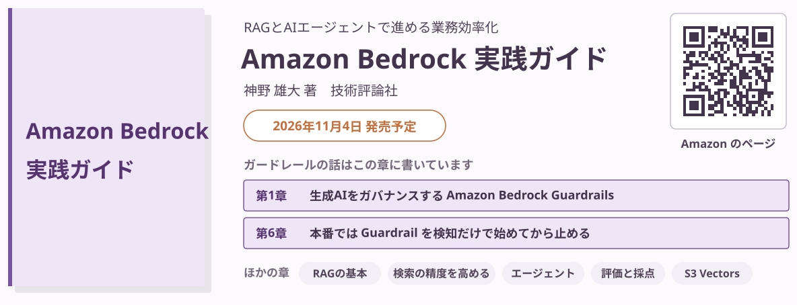

<!--
『Amazon Bedrock 実践ガイド』（技術評論社）、2026年11月4日発売予定。LT（10月29日）の翌週。
第1章「生成AIをガバナンスするAmazon Bedrock Guardrails」、第6章（本番の更新・セキュリティ・監視）で Guardrail を検知だけで始めてから止める段階的な入れ方を書いている。
今日の LiteLLM・Jev の話は本には入っていない。
Amazon：https://www.amazon.co.jp/dp/4297160110
-->

---
<!-- _class: book -->

# おまけ・宣伝 11月19日に大阪で発売記念イベントをします

前半は私のメインセッション、後半はAmazon BedrockとAgentCoreのやってみたLTです！LTの枠も募集しているのでぜひ来てください！！！！

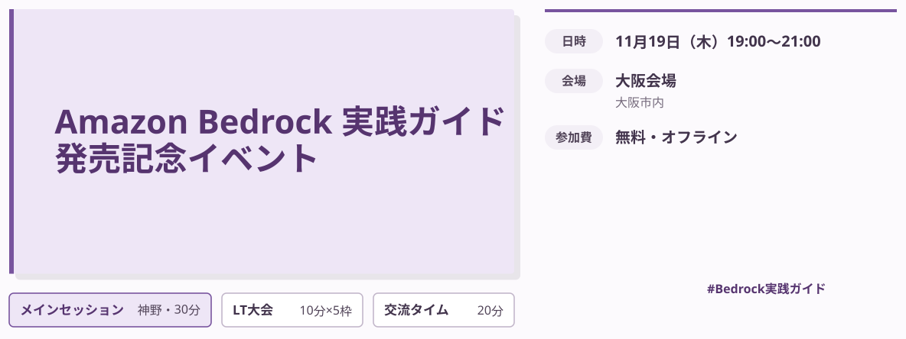

<!--
Bedrock実践ガイド発売記念イベント 大阪会場。2026年11月19日（木）19:00〜21:00、無料。
流れ：オープニング5分、メインセッション30分（神野）、LT大会60分（10分×5枠、テーマ「Amazon Bedrock / AgentCore やってみたLT」）、クロージング5分、交流タイム20分。
ハッシュタグ #Bedrock実践ガイド。申込の人数は変わるので載せていない。
-->


---

<!-- _class: closing back-cover -->

# ありがとうございました

<p class="kicker">Midosuji Tech 意思決定モデルやってみた編</p>

<p class="who"><b>神野 雄大</b>Yudai Jinno</p>

[GitHub · yuu551](https://github.com/yuu551)<br><small>アイコン：Lucide / Feather（[ライセンス](https://github.com/yuu551/jinno-slide-kit/blob/main/THIRD_PARTY_NOTICES.md)）</small>


