<!-- _class: cover cover-talk -->
<!-- _paginate: false -->

# RAGとAIエージェントを 業務で使える形にする

Amazon Bedrock ウェビナー

「答えが違う」と言われたときに どこを見て何を直すか

<b>神野 雄大</b>Yudai Jinno

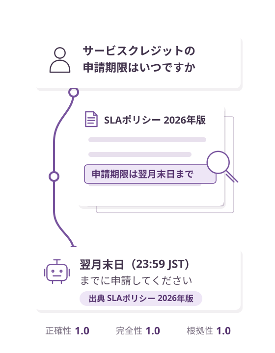

<!--
40分のウェビナー用。
-->

---

<!-- _class: full -->
<!-- _footer: "" -->

# 自己紹介

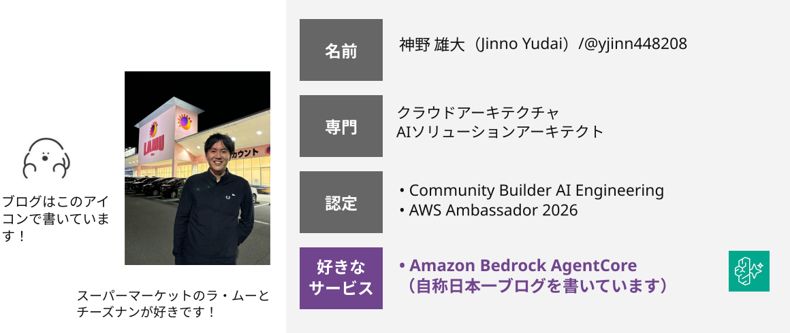

---

<!-- chapter: はじめに -->
<!-- _class: centered lead-1 -->

# Amazon BedrockでRAGを作ったことはありますか

::: speech 私
Knowledge BasesでRAGを作ってみた方、いますか？
よければチャットで教えてください！
:::

---

<!-- _class: centered lead-1 -->

# そのあと業務で使えていますか

::: speech 私
試しに作ったけど「求めている**答えが違う**」と言われて
**次に何を直せばいいか**迷っていませんか？
:::

---

<!-- _class: centered lead-1 -->

# 今日お伝えしたいこと

::: band
RAGは**動かすまで**ならすぐできるようになりましたが、難しいのは「求めている答えが違う」と言われてからの話です。
今日はその先で**知っておくと役に立つこと**を、本を書くために検証した結果と一緒にお話しします！
:::

---

# 対象と目的

RAGやAIエージェントを試したあとの「次に何をするか」を一緒に見ていきます。難しいところはあとから読み返せるように書いています。

::: purpose 1.0
- 対象
  - Amazon BedrockでRAGやAIエージェントを試した、またはこれから試す方
- **目的**
  - 回答がおかしいときに、どこを見て何を直すかを選べるようになる
  - 評価と運用で品質を保つ仕組みのイメージを持ち帰る
:::

---

# アジェンダ

RAGのきほんを押さえてから、検索の直し方・調べて人へ渡すエージェント・点数での確かめ方・更新後の品質の保ち方の順に進みます。

::: agenda 0.98
1. 基礎　Amazon BedrockとRAGのきほん
   Bedrockでできることと、社内の文書を生成モデルに渡す仕組み
2. 検索　答えが違うときにどこを直すか
   欠けた場所の見つけ方と、手だての選び方
3. エージェント　答えがないときに調べて人へ渡す
   止まる条件と、引き継ぎの中身
4. 評価　業務で使えるかを点数で確かめる
5. 運用　文書を更新しても品質を保つ
:::

---

# 架空のSaaS企業の問い合わせ対応で考えます

B2B SaaSのサポート担当者が、顧客からの問い合わせに社内の文書を調べて答える場面です。この題材を最後まで使います。

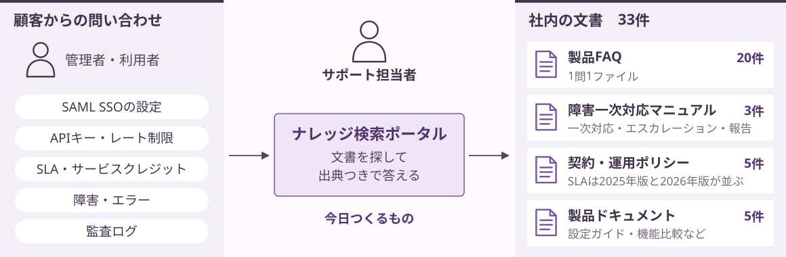

---

# 今日の見取り図

文書から根拠を探し、足りなければ追加で調べて回答か引き継ぎを選びます。その結果を評価して文書と設定を直す。この一周が今日の全体像です。

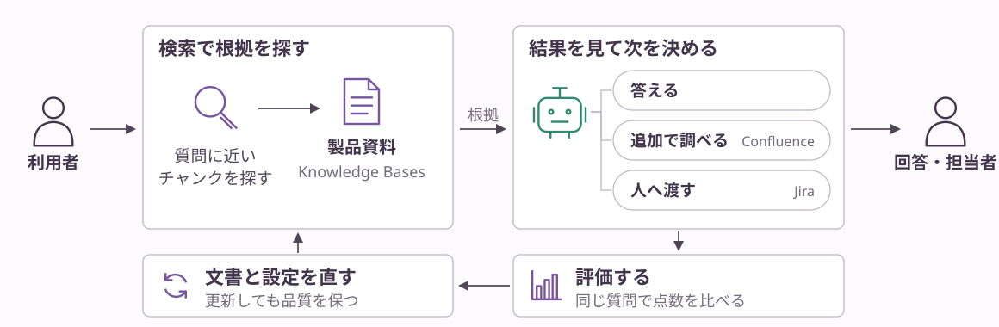

---

<!-- chapter: 基礎 -->
<!-- _class: divider -->

# 基礎 Amazon BedrockとRAGのきほん

まずAmazon Bedrockが何をしてくれるサービスかを見ます。そのあと、生成モデルだけでは答えられないことと、RAGがそこへ何を足すのかを見ていきます。

---

<!-- _class: centered -->

# そもそもAmazon Bedrockって何

::: dialogue 1.0
- 私: よく聞くけど、Amazon Bedrockって何をしてくれるサービスなの？
- Agent君: いろいろな会社の生成モデルを、**同じAPIで呼び出せる**AWSのサービスだよ。
  モデルを動かすサーバーを自分で用意しなくていいんだ！
:::

---

# Amazon Bedrockは生成モデルをAPIで呼び出すサービス

複数の会社の基盤モデルを同じAPIで呼び出せるフルマネージドサービスです。モデルを動かすインフラは要らず、自分で管理するのはアプリだけになります。

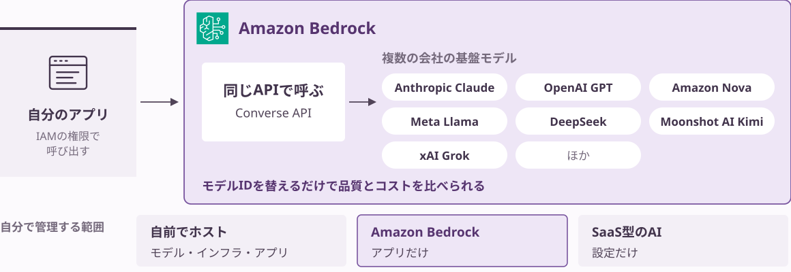

---

# モデルは処理ごとに使い分ける

同じAPIなので、モデルIDを替えるだけで品質と費用を比べられます。本では最終回答・前処理・ベクトル化で別のモデルを使いました。

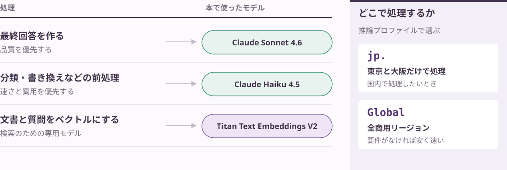

---

# 推論プロファイルで処理するリージョンを選ぶ

モデルIDの頭に付ける推論プロファイルで、処理するリージョンが決まります。国内で完結させるなら jp.、地域の要件がなければ global. が安く処理量も多いです。

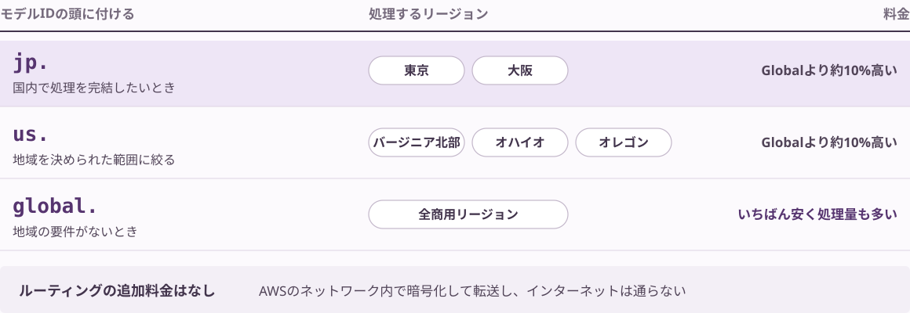

---

# 入力した内容はモデルの学習に使われない

業務で使うときに最も聞かれる不安です。Bedrockでは入力した内容が基盤モデルの学習に使われず、モデルの提供元にも共有されません。一部のモデルには例外があります。

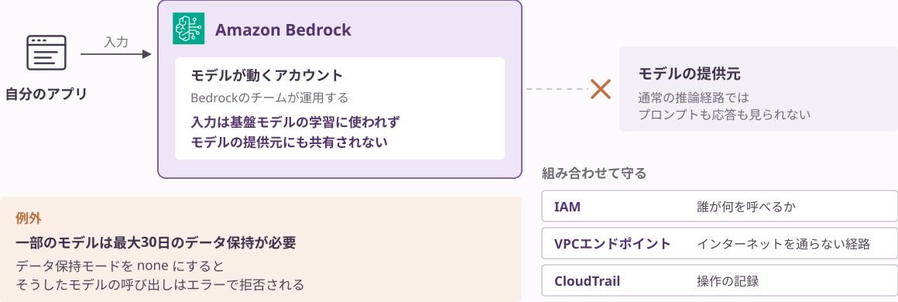

---

# Guardrailsで入力と出力を確かめて止める

モデルに渡す前の入力と、返す前の出力の両方を確かめる仕組みです。答えない話題や個人情報を決めておくと、引っかかったときに止めるか伏せ字にして返します。

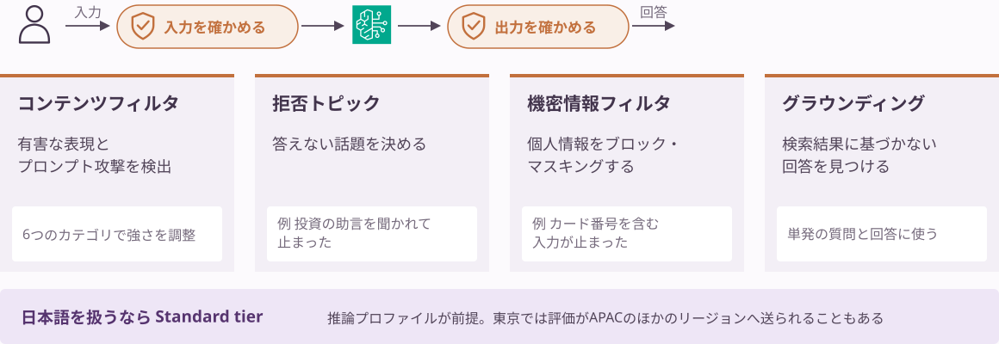

---

# Bedrockの機能と今日の話

モデルを呼び出すAPIに加えて、生成AIのアプリを作って運用するための機能があります。今日はこのうち4つを章ごとに使っていきます。

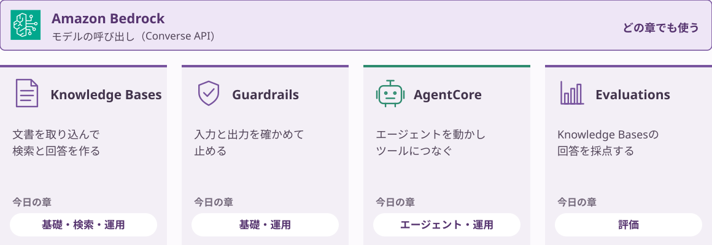

---

# 生成モデルは社内の文書を知らない

生成モデルはサンプルコネクト社のSLAポリシーを学習していません。そのまま聞くと答えられないか、もっともらしい別の答えが返ってきます。

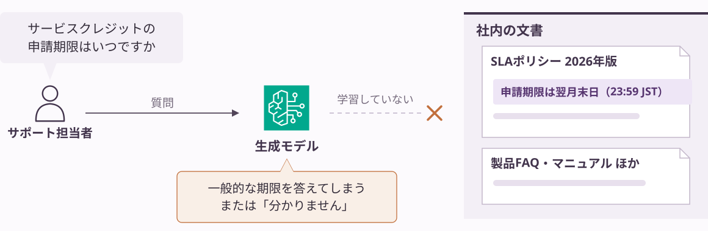

---

# RAGは先に文書を探して質問と一緒に渡す

RAGは質問に近い文書を先に探し、その中身を質問と一緒にモデルへ渡す方法です。Knowledge Basesは取り込みから検索と回答生成までをまとめて引き受けます。

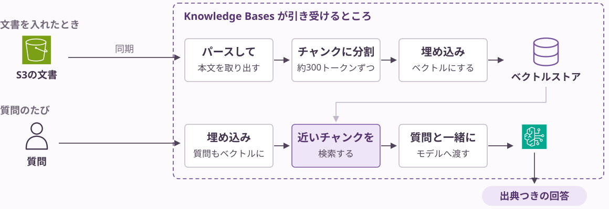

---

<!-- _class: centered -->

# どうやって近い文書を探しているの

::: dialogue 1.0
- 私: 「近い文書を探す」って、キーワード検索とは違うの？
- Agent君: 文書を**チャンク**という断片に切って、意味を数値の並び（**ベクトル**）にしておくんだ。
  質問もベクトルにして、**距離が近い**断片を取り出すよ。
:::

---

# 文書を切って意味の近さで探す

文書は既定で約300トークンずつのチャンクに切って登録されます。質問も同じ埋め込みモデルでベクトルにして、距離の近いチャンクを取り出します。

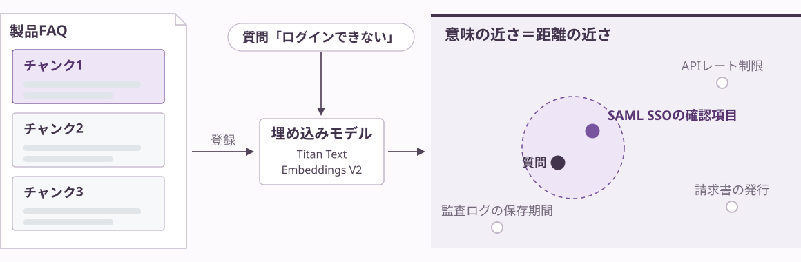

---

# 文書は取り込みやすい単位に整えてから置く

FAQを2問まとめたファイルでは1つのチャンクに別の質問が混ざります。改定版も同じファイルに追記せず、別のファイルにして日付のメタデータを付けておきます。

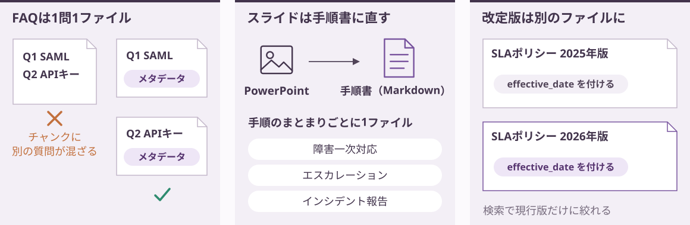

---

# ベクトルストアは小さく始めるならS3 Vectors

本の小さな検証ではS3 VectorsとOpenSearch Serverlessで取れる文書も回答の評価もほぼ同じでした。ハイブリッド検索や低レイテンシが要る段階で切り替えます。

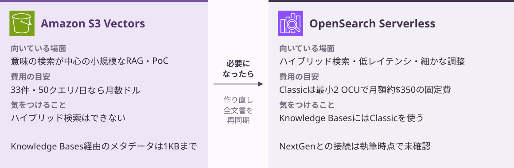

---

# 検索基盤ごとAWSに任せるManaged Knowledge Base

ベクトルストア・埋め込み・パーサー・リランキングを選ばずに、データソースをつなぐだけで検索できます。安さより、まとめて任せられることで選びます。

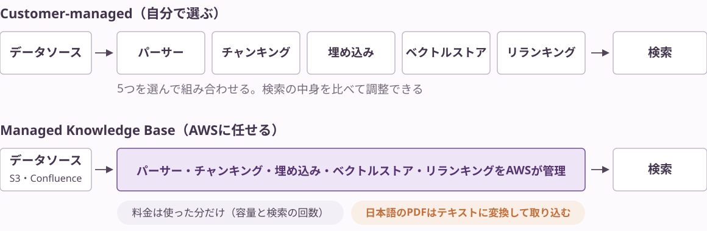

---

# 後から変えにくいものだけ最初に決める

チャンキングやパーサーに最初から凝ると、回答の差がどの設定から来たのか分からなくなります。デフォルトで動かし、変えにくい2つだけ先に選びます。

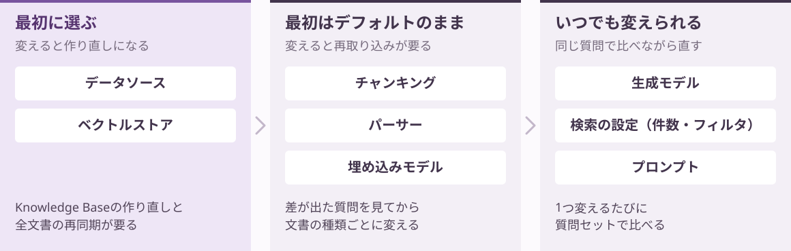

---

<!-- _class: centered -->

# 動いたけれど答えが違うと言われた

::: dialogue 1.0
- 私: 検証画面を配ったら、さっそく「答えが違う」って言われちゃった…。
  チャンクを変える？リランキングを足す？
- Agent君: 手だてを選ぶ前に、**どこで欠けたか**を見に行こう！
  直す場所は1つじゃないんだ。
:::

---

<!-- chapter: 検索 -->
<!-- _class: divider -->

# 検索 答えが違うときにどこを直すか

うまく答えないとき、直す場所は1つではありません。欠けた場所を見つけてから、それに合う手だてを選びます。

---

# 検索は根拠を取り出すところ

見取り図の左側です。質問を受けてから根拠を取り出すまでのあいだで、期待した情報が欠ける場所を探していきます。

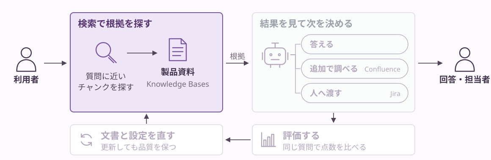

---

# 「答えが違う」は欠けた場所で直し方が変わる

文書にないのか。取り込みや検索で落ちたのか。渡したあとに落ちたのか。同じ「答えが違う」でも最初に直す場所が違います。

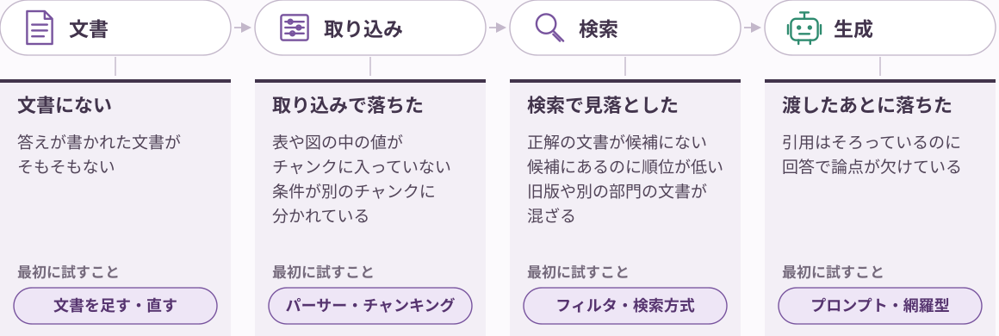

---

# 手だては改善マップから選ぶ

本で検証した手だてを欠ける場所ごとに並べた地図です。困りごとから手だてを1つ選び、同じ質問セットで比べます。ここからはこの地図に沿って見ていきます。

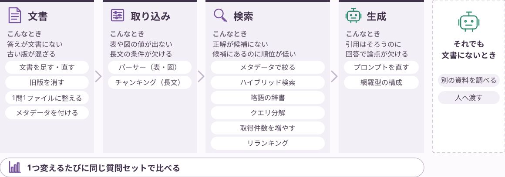

---

# まずは文書と取り込みを見直す

関係ない文書が出る、古い版で答える。こうした問題は検索の方式より、文書と取り込みに原因があることが多いです。

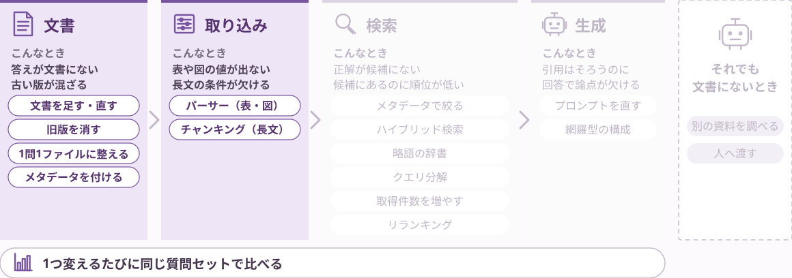

---

# メタデータはAIに付けさせても型はスキーマで固める

文書ごとのメタデータは生成モデルに付けさせると楽です。ただ自由に書かせると日付や配列の型が揺れて、範囲指定のフィルタが動きません。

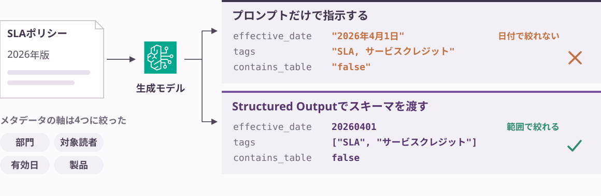

---

<!-- _class: centered -->

# 文書を直してもまだ出てこない

::: dialogue 1.0
- 私: 文書もチャンクも見直したのに、まだ出てこない質問があるんだよね…。
- Agent君: 正解の文書が**候補に入っていない**のか、**入っているのに順位が低い**のか。
  それで次に試すことが変わるよ！
:::

---

# 次は検索の手だてを選ぶ

文書と取り込みを見直しても出てこないなら、次は検索を見直します。正解が候補にないのか、候補にあるのに順位が低いのかで選ぶ手だてが変わります。

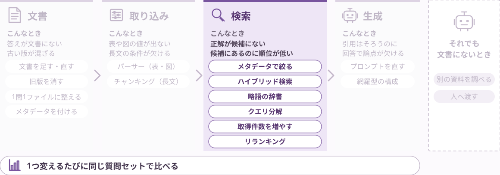

---

# 社内の略語は検索の前に正式な名前へ書き換える

ハイブリッド検索でも文書に出てこない略称はヒットしません。単純な文字列の置換は別の語まで巻き込むので、軽量モデルに書き換えさせます。

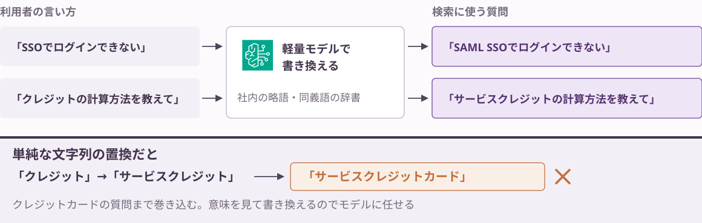

---

# 最後は渡したあとの生成を見る

引用には正解の文書が並んでいるのに、回答で論点が欠けることがあります。このときは検索ではなく、渡したあとの組み立て方を見直します。

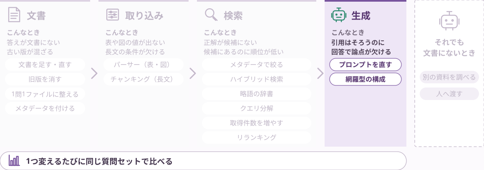

---

<!-- _class: centered lead-1 -->

# 検索のまとめ

::: band
まず**どこで欠けたか**を見る。
手だては**1つずつ**足して、**同じ質問セット**で比べる。
:::

---

<!-- _class: centered -->

# そもそも文書に答えがないときは

::: dialogue 1.0
- 私: 検索はだいぶ良くなった！でも文書に答えが書いていない問い合わせも来るよね。
- Agent君: そこからは、検索の結果を見て**次の行動を選ぶ**エージェントの出番だよ。
  ほかの資料を調べて、それでもだめなら**人へ渡そう**。
:::

---

<!-- chapter: エージェント -->
<!-- _class: divider -->

# エージェント 答えがないときに調べて人へ渡す

検索を直しても、文書に答えがない問い合わせは残ります。ここからは結果を見て次の行動を選ぶ作りにします。

---

# エージェントは結果を見て次を決めるところ

見取り図の右側です。検索の結果を見てから次の行動を選ぶ作りにして、追加の調査と人への引き継ぎまでつなげます。

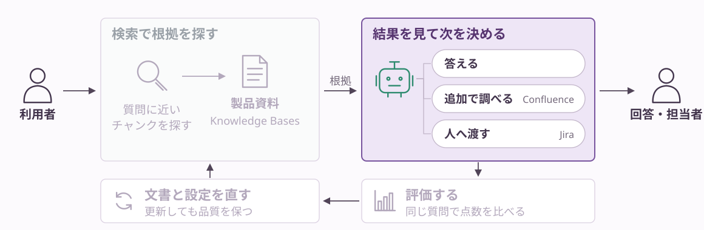

---

# RAGを捨てずにエージェントの行動の1つにする

これまでのRAGは「探して答える」の一方通行でした。エージェントは検索を行動の1つとして持ち、結果が足りなければ別の資料を調べるか人へ渡します。

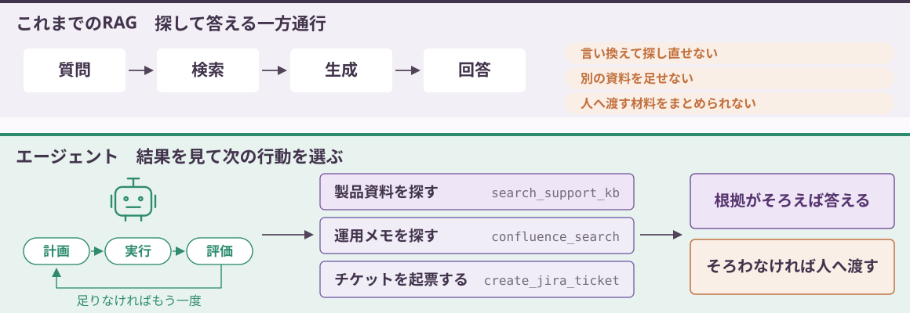

---

# ツールはモデルが選びアプリが実行する

ツールは検索や起票を実際に行う関数です。モデルはツールと引数を選ぶだけで、実行するのはアプリです。アプリが結果を返すと、モデルは次の判断に進みます。

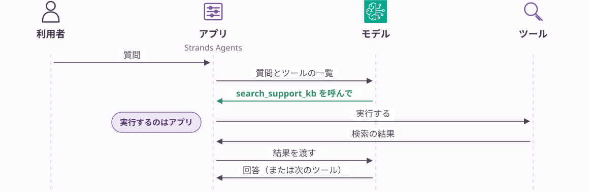

---

# 人へ渡すときは調べた中身ごと渡す

質問をそのまま転記すると、担当者は最初から調べ直しになります。確認した資料と、分かったこと・分からないことを分けて書いておけば続きから始められます。

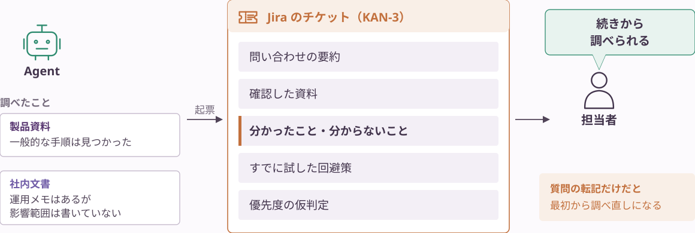

---

# 答えずに止まる条件を先に決めておく

本では「この止まる判断こそが質を決めます」と書きました。根拠が足りないときに、それらしい回答を作らせないための条件です。

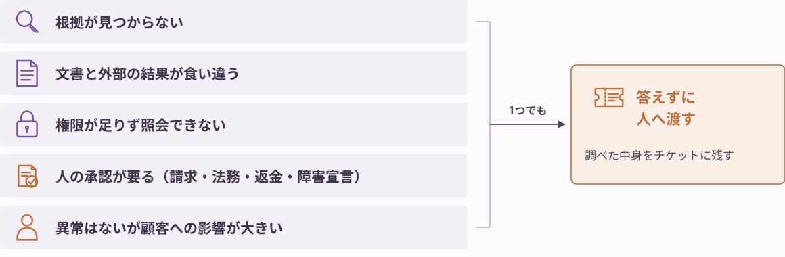

---

<!-- _class: centered -->

# ツールはどのくらいの大きさで作るの

::: dialogue 1.0
- 私: ツールって、どのくらいの単位で作ればいいの？
  全部まとめた大きいツール1つでもいい？
- Agent君: **業務として意味のある操作1つ**が目安だよ。
  大きすぎても細かすぎても、選び間違えやすくなるんだ。
:::

---

# ツールは業務の操作1つ分で切る

処理を1つのツールに詰め込むと何が起きたか追えず、細かく割るとツールが増えて選び間違えます。ツールの数が増えるほど、選ぶ精度は下がります。

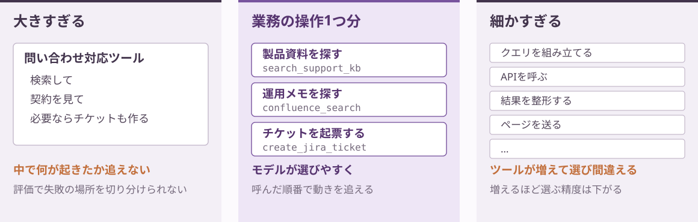

---

# 書き込めるツールは起票だけに絞る

回答を確定するまでは検索のツールだけで進めます。説明文に書いた条件は実行を止める仕組みにはならないので、実行する側でも範囲を決めます。

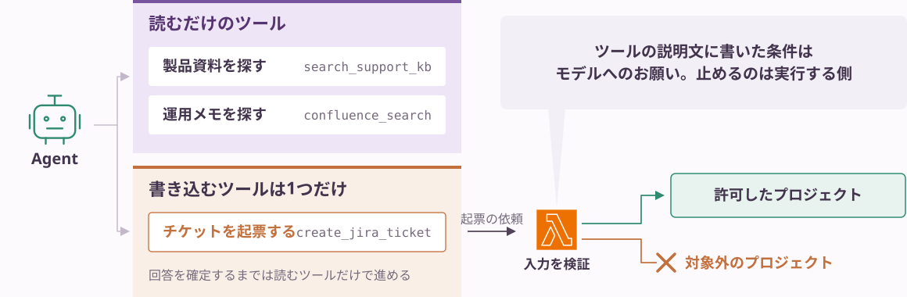

---

# この流れをAWSで組むとこうなる

AgentCore Runtimeに置いたAgentがBedrockのモデルを使い、Knowledge Basesで製品資料を探します。ConfluenceやJiraへの接続はAgentCore Gatewayにまとめます。

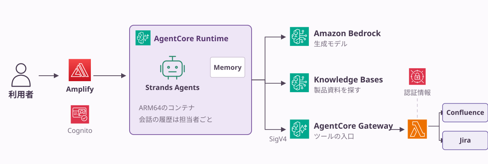

---

# 判断の手順が増えたらスキルとして外へ出す

ルーティングの手順やエスカレーションの基準をシステムプロンプトに足し続けると、毎回すべてを読ませることになります。名前と説明だけ先に渡し、必要なときに全文を読ませます。

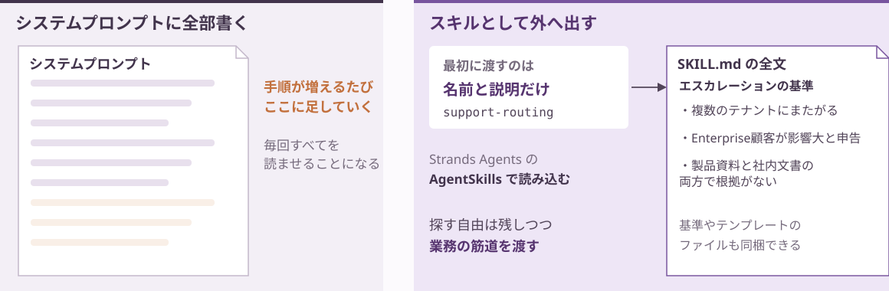

---

<!-- _class: centered lead-1 -->

# エージェントのまとめ

::: band
エージェントの質は**止まれるか**で決まる。
止まったら、**調べた中身ごと**人へ渡す。
:::

---

<!-- _class: centered -->

# ちゃんと動いているとどう言えばいいの

::: dialogue 1.0
- 私: 動いた画面を見せたら「良さそうだね」って言われた！
  …でも、なんとなく良さそうで本番に出していいのかな？
- Agent君: 質問ごとに**期待する答えと根拠**を書いて、点数で比べよう。
  直したあとも同じ質問で確かめられるよ。
:::

---

<!-- chapter: 評価 -->
<!-- _class: divider -->

# 評価 業務で使えるかを点数で確かめる

精度を「何となく」で語らないために、期待する答えを先に書いて、同じ基準で何度でも比べられるようにします。

---

# 評価は一周したあとに確かめるところ

見取り図の下段です。質問と期待する答えを先に書いておき、検索やエージェントを変えるたびに同じ基準で確かめます。

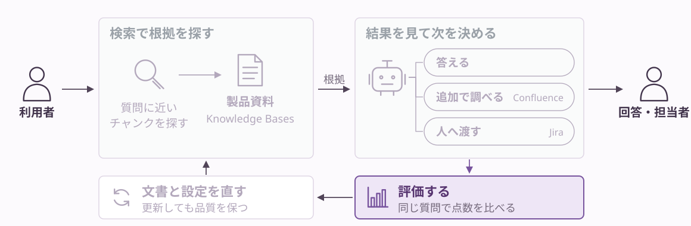

---

# 失敗を4つに分けると直す場所が決まる

RAGでは検索と回答、エージェントではさらに行動と判断で失敗します。答えの点数だけを見ていると、どこを直せばよいかが分かりません。

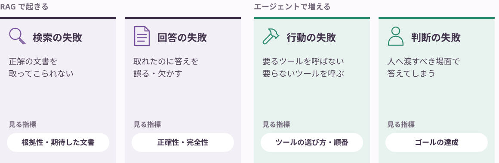

---

# 評価ケースは質問と期待する要点と根拠を1行にする

期待する要点と文書を持たせておけば失敗を読み分けられます。要点が欠けたら回答の問題で、文書が出てこなければ検索の問題です。

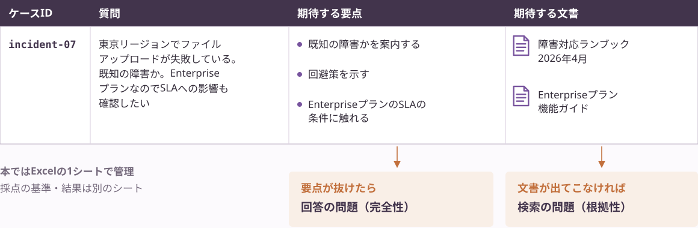

---

# 評価ケースは失敗しそうな質問から入れる

まずは件数の多い問い合わせで品質を固めます。そのうえで、間違えやすい5つの型を足していきます。全部を用意してから始める必要はありません。

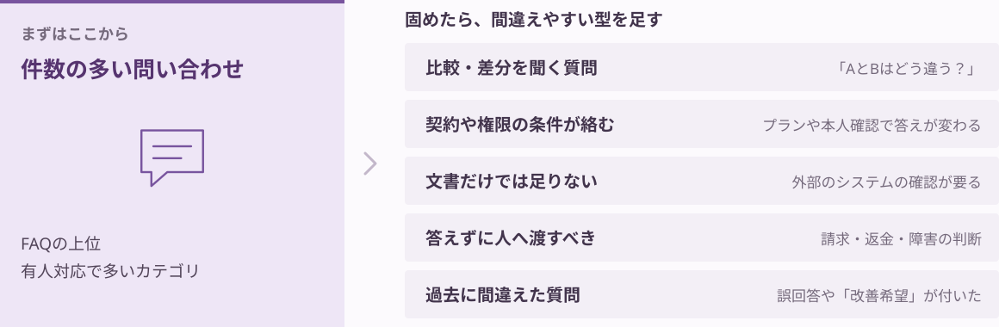

---

# 採点役のLLMが見ているのは渡した4つだけ

LLMにまとめて採点させると楽ですが、採点役は検索の中身も文書の全体も見ていません。採点の基準が曖昧なら、推測で点を付けてしまいます。

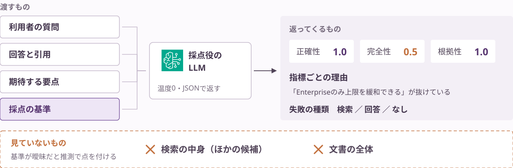

---

<!-- _class: centered -->

# エージェントも同じ採点でいいの

::: dialogue 1.0
- 私: エージェントも、答えの点数を見ればいいの？
- Agent君: 答えが正しくても、**途中で余計なことをしている**ことがあるんだ。
  どのツールをどの順番で呼んだかも採点しよう！
:::

---

# 評価の道具は目的で選ぶ

本ではまずExcelと自前のスクリプトで始めました。業務固有の採点基準を調整しやすいからです。運用をAWSへ寄せたくなったらマネージドの評価へ広げます。

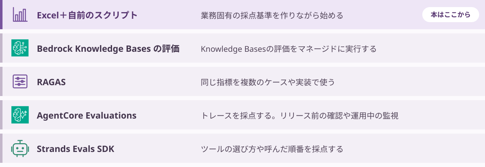

---

<!-- _class: centered lead-1 -->

# 評価のまとめ

::: band
評価ケースを**先に**書いておけば、改善のたびに**同じ基準**で比べられる。
点数が下がったら、**回答と根拠を読んで**理由を確かめる。
:::

---

<!-- _class: centered -->

# 文書はこれからも増える

::: dialogue 1.0
- 私: 評価の仕組みはできた！でも文書は毎週のように更新されるよね。
  そのたびに手で確かめるの？
- Agent君: 取り込んだあとに**自動で採点して**、下がったら止めればいいんだよ。
:::

---

<!-- chapter: 運用 -->
<!-- _class: divider -->

# 運用 文書を更新しても品質を保つ

答え方と確かめ方は決まりました。あとは文書が増えたり直ったりしても、この品質を保てるようにします。

---

# 運用は一周を続けていくところ

見取り図の下の矢印です。文書と設定を直したら同じ基準で確かめ、利用者の声を次の評価ケースにします。

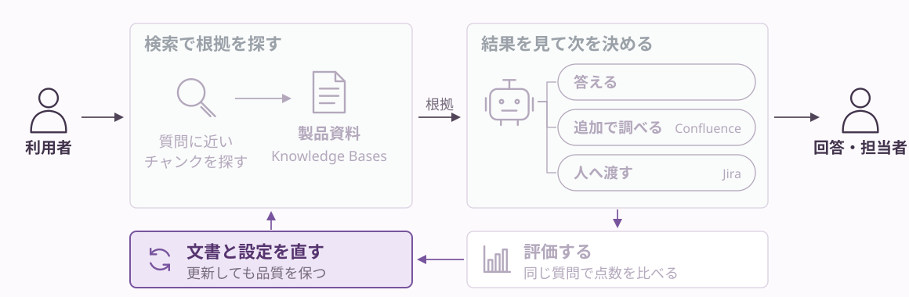

---

# 本番の事故は性能より運用の設計から起きる

本の第6章は本番で起こりがちな3つの事故から始めました。どれもモデルの性能ではなく、更新・構築・監視の設計の問題です。

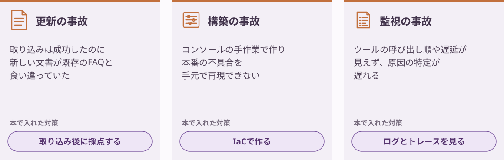

---

# 取り込みのあとに採点して採用するかを決める

取り込みのジョブが成功しても新しい手順が既存のガイドと矛盾していることがあります。同期のあとに評価ケースを流し、前回の結果と比べてから採用します。

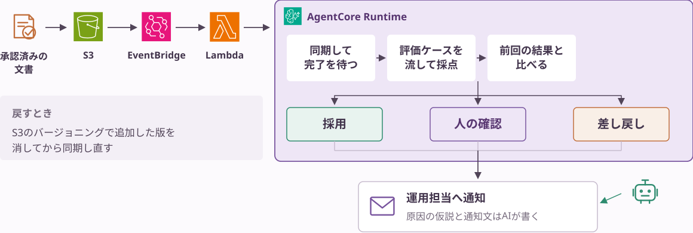

---

# 判定はコードで固定しAIには説明だけ任せる

処理の順番や合否の判定までモデルに任せると、同じ結果になる保証がありません。決まった処理はコードに書き、AIには原因の仮説と通知文だけを作らせます。

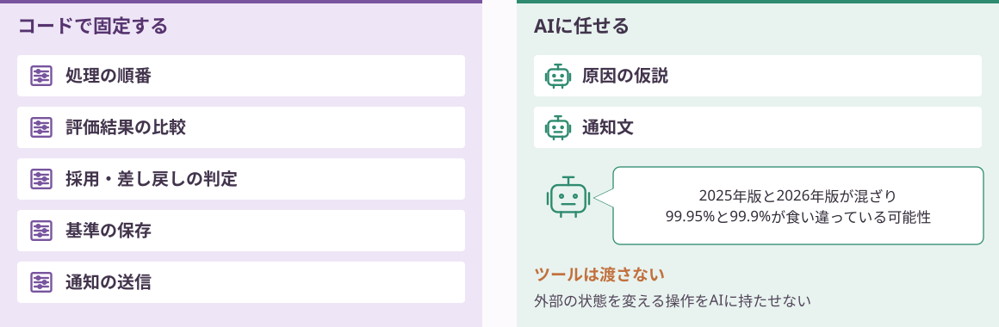

---

<!-- _class: centered -->

# 評価ケースはどこから増やすの

::: dialogue 1.0
- 私: 評価ケースを増やしたいけど、自分で考えた質問だけだと偏りそう…。
- Agent君: いちばんの材料は**利用者の声**だよ！
  フィードバックを集める仕組みを最初から置いておこう。
:::

---

# フィードバックを集めよう

開発者が評価で見つける問題と、現場の利用者が感じる不満は違います。利用者の声を最初から集めておくと、次の評価ケースと文書の更新の材料になります。

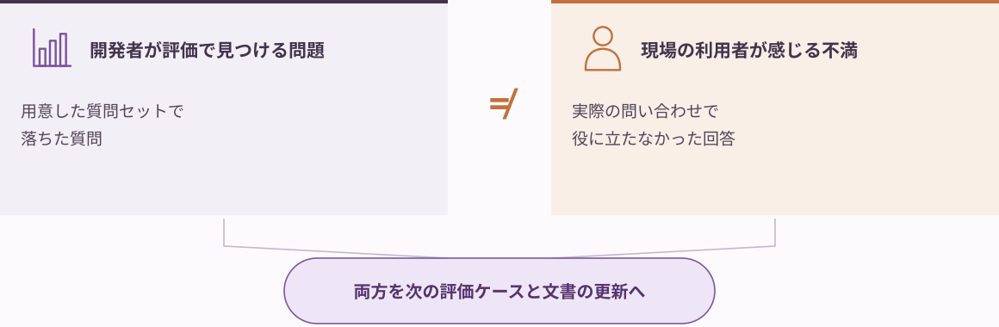

---

# フィードバックは明示的なものと暗黙的なものを集める

ボタンやコメントで送られる声に加えて、聞き直しや離脱のような行動も材料になります。ログをセッションでひも付けておけば、低い評価が付いた回答のどこが悪かったかをたどれます。

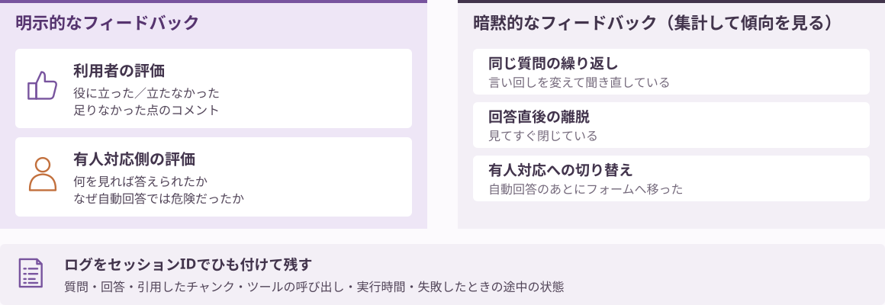

---

# ボタンは置いただけでは押してもらえない

ボタンに気づかない、わざわざ評価するほどでもないと感じる。こうしたことは珍しくありません。回答のすぐ近くに置き、ワンタップで終わるようにします。

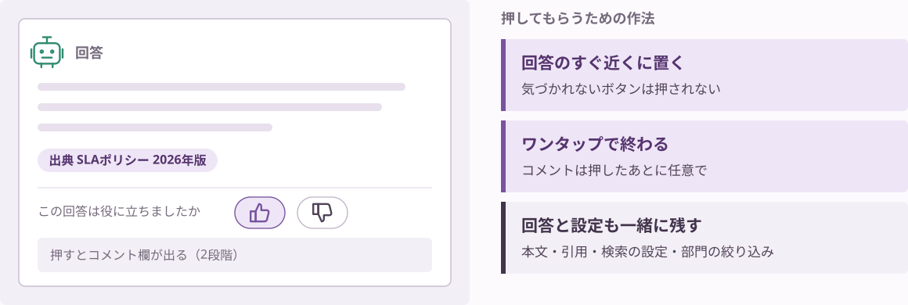

---

# 利用者の声を次の評価ケースと文書の更新につなぐ

回答に付いた「改善希望」は評価ケースの候補になります。更新案は軽量モデルに作らせますが、文書の更新そのものは人が承認してから反映します。

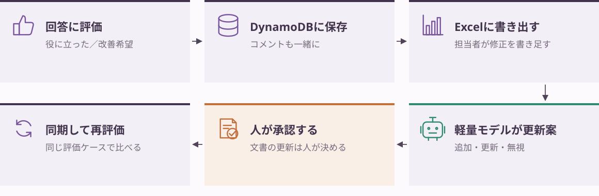

---

# 人へ渡した問い合わせはいちばんの改善材料になる

自動で答えられなかった理由はそのまま次に足す文書と評価ケースのヒントです。引き継ぎのチケットに、足りなかった根拠を書く欄を置いておきます。

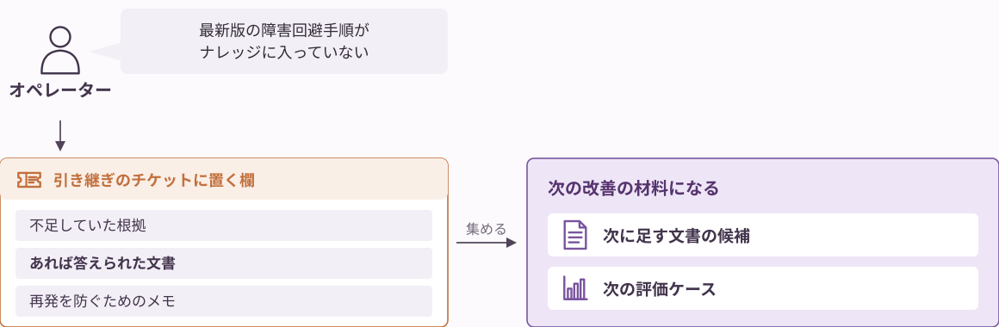

---

# 本番で考えることは分ける・守る・見る・抑えるの4つ

全部を最初から作る必要はありません。困りそうなところから手を付けます。

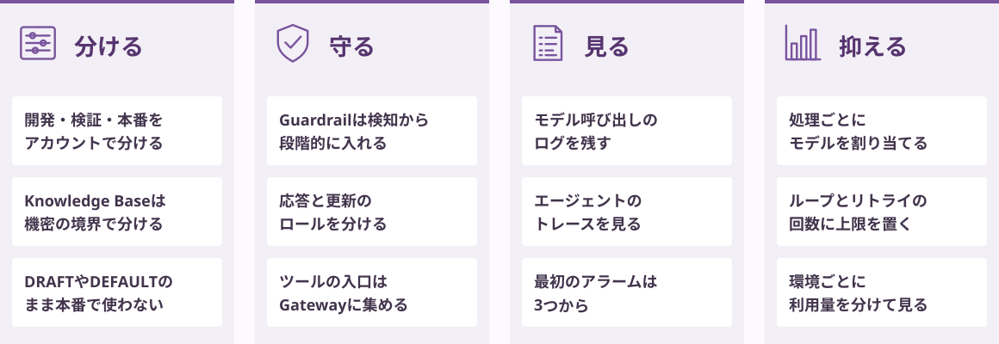

---

# 応答用のロールに更新の権限を持たせない

問い合わせに答えるロールに文書を更新する権限まで入れると、ツールの不具合がそのままナレッジの更新事故になります。呼び出す側の役割ごとにロールを分けます。

---

# Guardrailは検知だけで始めてから止める

いきなり止めると、業務に必要な質問まで止めてしまいます。まず検知だけで1〜2週間動かし、誤検知を見ながら強さを決めてからブロックに切り替えます。

---

# コストはモデルの割り当てとループの上限で決まる

エージェントは1回の依頼で何度もモデルを呼びます。単価を比べる前に、処理ごとのモデルと追加で調べてよい回数を決めます。

---

<!-- _class: centered lead-1 -->

# 運用のまとめ

::: band
取り込めた、で終わらせない。**採点してから採用**する。
**利用者の声**を最初から集めて、次の評価ケースにする。
:::

---

<!-- chapter: まとめ -->
<!-- _class: divider -->

# まとめ 明日から何を始めるか

一度に全部は作れません。最後に今日の話から最初の一歩を選びます。

---

# 今日持ち帰ってほしいこと

うまく答えないときに、次に何を試すかを1つ選べる。まずはその状態を目指しましょう！

---

# 明日はまず評価ケースを1件作ってみる

最初から全部の機能を入れる必要はありません。よく来る問い合わせを1つ選び、期待する答えと根拠を書く。答えがないときの動きも書く。まずはそこまでで十分です。

---

<!-- _class: book -->

# おまけ・宣伝 今日の話を1冊にまとめました

RAGの構築から本番の運用まで、今日の題材を章をまたいで育てていく本です。

---

# サンプルコードはGitHubで公開しています

今日紹介した検証は本のサンプルで再現できます。自分のAWSアカウントで試してみてください。

::: links cols-1
- [amazon-bedrock-practical-guide-samples](https://github.com/yuu551/amazon-bedrock-practical-guide-samples): 章ごとのサンプルコードと補足資料。GitHub Codespacesならブラウザだけで始められます
:::

---

<!-- _class: lead-1 -->

# おわりに

ご清聴ありがとうございました！今日の話が、お使いのRAGを**もう一歩業務に近づけるきっかけ**になれば嬉しいです。

::: prose 1.0
「答えが違う」と言われたら、まずどこで欠けたかを見てみてください。
そして評価ケースを1件だけ書いて、回答の近くにフィードバックのボタンを置いてみてください。そこから少しずつ良くしていけます。

RAGやAgentCoreで迷っていることがあれば、気軽に声をかけてください！
:::

---

<!-- _class: closing back-cover -->

# ありがとうございました

Amazon Bedrock ウェビナー

<b>神野 雄大</b>Yudai Jinno

[GitHub · yuu551](https://github.com/yuu551) <small>アイコン：Lucide / Feather（[ライセンス](https://github.com/yuu551/jinno-slide-kit/blob/main/THIRD_PARTY_NOTICES.md)）</small>

