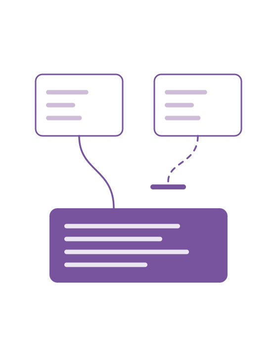
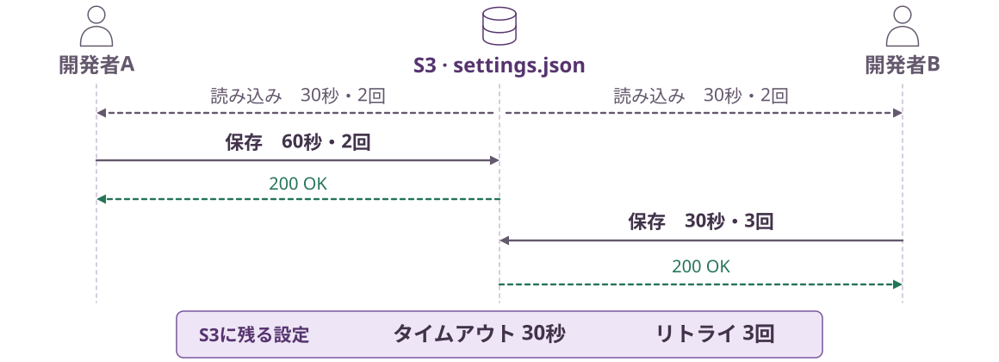
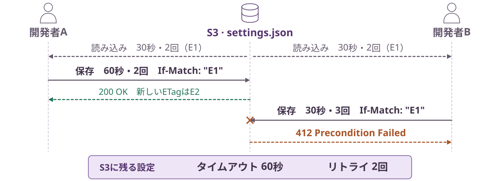
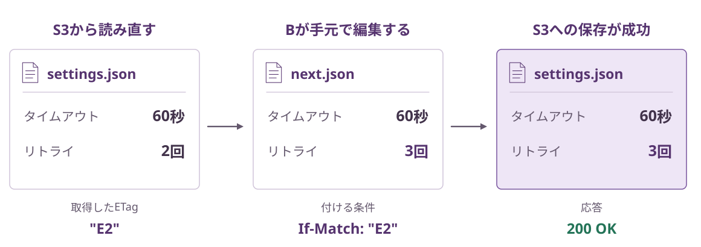

<!-- _class: cover cover-talk -->
<!-- _paginate: false -->

# Amazon S3の<br>条件付き書き込み

<p class="kicker">AWS アップデート解説</p>

<p class="sub">2人が同じ設定ファイルを編集したとき、<br>先に保存した変更をどう守るか</p>

<p class="who"><b>神野 雄大</b>Yudai Jinno</p>



<!--
この資料では、アプリのタイムアウトとリトライ回数をS3のsettings.jsonに保存する例を使います。ファイルの中身、処理の順番、短縮したETagは説明用です。最後には初回作成と更新で条件を選び、書き込みが拒否されたときに次の操作を判断できます。
[Amazon S3 ユーザーガイド・条件付き書き込み](https://docs.aws.amazon.com/AmazonS3/latest/userguide/conditional-writes.html)
-->

---

<!-- _class: lead-s -->
<!-- _footer: "" -->

# S3が保存時に確認できる2つの条件

同じキーに書き込むとき、**初回の作成**と**既存ファイルの更新**で条件を選べます。キーはバケット内のファイル名にあたります。

| AWS発表日 | settings.json を保存したい場面 | リクエストに付ける条件 |
| --- | --- | --- |
| 2024年8月20日 | 同じキーにまだファイルがないとき | `If-None-Match: *` |
| 2024年11月25日 | 読んだときと現在のETagが一致するとき | `If-Match: "E1"` |

> ETagはS3がオブジェクトの内容に対応して返す値です。この例のE1は読み込み時のETagの略記です。

<!--
最初の発表でPutObjectとCompleteMultipartUploadがキーの存在を判定できるようになりました。11月の追加機能は、クライアントが読んだ内容とS3の現在の内容の照合です。ETagはそのまま保存して渡す文字列です。自前でハッシュを計算する必要はありません。バージョンIDとは別の値です。
[2024年8月20日のAWS発表](https://aws.amazon.com/about-aws/whats-new/2024/08/amazon-s3-conditional-writes/)
[2024年11月25日のAWS発表](https://aws.amazon.com/about-aws/whats-new/2024/11/amazon-s3-functionality-conditional-writes/)
-->

---

<!-- _class: lead-s -->
<!-- _footer: "" -->

# 条件なしで保存すると先に変えたタイムアウトが戻る

2人が同じ設定を読み、Aはタイムアウトを30秒から60秒に変えます。Bがリトライを2回から3回に変えてファイル全体を保存するとタイムアウトは30秒に戻ります。



<!--
同一バケット、同一キーでバージョニングを無効にした汎用バケットを例にしています。左右の実線はPutObject、破線はS3の応答です。時間は上から下に進みます。2人が触った項目は別ですが、S3に書き込む単位はオブジェクト全体です。Bの手元ではタイムアウトがまだ30秒のため、無条件で保存するとAの編集が失われます。
[PutObject API](https://docs.aws.amazon.com/AmazonS3/latest/API/API_PutObject.html)
-->

---

<!-- _class: lead-s -->
<!-- _footer: "" -->

# If-Matchを付けると古い設定の保存を止められる

2人が読んだETagをE1とします。Aが保存するとETagはE2に変わるので、E1を指定したBにはS3が **412 Precondition Failed** を返します。



<!--
前のページと設定値も要求の順番も同じです。違いは保存要求に読み込み時のETagを付けたことです。図のE1とE2は説明用の略記です。AのIf-Matchは一致し、Aの変更が反映されます。BのIf-Matchは不一致で、S3はBの内容を書き込みません。
[Amazon S3 ユーザーガイド・条件の評価と応答](https://docs.aws.amazon.com/AmazonS3/latest/userguide/conditional-writes.html#conditional-error-response)
-->

---

<!-- _class: lead-s -->
<!-- _footer: "" -->

# 初期設定を作るときは If-None-Match を使う

`*` を渡すと、S3は同じキーにファイルがあるかを保存時に調べます。同じ名前で初期設定を作る処理をもう一度実行しても、既存の設定を残せます。

```bash AWS CLI｜初期設定を作成する
printf '%s\n' '{"timeout":30,"retries":2}' > settings.json
aws s3api put-object --bucket "$BUCKET" --key settings.json \
  --body settings.json --if-none-match '*'
```

| 書き込み時の settings.json | S3の応答 |
| --- | --- |
| まだ存在しない | 200 OK で作成 |
| すでに存在する | 412 Precondition Failed で作成を拒否 |

<!--
BUCKETには書き込み権限のある汎用バケット名を設定します。以下のCLI例はPOSIX系シェル用です。引用符はアスタリスクがシェルで展開されるのを防ぎます。表の200と412はHTTPステータスで、CLIの通常出力は成功時にETagなどを含むJSONです。同じ未作成キーに2つの条件付き書き込みが競合し、削除がなければ先に完了した方が成功します。バージョニング有効時は現在のバージョンを判定し、現在が削除マーカーなら作成できます。
[Amazon S3 ユーザーガイド・条件付き書き込み](https://docs.aws.amazon.com/AmazonS3/latest/userguide/conditional-writes.html)
[AWS CLI put-object](https://docs.aws.amazon.com/cli/latest/reference/s3api/put-object.html)
-->

---

<!-- _class: lead-s -->
<!-- _footer: "" -->

# 更新には読み込み時のETagを渡す

Bは1回の読み込みで `settings.json` の中身とETagを取得します。リトライを3回にしたファイルを送り、保存の条件にそのETagを使います。

```bash AWS CLI と jq｜リトライ回数を変更する
etag=$(aws s3api get-object --bucket "$BUCKET" --key settings.json \
  --query ETag --output text current.json) &&

jq '.retries = 3' current.json > next.json &&

aws s3api put-object --bucket "$BUCKET" --key settings.json \
  --body next.json --if-match "$etag"
```

<!--
AWS CLIとjqを使う例です。BUCKETは前ページと同じ汎用バケットです。get-objectはオブジェクト本体をcurrent.jsonに保存し、同じ応答のETagを標準出力に返します。シェル変数etagに入った値はそのまま渡してください。取得と編集が成功したことを確認してからPUTします。読み込み後にAが編集していれば、4枚目の図のとおりBのPUTは412です。保存の直前にETagだけを取り直すと、編集したファイルと取得元が食い違います。
[AWS CLI get-object](https://docs.aws.amazon.com/cli/latest/reference/s3api/get-object.html)
[AWS CLI put-object](https://docs.aws.amazon.com/cli/latest/reference/s3api/put-object.html)
-->

---

<!-- _class: lead-s -->
<!-- _footer: "" -->

# 更新が412で止まったら最新の内容を読み直す

BはAが保存した「60秒・2回」を読み直し、リトライだけを3回に変えます。新しく取得したE2を付けて保存すれば、Aの60秒も残ります。



<!--
これはBが412を受けた後に、さらに別の書き込みが入らなかった場合の例です。Bが実行するのは前ページのGETからPUTまでの一連の操作です。古いnext.jsonと新しいETagを組み合わせるとAの変更を上書きするので、本文と条件値を同じ読み込みから作ります。同じ項目を2人が編集した場合は、どちらの値を採用するかをアプリ側で決めます。
412のほか、同時操作で409 ConditionalRequestConflictが返る場合があります。PutObjectの更新なら最新の状態を取得してから再試行し、CompleteMultipartUploadの409ではマルチパートアップロードを開始し直して各パートを再送します。If-Matchで現在の対象が存在しない場合は404です。
[Amazon S3 ユーザーガイド・条件の評価と応答](https://docs.aws.amazon.com/AmazonS3/latest/userguide/conditional-writes.html#conditional-error-response)
[CompleteMultipartUpload API](https://docs.aws.amazon.com/AmazonS3/latest/API/API_CompleteMultipartUpload.html)
-->

---

<!-- _class: lead-s -->
<!-- _footer: "" -->

# 共有ファイルに書き込むすべての経路で条件を使う

別の処理が条件を省くと、その処理は設定を上書きできます。汎用バケットならバケットポリシーで特定のキーへの条件付き書き込みを必須にできます。

| settings.json の保存経路 | 条件を付ける操作 | S3が確認する対象 |
| --- | --- | --- |
| ファイルをアップロード | `PutObject` | 保存先のキー |
| 分割してアップロード | `CompleteMultipartUpload` | 分割したデータを結合する時点の保存先 |
| 別の場所からコピー | `CopyObject` | コピー先のキー（2025年10月29日追加） |

> 条件付き書き込みは全AWSリージョンの汎用バケットとディレクトリバケットに対応します。条件の評価は追加料金なしで、通常のリクエスト料金が適用されます。

<!--
初期設定を守るならIf-None-Match: *、編集内容を守るなら読み込み時のETagを使ったIf-Matchです。設定の配布ツールやコピー処理にも同じように条件を付けてください。2025年10月29日に追加されたCopyObjectの条件はコピー先の状態を照合します。コピー元の条件付き読み取りとは役割が異なります。
汎用バケットでの必須化にはバケットポリシーの条件キーs3:if-none-match、s3:if-matchを使います。マルチパートアップロードでは条件を送れない開始や個々のパートの転送を除外し、完了時に条件を課します。条件の評価に固有の料金はありません。S3 Standardの通常のPUTやGETの料金表は1,000リクエストあたりの単価表示です。
[2025年10月29日のAWS発表・コピー先の条件付き書き込み](https://aws.amazon.com/about-aws/whats-new/2025/10/amazon-s3-conditional-write-functionality-copy-operations/)
[AWS発表・汎用バケットでの条件の必須化](https://aws.amazon.com/about-aws/whats-new/2024/11/amazon-s3-enforcement-conditional-write-operations-general-purpose-buckets/)
[Amazon S3料金](https://aws.amazon.com/s3/pricing/)
-->

---

<!-- _class: closing back-cover -->

# ありがとうございました

<p class="kicker">AWS アップデート解説</p>

<p class="who"><b>神野 雄大</b>Yudai Jinno</p>

[GitHub · yuu551](https://github.com/yuu551)


