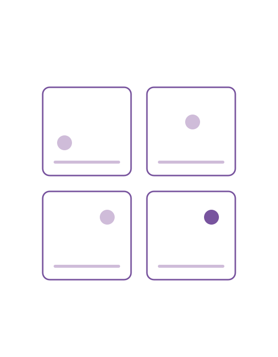
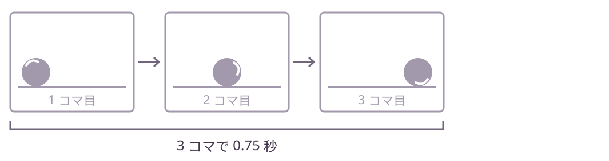
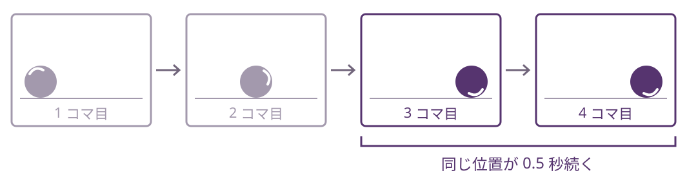

<!-- _class: cover cover-talk stage -->

# {{TITLE}}

コマ撮り ライトニングトーク · 5分

最後のコマを一枚増やすと、 玉の動きはどう変わるか

<b>Your Name</b>

---

# 3コマで玉が右へ転がる

玉を左から右にずらしながら3枚撮ります。毎秒4コマで再生すると、1枚が映る時間は0.25秒です。

---

# 右端のコマをもう1枚

4コマ目には3コマ目と同じ写真を使います。玉が右端に見える時間は0.5秒になります。

---

# 変わるのは止まって見える時間

どちらも毎秒4コマで再生します。

| 比べる時間 | 3コマ | 4コマ |
| --- | ---: | ---: |
| 左から中央への移動 | 0.25秒後 | 0.25秒後 |
| 右端で映る時間 | 0.25秒 | 0.5秒 |
| 全体の長さ | 0.75秒 | 1秒 |

---

# 再生速度を落とすと？

最初の3コマを毎秒2コマで再生しても、右端の玉は0.5秒映ります。

::: compare
- 毎秒2コマにする
  - 左と中央も0.5秒ずつ映る
  - 全体の動きがゆっくりになる
- 最後の写真を重ねる
  - 左と中央は0.25秒ずつ
  - 止まるところだけ長く見える
:::

---

<!-- _class: divider -->

# どこで動きを止めたいですか？

見せたい瞬間のコマを一枚重ねて、元の動きと見比べてください。

---

<!-- _class: closing back-cover stage -->

# ありがとうございました

コマ撮り ライトニングトーク · 5分

<b>Your Name</b>

