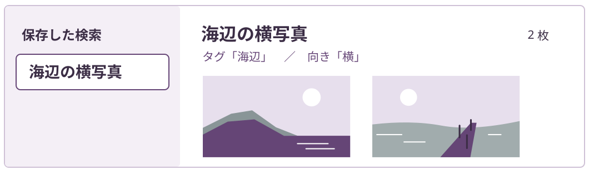
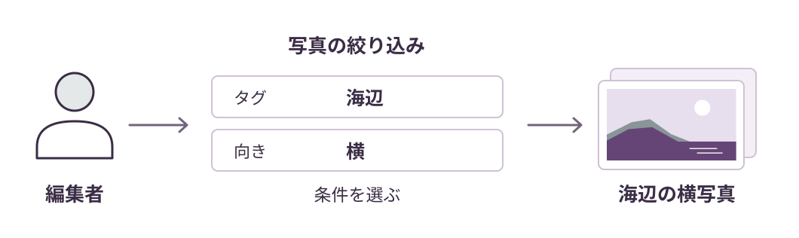
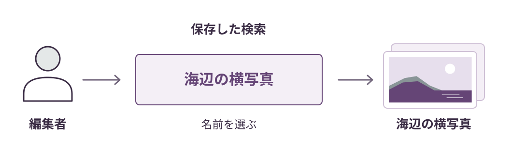
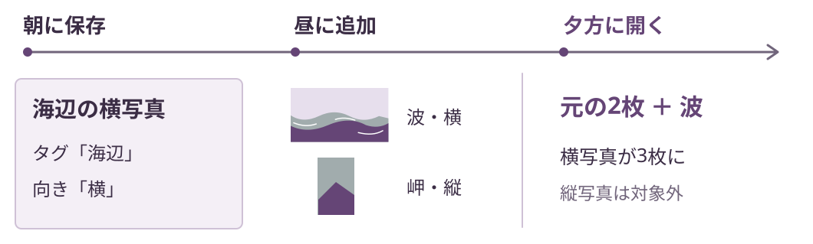

<!-- _class: cover cover-talk -->

# {{TITLE}}

写真箱 アップデート紹介

架空の写真整理アプリで よく使う検索を保存する

<b>Your Name</b>

---

# よく使う検索に名前を付ける

「海辺」のタグが付いた横写真を何度も探すときは、条件を一度保存しておきます。

---

# これまでは条件を選び直す

海辺の写真を昨日も探したのに、今日もタグと向きを指定していました。

---

# これからは名前を選んで開く

「海辺の横写真」を開くと、保存した条件で写真箱がもう一度検索します。

---

# 探し直すときに何が変わる？

夕方には朝の検索を開いて、その後に撮った写真もまとめて見直せます。

| 作業 | これまで | 保存した検索 |
| --- | --- | --- |
| 朝、候補を探す | タグと向きを指定 | 条件を指定して保存 |
| 夕方、もう一度探す | 両方の条件を選び直す | 保存した名前を開く |
| 条件を思い出す | 自分で控えておく | 保存した条件を画面で見る |

---

# 後から加えた写真はどうなる？

検索を開いた時点で、タグと向きの両方に合う写真が並びます。

---

# 最初の検索を保存する

写真一覧で条件を選び、後から見つけやすい名前を付けます。

1. タグを「海辺」、向きを「横」にする
2. 表示された写真を見て「検索を保存」を選ぶ
3. 「海辺の横写真」と入力して保存する

---

# 条件の違いを名前に残す

縦写真も探すなら、向きを変えて別の名前で保存します。

::: compare
- 海辺の横写真
  - タグは「海辺」
  - 向きは「横」
- 海辺の縦写真
  - タグは「海辺」
  - 向きは「縦」
:::

---

<!-- _class: centered -->

# 保存した検索を消したら？

一覧から「海辺の横写真」を削除すると、その名前と検索条件が消えます。

::: band
写真とタグは写真箱に残ります。
:::

---

<!-- _class: divider -->

# 次の一枚で試す

「海辺」の横写真を一枚追加して、朝に保存した検索を開いてみてください。

---

<!-- _class: closing back-cover -->

# ありがとうございました

写真箱 アップデート紹介

<b>Your Name</b>

