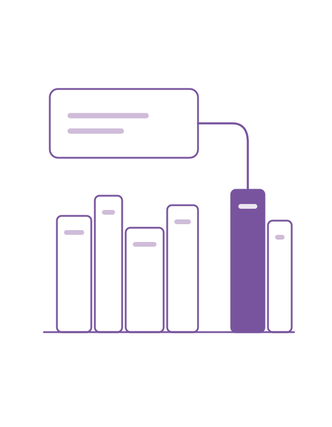
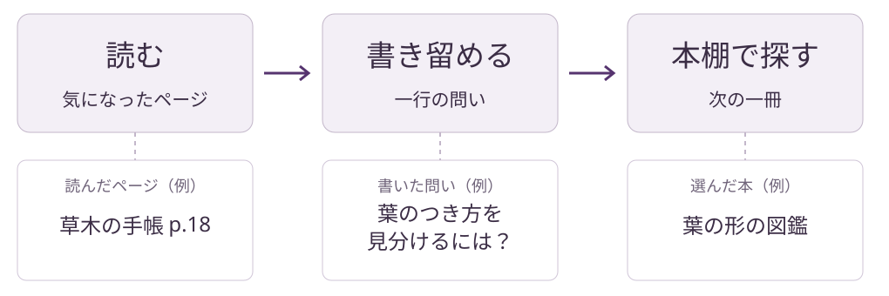

<!-- _class: cover cover-talk -->

# {{TITLE}}

読書メモ 勉強会

読み終えた本に一行だけ書き添える

<b>Your Name</b>

---

<!-- chapter: 記録 -->

# 一冊につき一つの問いを残す

読んでいて浮かんだ問いをメモすると、次の本を選ぶときに使えます。

---

# 同じ欄に書いておく

気になることが出てきたら、ページと一緒にメモします。

| 本の名前 | ページ | 読んでみたいこと |
| --- | ---: | --- |
| 草木の手帳 | 18 | 葉のつき方を見分けるには？ |
| 雨の日の散歩 | 42 | 雲の形で何が分かる？ |

---

<!-- chapter: 選書 -->

# 次の一冊を選ぶ

本棚の前でメモを開き、今いちばん気になる問いを選びます。

::: band
選んだ問いを目次の言葉と照らし合わせます。
:::

<!-- 次の本を手に取ったところを想像して、目次のどこを先に見るか考えてみてください。 -->

---

# 読み終えたらまた一行

読み終えた本の下に、新しく浮かんだ問いを書き足します。

---

<!-- _class: closing back-cover -->

# ありがとうございました

読書メモ 勉強会

<b>Your Name</b>

