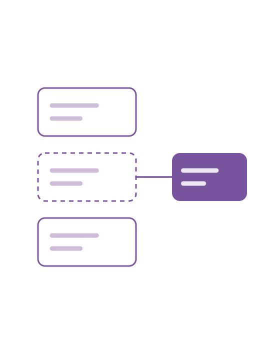
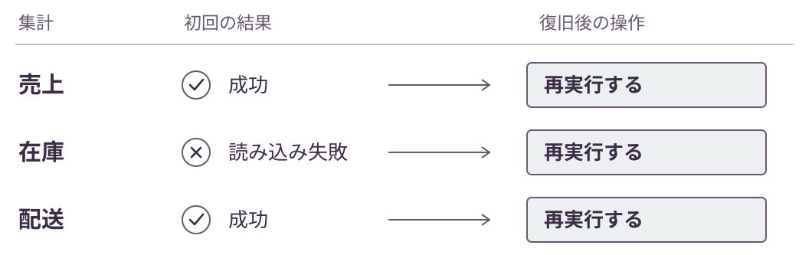
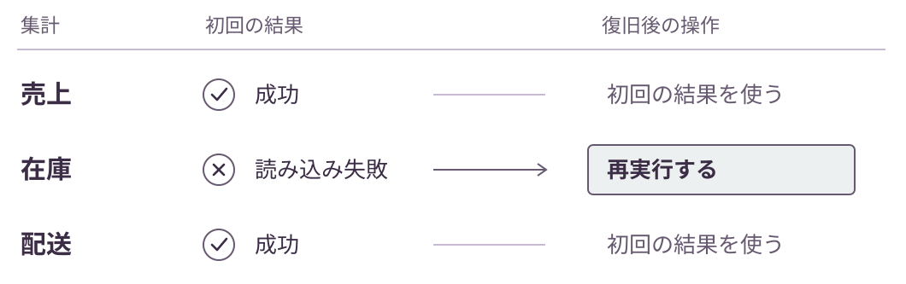

<!-- _class: cover cover-talk -->

# {{TITLE}}

<p class="kicker">夜間集計 <span>アップデート解説</span></p>

<p class="sub">架空のクラウドサービスを例に、<br>失敗した集計のやり直し方を紹介します</p>

<p class="who"><b>Your Name</b></p>



---

# 今までは3件ともやり直していた

在庫でエラーが出ると、売上と配送もまとめて集計し直していました。



---

# 在庫だけを選んで再実行できる

在庫データを戻したら、履歴で「失敗したジョブを再実行」を選びます。



---

# 朝の確認は在庫の結果だけで済む

売上と配送の集計時刻を見れば、午前1時の結果が残っていると分かります。

| 集計 | これまで | 失敗したジョブだけ再実行 |
| --- | --- | --- |
| 売上・配送 | 2件とも新しい結果を確認 | 確認済みの結果を使う |
| 在庫 | 再実行の結果を確認 | 再実行の結果を確認 |

---

# 履歴から在庫を再実行してみた

朝7時半に在庫データを戻し、実行番号42から再実行しました。

```text 実行履歴の出力例
01:00   sales       OK
01:00   stock       READ_ERROR
01:00   shipping    OK
07:30   stock       OK
```

07:30の行には在庫（stock）だけが記録されています。

---

# 売上の元データも変わっていたら？

再実行の対象は前回失敗したジョブです。成功したジョブの元データが変わっていても、初回の結果を使います。

::: dialogue 0.9
- 担当者: 朝になって売上データも訂正されました。
- [person right] 運用担当: それなら今回は3件とも集計し直しましょう。
:::

---

<!-- _class: divider -->

# まとめ　どの集計をやり直すか

在庫だけを復旧したら「失敗したジョブを再実行」を選びます。売上や配送のデータも訂正した日は全件を集計し直します。

---

<!-- _class: closing back-cover -->

# ありがとうございました

<p class="kicker">夜間集計 <span>アップデート解説</span></p>

<p class="who"><b>Your Name</b></p>


