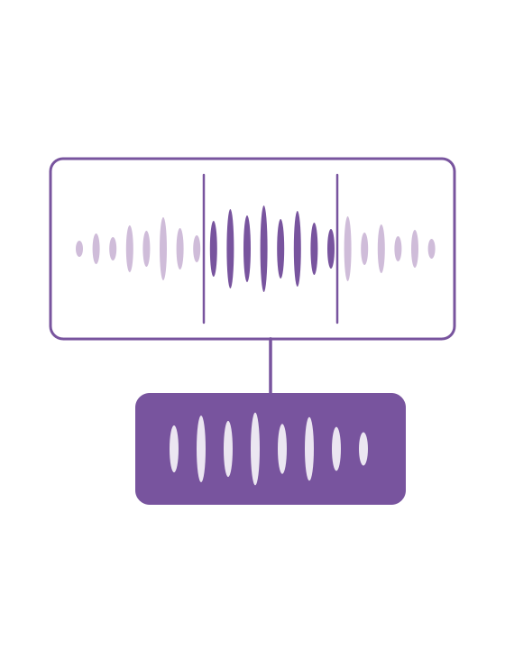
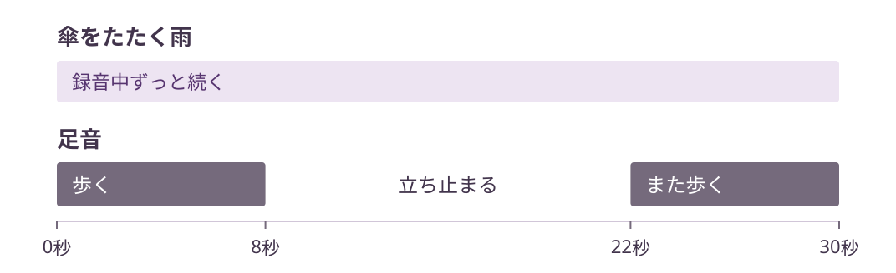
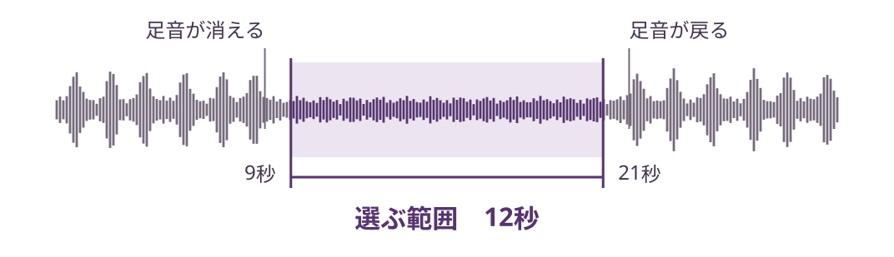
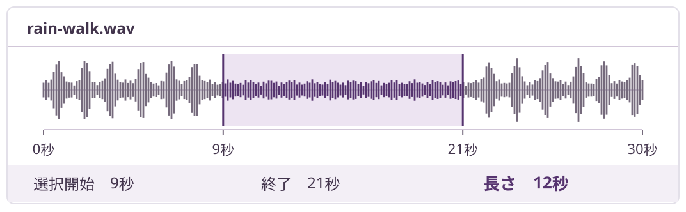

<!-- _class: cover cover-talk -->

# {{TITLE}}

音の編集 デモ付きウェビナー

音の編集を初めて試す方へ

<b>Your Name</b>

---

# 自己紹介

Your Name

| プロフィール | 話し手の紹介 |
| --- | --- |
| ふだんの活動 | ［録音や編集に関わる活動を一行で］ |
| このテーマを選んだ理由 | ［聞き直したくなった音の話を一つ］ |

---

# 今日の流れ

足音が混じった30秒の録音から、雨音だけの短い音を作ります。

1. **聞き分ける**　足音が消える位置と戻る位置を探す
2. **切り出す**　デモで範囲を選び、両端を聞く
3. **振り返り**　別の録音でも区間を選んでみる

---

<!-- chapter: 聞き分ける -->

# 傘の下で30秒録ったら

歩いて立ち止まり、また歩き始める場面を例にします。雨はその間ずっと降っています。

---

# 波形だけで雨音を選べる？

波形の山は大きな音がした場所を探す手掛かりです。音の種類は再生して聞き分けます。

::: dialogue 0.9
- 聞き手: この大きな山が足音ですか？
- [person right] 話し手: 雨粒かもしれません。山の少し手前から聞いてみましょう。
:::

---

# 足音が消えた時刻をメモする

録音を先頭から聞きます。8秒で足音が消え、22秒でまた聞こえました。

| 再生位置 | 聞こえた音 |
| --- | --- |
| 0〜8秒 | 靴音と傘をたたく雨 |
| 8〜22秒 | 傘をたたく雨 |
| 22〜30秒 | 雨に再び重なる靴音 |

---

# 両端から1秒ずつ内側を選ぶ

9秒から21秒までを選ぶと、足音との境目を避けて12秒の雨音を残せます。

---

<!-- _class: divider -->
<!-- chapter: 切り出す -->

# デモ　雨音を切り出す

範囲を選んだあと、先頭と末尾に靴音が残っていないか聞きます。

---

# 波形の上で12秒を選ぶ

左端を9秒、右端を21秒に合わせます。選択範囲が12秒になったことを画面で確認します。

---

# 先頭と末尾を続けて聞く

選んだ範囲を繰り返し再生すると、末尾のすぐ後に先頭を聞けます。

::: compare
- 先頭に靴音が残ったら
  - 左端を少し右へ動かす
  - 新しい先頭から聞き直す
- 末尾に靴音が入ったら
  - 右端を少し左へ動かす
  - 新しい末尾まで聞き直す
:::

---

# 選んだ雨音を書き出す

この例では両端に靴音が残らなかったので、12秒のまま別ファイルに保存します。

| ファイル名の例 | 中身 |
| --- | --- |
| rain-walk.wav | 元の録音　30秒 |
| rain-only.wav | 選んだ雨音　12秒 |

<!-- デモでは書き出す範囲に「選択範囲」を指定し、新しいファイルを再生する。 -->

---

<!-- chapter: 振り返り -->

# 練習　別の録音ならどこを選ぶ？

別の録音では5秒で足音が消え、18秒で戻りました。両端から1秒ずつ内側を選ぶと何秒残りますか？

::: band
開始と終了の時刻をチャットにどうぞ。
:::

<!-- 回答を待ってから次のページに進む。 -->

---

# まとめ　音を聞いて決めた区間

練習の答えは6秒から17秒までの11秒です。

1. 録音を聞き、残したい音の始まりと終わりを探す
2. 波形を見ながら範囲を選び、先頭と末尾を聞き直す
3. 選んだ範囲を別名で書き出す

---

<!-- _class: divider -->

# Q&A

区間の選び方や書き出しで迷ったところをチャットでお知らせください。

---

# 次回のご案内

次回は同じ雨音でフェードインとフェードアウトを試します。

| 開催日時 | 参加方法 |
| --- | --- |
| ［日時・タイムゾーン］ | ［申込先または会場］ |

---

<!-- _class: closing back-cover -->

# ありがとうございました

音の編集 デモ付きウェビナー

<b>Your Name</b>

